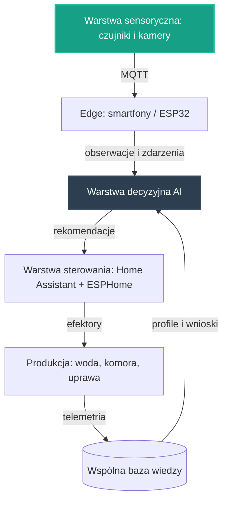

# 25. Zintegrowany Pilotaż Automatyzacji Produkcji Żywności

## **Intelekt wyprzedza Kapitał!**

## Opis Projektu
Ten dokument definiuje koncepcję zintegrowanego pilotażu zautomatyzowanej produkcji żywności dla osi **Żywność** — pierwszej z [głównych osi rozwoju](../README.md) NARODOWYCH SIŁ INTELEKTUALNYCH POLSKI. Celem pilotażu jest automatyzacja i robotyzacja produkcji rolno-spożywczej sterowana przez Sztuczną Inteligencję: autonomiczny węzeł produkcyjny, który najpierw mierzy stan środowiska, następnie podejmuje decyzje na podstawie lokalnej analizy AI, a na końcu steruje elementami wykonawczymi — ucząc się przy każdym kolejnym cyklu produkcyjnym.

Pilotaż nie zaczyna od zera. W repozytorium istnieją już zalążki tego kierunku:

* **[01. Inteligentna Akwakultura](01_inteligentna_akwakultura.md)** — autonomiczne węzły produkcji ryb oparte na IoT i AI: monitoring jakości wody, analiza zachowania ryb wykonywana lokalnie na urządzeniu brzegowym oraz wspólny kontrakt danych dla providerów,
* **[24. Automatyzacja Hodowli Grzybów](24_automatyzacja_hodowli_grzybow.md)** — autonomiczne komory hodowlane, w których AI zarządza mikroklimatem, wykrywa zagrożenia i pomaga wywoływać owocnikowanie na podstawie ciągłej analizy sensorycznej.

Oba zalążki opierają się na tych samych fundamentach opisanych w **[00. Fundamentach Technologicznych NSIP](00_fundamenty_technologiczne.md)**. Zintegrowany pilotaż łączy je we wspólny, powtarzalny wzorzec węzła produkcji żywności — tak, aby wiedza, moduły i doświadczenia przenosiły się między domenami: wodą, komorą hodowlaną i uprawą. Zgodnie z [Mapą drogową](../ROADMAPA.md) jest to przykład projektu pilotażowego z Fazy 1: niewielka, weryfikowalna realizacja, która dowodzi słuszności koncepcji i staje się wzorcem do powielenia w fazie skalowania.

---

## Proponowane moduły koncepcyjne

Pilotaż projektujemy jako zespół współpracujących warstw, z których każda powstaje w oparciu o gotowe, otwarte komponenty zebrane w repozytorium — zgodnie z Naszą zasadą, że kod już istnieje, a zadaniem twórców jest jego twórcza adaptacja.

### Moduł 1: Warstwa sensoryczna i sterowanie
* Fundamenty z **[00. Fundamentów Technologicznych NSIP](00_fundamenty_technologiczne.md)**: **Home Assistant** jako lokalny mózg automatyzacji, **ESPHome** do błyskawicznego tworzenia firmware'u dla czujników i elementów wykonawczych oraz **MQTT** jako lekki protokół komunikacyjny urządzeń IoT.
* Edge computing w duchu projektów **[06. Smartfony jako Sterowniki](06_smartfony_jako_sterowniki.md)** i **[21. Home Assistant na Smartfonie](21_home_assistant_na_telefonie.md)**: stare urządzenia z odzysku pełnią rolę węzłów sterujących, bramek danych i kamer inspekcyjnych.
* Sensorika zaczerpnięta z zalążków: pomiar jakości wody i przepływu z [Inteligentnej Akwakultury](01_inteligentna_akwakultura.md) oraz pomiar klimatu (temperatura, wilgotność, stężenie dwutlenku węgla) i sterowanie efektorami komory z [Automatyzacji Hodowli Grzybów](24_automatyzacja_hodowli_grzybow.md).
* Łączność odporna na brak Internetu, w oparciu o sieć Mesh opisaną w **[10. Łączności Mesh i LoRa](10_lacznosc_mesh_lora.md)** — dla węzłów pracujących daleko od infrastruktury.

### Moduł 2: Warstwa decyzyjna AI
* Modele uruchamiane na krawędzi (Edge AI) z użyciem silników wskazanych w fundamentach: **TensorFlow Lite** oraz **ONNX Runtime** — analiza wykonywana lokalnie, blisko czujników i kamer, bez uzależnienia od zewnętrznych chmur.
* Wzorzec pracy „edge-first" wypracowany w [projekcie 01](01_inteligentna_akwakultura.md): do wspólnej warstwy wiedzy trafia wynik analizy, a nie surowy strumień danych.
* Wizja komputerowa z [projektu 24](24_automatyzacja_hodowli_grzybow.md): detekcja zagrożeń i obserwacja wzrostu na podstawie obrazu z tanich kamer oraz starych smartfonów.
* Decyzje w ujednoliconej postaci rekomendacji (poziom ryzyka, rekomendacja, poziom pewności, kody przyczyn) — taki kształt wyniku analitycznego definiuje już kontrakt danych [projektu 01](01_inteligentna_akwakultura.md).

### Moduł 3: Pętla nauki z telemetrii
* Najpierw węzeł zbiera obserwacje i zdarzenia z warstwy sensorycznej, następnie warstwa decyzyjna porównuje je z dotychczasową wiedzą, w kolejnym etapie koryguje sterowanie efektorami, a na końcu zapisuje wniosek do wspólnej bazy wiedzy.
* Konwencja z [projektu 01](01_inteligentna_akwakultura.md): surowe odczyty trafiają do warstwy operacyjnej poza repozytorium, natomiast do repozytorium wraca wiedza opracowana — snapshoty, raporty zbiorcze i udokumentowane przypadki.
* Wiedza zapisywana jest jako otwarte, wspólne profile (np. receptury klimatyczne w formacie JSON/YAML, jak w [projekcie 24](24_automatyzacja_hodowli_grzybow.md)) — dzięki temu każdy kolejny węzeł rozpoczyna pracę z dorobkiem poprzedników.
* W repo istnieją już zalążki tej pętli po stronie upraw: modele i schematy `fish_pond` ([schemat](../schemas/fish_pond_v1.yaml), [API](../openapi/fish_pond_api_v1.yaml)) oraz pętla upraw agri ([agent wzrostu](../agri_grow_agent/README.md), [autopilota uprawy](../agri_autopilot/README.md)).

---

## Zależności od pozostałych osi rozwoju

Zintegrowany pilotaż nie jest wyspą — korzysta z dorobku sąsiednich osi i sam zasila je danymi, zgodnie z zasadą spójności opisaną w [Mapie drogowej](../ROADMAPA.md).

### Energia (oś trzecia)
Produkcja maksymalnie autonomiczna ma być sterowana przez AI i zasilana z odnawialnych źródeł energii — tak określa to strategia opisana w [README](../README.md) oraz kierunek prac na osi Żywność w Fazie 1 [Mapy drogowej](../ROADMAPA.md). Dlatego pilotaż od początku projektujemy tak, aby najpierw mierzył własne zużycie energii, w kolejnym etapie ograniczał je na drodze optymalizacji sterowania, a docelowo korzystał z planowania, magazynowania i dystrybucji energii rozwijanych na osi Energia. Stabilna i tania energia jest warunkiem autonomicznej produkcji żywności — ta zależność jest wprost zapisana w Mapie drogowej.

### Optymalizacja zużycia zasobów strategicznych (oś czwarta)
Racjonalne zarządzanie wodą, surowcami i ziemią, poparte zaawansowaną analizą danych, to definicja tej osi z [README](../README.md). Pilotaż dostarcza jej telemetrię zużycia: wodę w akwakulturze oraz substraty pochodzące z odpadów rolniczych w hodowli grzybów, co pozwala eliminować gospodarkę rabunkową tam, gdzie dotychczas nikt jej nie mierzył. Kolejność jest względna: najpierw monitorowanie zużycia, następnie wspólne narzędzia analityczne osi czwartej, a w kolejnym etapie modele wspierające decyzje o alokacji zasobów między węzłami produkcji.

---

## Miejsce pilotażu na mapie drogowej

* **Faza 0 (Krystalizacja):** ten dokument jest produktem burzy mózgów, analizy i planowania — precyzyjną koncepcją, która powstaje intelektem, nie budżetem.
* **Faza 1 (Pierwsze projekty pilotażowe):** tu jest miejsce tego pilotażu. Zgodnie z [Mapą drogową](../ROADMAPA.md) projekty pilotażowe to niewielkie, weryfikowalne realizacje, które dowodzą słuszności koncepcji i stają się wzorcem do powielenia.
* **Faza 2 (Skalowanie i samonapędzająca się gospodarka):** gdy pilotaż potwierdzi zasadność koncepcji, powielanie węzłów i łączenie ich z energią, zasobami oraz logistyką buduje samonapędzającą się gospodarkę technologiczną, w której każdy zrealizowany projekt obniża koszt następnego.
* **Faza 3 (Finansowanie Dochodu Gwarantowanego):** docelowy punkt — nadwyżki wypracowane przez system wracają do **WSPÓLNEGO DOBRA NARODOWEGO**.

Granice między fazami są jakościowe, a nie kalendarzowe: fazę zamyka realne osiągnięcie, a nie data. Kolejność prac wewnątrz Fazy 1 nie jest sztywna — osie wzajemnie się napędzają.

---

## Jak społeczność może rozwinąć ten projekt

Ten projekt jest własnością społeczności i tak ma być rozwijany — w otwartym modelu współtworzenia opisanym w **[CONTRIBUTING.md](../CONTRIBUTING.md)**.

* **Dyskusja i analiza:** pytania, pomysły i zastrzeżenia zgłaszaj w zakładce Issues repozytorium — to serce projektu, w którym ma się roić jak w ulu. Każdy komentarz merytoryczny to cenny wkład w **NARODOWY WYSIŁEK INTELEKTUALNY**.
* **Pull Requesty:** dojrzałe zmiany — rozszerzenia koncepcji, dokumentacja, schematy, adaptery — trafiają do plików poprzez Pull Requesty, dokładnie według instrukcji z [CONTRIBUTING.md](../CONTRIBUTING.md).
* **Ścieżki wkładu** (wzorce ścieżek wypracowane w [projekcie 01](01_inteligentna_akwakultura.md)):
  * sensory i elektronika — testowanie czujników, kalibracja, budowa węzłów terenowych,
  * integracja i kontrakty danych — mapowanie danych do wspólnego schematu, adaptery providerów,
  * edge i analiza — lekkie modele na stare smartfony, zamiana obrazu na wyniki analityczne,
  * dokumentacja i kuracja wiedzy — opisy przypadków, snapshoty, receptury.

Pełnoprawny wkład jest możliwy także bez własnego sprzętu: projektowanie schematów, walidacja danych, analiza przypadków i dokumentacja to praca intelektualna tej samej rangi. Oceniamy pomysły i kod, nie ludzi — a liczy się wyłącznie dokonanie.

---

## Zasoby wewnętrzne w repozytorium
* **[00. Fundamenty Technologiczne NSIP](00_fundamenty_technologiczne.md)** — Home Assistant, ESPHome, MQTT, Edge AI, Mesh.
* **[01. Inteligentna Akwakultura](01_inteligentna_akwakultura.md)** — wzorzec edge-first, kontrakt danych i pętla wiedzy.
* **[24. Automatyzacja Hodowli Grzybów](24_automatyzacja_hodowli_grzybow.md)** — sterowanie klimatem, wizja komputerowa, receptury klimatyczne.
* **[06. Smartfony jako Sterowniki](06_smartfony_jako_sterowniki.md)** i **[21. Home Assistant na Smartfonie](21_home_assistant_na_telefonie.md)** — edge computing z odzysku.
* **[08. Autonomiczne Maszyny Rolnicze (OpenBot)](08_openbot_autonomiczne_maszyny_rolnicze.md)** — smartfon jako mózg robota.
* **[10. Łączność Mesh i LoRa](10_lacznosc_mesh_lora.md)** — suwerenna łączność dla węzłów terenowych.
* **[Mapa drogowa (ROADMAPA.md)](../ROADMAPA.md)** — fazy rozwoju i zasady ich przechodzenia.
* **[CONTRIBUTING.md](../CONTRIBUTING.md)** — jak zgłaszać pomysły i współtworzyć repozytorium.

---
*Intelekt wyprzedza Kapitał!*

**Nawet kod już jest, brakuje tylko Ciebie.**
