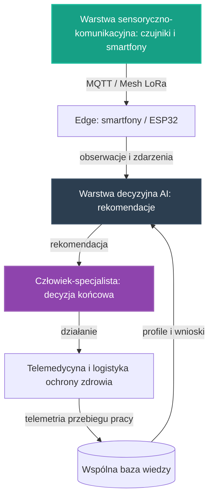

# 26. Koncepcyjny Pilotaż AI w Medycynie

## **Intelekt wyprzedza Kapitał!**

## Opis Projektu
Ten dokument definiuje koncepcję pilotażu dla osi **Medycyna** — drugiej z [głównych osi rozwoju](../README.md) NARODOWYCH SIŁ INTELEKTUALNYCH POLSKI. Zgodnie z brzmieniem tej osi w [README](../README.md) chodzi o **zastosowanie AI w diagnostyce, telemedycynie, wynajdywaniu terapii oraz w logistyce ochrony zdrowia, podnosząc skuteczność i dostępność dla każdego obywatela**. Celem pilotażu jest zaprojektowanie otwartego, niskokosztowego zestawu narzędzi AI, które porządkują organizację pracy i wspierają specjalistów w ich codziennych decyzjach — od pomiaru i łączności, przez lokalną analizę, po decyzję końcową należącą wyłącznie do człowieka.

> [!IMPORTANT]
> **Zakres dokumentu:** opisujemy wyłącznie koncepcję organizacji pracy i architekturę narzędzi. Nie formułujemy tu żadnych twierdzeń medycznych — ani o skuteczności, diagnozach, ani o rezultatach zdrowotnych. Zasadę pracy całego pilotażu określa [Mapa drogowa](../ROADMAPA.md): **AI wspiera specjalistów, zamiast zastępować ich rolę** — decyzja końcowa zawsze pozostaje po stronie człowieka-specjalisty.

Pilotaż nie zaczyna od zera. W repozytorium istnieją już zalążki tego kierunku:

* **[25. Zintegrowany Pilotaż Automatyzacji Produkcji Żywności](25_pilot_automatyzacji_zywnosci.md)** — wspólny wzorzec warstw: sensorycznej, decyzyjnej AI na krawędzi oraz pętli nauki z telemetrii; ten dokument przenosi ten wzorzec na grunt medycyny,
* **[03. Edge AI w Pasterstwie](03_ai_monitoring_porodow.md)** — wzorzec pracy edge-first: analiza wykonywana lokalnie, niezależnie od zewnętrznej chmury, z alarmem kierowanym do człowieka w kluczowych momentach,
* **[09. Monitoring IoT i Akcelerometria](09_monitoring_iot_livestock.md)** — wzorzec pozyskiwania telemetrii z sensorów smartfona i przesyłania jej protokołem MQTT do lokalnego punktu analizy.

Wszystkie te zalążki opierają się na tych samych fundamentach opisanych w **[00. Fundamentach Technologicznych NSIP](00_fundamenty_technologiczne.md)**. Pilotaż porządkuje je we wspólny, powtarzalny wzorzec narzędzi dla ochrony zdrowia — tak, aby wiedza, moduły i doświadczenia przenosiły się między domenami. Zgodnie z [Mapą drogową](../ROADMAPA.md) jest to przykład projektu pilotażowego z Fazy 1: niewielka, weryfikowalna realizacja, która dowodzi słuszności koncepcji i staje się wzorcem do powielenia w fazie skalowania.

---

## Proponowane moduły koncepcyjne

Pilotaż projektujemy jako zespół współpracujących warstw, z których każda powstaje w oparciu o gotowe, otwarte komponenty zebrane w repozytorium — zgodnie z Naszą zasadą, że kod już istnieje, a zadaniem twórców jest jego twórcza adaptacja.

### Moduł 1: Warstwa sensoryczno-komunikacyjna
* Fundamenty z **[00. Fundamentów Technologicznych NSIP](00_fundamenty_technologiczne.md)**: **Home Assistant** jako lokalny mózg automatyzacji, **ESPHome** do błyskawicznego tworzenia firmware'u dla czujników oraz **MQTT** jako lekki protokół komunikacyjny urządzeń IoT.
* Edge computing w duchu projektów **[06. Smartfony jako Sterowniki](06_smartfony_jako_sterowniki.md)** i **[21. Home Assistant na Smartfonie](21_home_assistant_na_telefonie.md)**: stare urządzenia z odzysku pełnią rolę węzłów pomiarowych, bramek danych i kamer inspekcyjnych.
* Wzorzec telemetrii z sensorów smartfona, wypracowany w [projekcie 09](09_monitoring_iot_livestock.md): odczyty trafiają kanałem MQTT do lokalnego punktu, w którym pracuje analiza.
* Łączność odporna na brak Internetu, w oparciu o sieć Mesh opisaną w **[10. Łączności Mesh i LoRa](10_lacznosc_mesh_lora.md)** — dla węzłów pracujących tam, gdzie zawodzi infrastruktura. Kolejność pracy warstwy jest względna: najpierw lokalny pomiar, następnie transmisja przez sieć, na końcu przekazanie obserwacji do warstwy decyzyjnej.

### Moduł 2: Warstwa decyzyjna AI wspomagająca człowieka
* Modele uruchamiane na krawędzi (Edge AI) z użyciem silników wskazanych w fundamentach: **TensorFlow Lite** oraz **ONNX Runtime** — analiza wykonywana lokalnie, blisko danych, bez uzależnienia od zewnętrznych chmur.
* Wzorzec pracy „edge-first" wypracowany w [projekcie 01](01_inteligentna_akwakultura.md): do wspólnej warstwy wiedzy trafia wynik analizy, a nie surowy strumień danych.
* Wynik analizy w ujednoliconej postaci rekomendacji (poziom ryzyka, rekomendacja, poziom pewności, kody przyczyn) — taki kształt wyniku analitycznego definiuje już kontrakt danych [projektu 01](01_inteligentna_akwakultura.md). Rekomendacja jest zawsze wejściem do decyzji człowieka, nigdy jej zamiennikiem.
* **Telemedycyna:** rekomendacja i jej kontekst trafiają do człowieka-specjalisty, który podejmuje decyzję końcową; łączność z [projektu 10](10_lacznosc_mesh_lora.md) — telemetria i wiadomości bez Internetu — ma umożliwiać ten kontakt także tam, gdzie infrastruktura jest niedostępna.
* **Wynajdywanie terapii:** narzędzia analityczne wspomagające przegląd dostępnej wiedzy medycznej — kierunek wprost wskazany dla osi Medycyna w [Mapie drogowej](../ROADMAPA.md), tu traktowany wyłącznie koncepcyjnie, jako organizacja pracy narzędzia nad materiałem źródłowym.
* **Logistyka ochrony zdrowia:** modele optymalizujące przepływy, budowane w oparciu o narzędzia z **[18. Automatyzacji Transportu i Logistyki](18_automatyzacja_transportu_i_logistyki.md)** oraz **[20. Logistyki Sąsiedzkiej i Optymalizacji Tras](20_logistyka_sasiadzka_nawigacja.md)** — tak, jak określa to [Mapa drogowa](../ROADMAPA.md): logistyka spina pozostałe obszary i łączy ochronę zdrowia z pacjentem.

### Moduł 3: Pętla nauki z telemetrii
* Najpierw węzeł zbiera obserwacje i zdarzenia z warstwy sensoryczno-komunikacyjnej, następnie warstwa decyzyjna porównuje je z dotychczasową wiedzą o pracy narzędzi, w kolejnym etapie koryguje rekomendacje, a na końcu zapisuje wniosek do wspólnej bazy wiedzy. Pętla uczy narzędzia i organizacji pracy — nie wypowiada się w niej nic o zdrowiu ani o wynikach leczenia.
* Konwencja z [projektu 01](01_inteligentna_akwakultura.md): surowe odczyty trafiają do warstwy operacyjnej poza repozytorium, natomiast do repozytorium wraca wyłącznie wiedza opracowana — snapshoty, raporty zbiorcze i udokumentowane, organizacyjne przypadki pracy narzędzi.
* Wiedza zapisywana jest jako otwarte, wspólne profile w formatach JSON/YAML, na wzór receptur klimatycznych z [projektu 24](24_automatyzacja_hodowli_grzybow.md) — dzięki temu każdy kolejny węzeł rozpoczyna pracę z dorobkiem poprzedników.

---

## Zależności od pozostałych osi rozwoju

Pilotaż nie jest wyspą — korzysta z dorobku sąsiednich osi i sam zasila je danymi, zgodnie z zasadą spójności opisaną w [Mapie drogowej](../ROADMAPA.md).

### Energia (oś trzecia)
Stabilna i tania energia to, jak stanowi [Mapa drogowa](../ROADMAPA.md), warunek pracy systemów obliczeniowych całej inicjatywy — a więc także węzłów tego pilotażu. Dlatego projektujemy go tak, aby najpierw mierzył własne zużycie energii, w kolejnym etapie ograniczał je na drodze optymalizacji, a docelowo korzystał z systemów planowania, magazynowania i dystrybucji energii rozwijanych na osi Energia.

### Optymalizacja zużycia zasobów strategicznych (oś czwarta)
Racjonalne, poparte zaawansowaną analizą danych zarządzanie zasobami — tak określa tę oś [README](../README.md). Pilotaż budowany jest na sprzęcie z odzysku i dlatego naturalnie współpracuje z tą osią: najpierw dostarcza telemetrię zużycia we własnych węzłach, następnie korzysta ze wspólnych narzędzi analitycznych osi czwartej, a w kolejnym etapie z modeli wspierających decyzje o alokacji zasobów. Kolejność jest względna i wynika z kolejności prac opisanych w [Mapie drogowej](../ROADMAPA.md).

---

## Miejsce pilotażu na mapie drogowej

* **Faza 0 (Krystalizacja):** ten dokument jest produktem burzy mózgów, analizy i planowania — precyzyjną koncepcją, która powstaje intelektem, nie budżetem.
* **Faza 1 (Pierwsze projekty pilotażowe):** tu jest miejsce tego pilotażu. [Mapa drogowa](../ROADMAPA.md) wprost wymienia Medycynę wśród osi Fazy 1 i wskazuje kierunki prac koncepcyjnych: narzędzia analityczne wspomagające diagnostykę i interpretację wyników, rozwiązania telemedycynne podnoszące dostępność specjalistycznej wiedzy, systemy wspierające poszukiwanie terapii oraz modele optymalizujące przepływy w logistyce ochrony zdrowia.
* **Faza 2 (Skalowanie i samonapędzająca się gospodarka):** gdy pilotaż potwierdzi zasadność koncepcji, powielanie węzłów i łączenie ich z energią, zasobami oraz logistyką buduje samonapędzającą się gospodarkę technologiczną, w której każdy zrealizowany projekt obniża koszt następnego.
* **Faza 3 (Finansowanie Dochodu Gwarantowanego):** docelowy punkt — nadwyżki wypracowane przez system wracają do **WSPÓLNEGO DOBRA NARODOWEGO**.

Granice między fazami są jakościowe, a nie kalendarzowe: fazę zamyka realne osiągnięcie, a nie data. Kolejność prac wewnątrz Fazy 1 nie jest sztywna — osie wzajemnie się napędzają.

---

## Jak społeczność może rozwinąć ten projekt

Ten projekt jest własnością społeczności i tak ma być rozwijany — w otwartym modelu współtworzenia opisanym w **[CONTRIBUTING.md](../CONTRIBUTING.md)**.

* **Dyskusja i analiza:** pytania, pomysły i zastrzeżenia zgłaszaj w zakładce Issues repozytorium — to serce projektu, w którym ma się roić jak w ulu. Każdy komentarz merytoryczny to cenny wkład w **NARODOWY WYSIŁEK INTELEKTUALNY**.
* **Pull Requesty:** dojrzałe zmiany — rozszerzenia koncepcji, dokumentacja, profile wiedzy, adaptery — trafiają do plików poprzez Pull Requesty, dokładnie według instrukcji z [CONTRIBUTING.md](../CONTRIBUTING.md).
* **Ścieżki wkładu:**
  * sensory, edge i łączność — budowa węzłów pomiarowych, transmisja przez Mesh LoRa, adaptacja smartfonów z odzysku,
  * analiza i narzędzia — lekkie modele na krawędzi, ujednolicony kształt rekomendacji, narzędzia pracy z wiedzą medyczną,
  * logistyka ochrony zdrowia — optymalizacja przepływów i tras w oparciu o narzędzia osi logistycznej,
  * dokumentacja i kuracja wiedzy — opisy organizacyjnych przypadków pracy narzędzi, snapshoty, wspólne profile,
  * eksperci dziedzinowi — [Mapa drogowa](../ROADMAPA.md) wskazuje medycynę wśród dziedzin, z których eksperci są potrzebni społeczności od samego początku.

Pełnoprawny wkład jest możliwy także bez własnego sprzętu: projektowanie schematów, analiza organizacji pracy i dokumentacja to praca intelektualna tej samej rangi. Oceniamy pomysły i kod, nie ludzi — a liczy się wyłącznie dokonanie.

---

## Zasoby wewnętrzne w repozytorium
* **[00. Fundamenty Technologiczne NSIP](00_fundamenty_technologiczne.md)** — Home Assistant, ESPHome, MQTT, Edge AI, Mesh.
* **[25. Zintegrowany Pilotaż Automatyzacji Produkcji Żywności](25_pilot_automatyzacji_zywnosci.md)** — wzorzec warstw i pętli nauki, od którego dziedziczymy format.
* **[01. Inteligentna Akwakultura](01_inteligentna_akwakultura.md)** — wzorzec edge-first, kontrakt danych i pętla wiedzy.
* **[03. Edge AI w Pasterstwie](03_ai_monitoring_porodow.md)** — analiza lokalna i alarm do człowieka.
* **[09. Monitoring IoT i Akcelerometria](09_monitoring_iot_livestock.md)** — telemetria z sensorów smartfona.
* **[06. Smartfony jako Sterowniki](06_smartfony_jako_sterowniki.md)** i **[21. Home Assistant na Smartfonie](21_home_assistant_na_telefonie.md)** — edge computing z odzysku.
* **[10. Łączność Mesh i LoRa](10_lacznosc_mesh_lora.md)** — suwerenna łączność dla węzłów.
* **[18. Automatyzacja Transportu i Logistyki](18_automatyzacja_transportu_i_logistyki.md)** oraz **[20. Logistyka Sąsiedzka i Optymalizacja Tras](20_logistyka_sasiadzka_nawigacja.md)** — narzędzia dla logistyki ochrony zdrowia.
* **[24. Automatyzacja Hodowli Grzybów](24_automatyzacja_hodowli_grzybow.md)** — otwarte profile wiedzy w formatach JSON/YAML.
* **[Mapa drogowa (ROADMAPA.md)](../ROADMAPA.md)** — fazy rozwoju i zasady ich przechodzenia.
* **[CONTRIBUTING.md](../CONTRIBUTING.md)** — jak zgłaszać pomysły i współtworzyć repozytorium.

---
*Intelekt wyprzedza Kapitał!*

**Nawet tu kod już jest — brakuje tylko Ciebie.**
