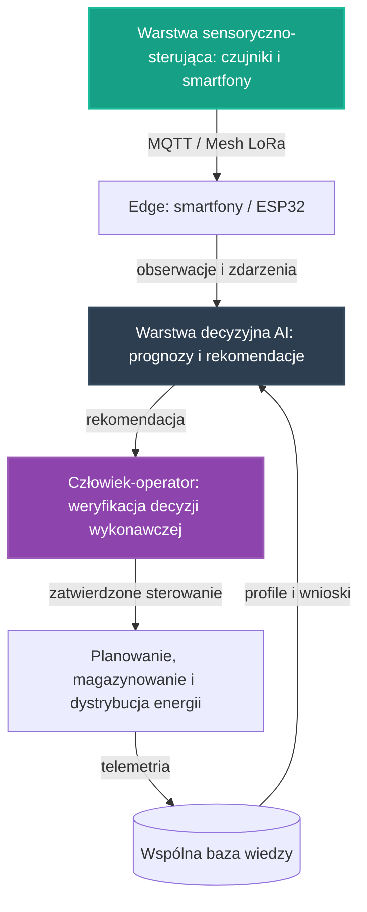

# 27. Koncepcyjny Pilotaż Sieci Energetycznej

## **Intelekt wyprzedza Kapitał!**

## Opis Projektu
Ten dokument definiuje koncepcję pilotażu dla osi **Energia** — trzeciej z [głównych osi rozwoju](../README.md) NARODOWYCH SIŁ INTELEKTUALNYCH POLSKI. Zgodnie z brzmieniem tej osi w [README](../README.md) chodzi o **opracowanie systemów planowania, magazynowania i dystrybucji zielonej oraz konwencjonalnej energii, by zminimalizować jej straty i zoptymalizować gospodarkę sieciową**. Celem pilotażu jest zaprojektowanie otwartego, niskokosztowego wzorca węzła energetycznego, który porządkuje organizację pracy: od pomiaru i łączności, przez lokalną analizę i prognozy, po decyzje wykonawcze weryfikowane przez człowieka.

> [!IMPORTANT]
> **Zakres dokumentu:** opisujemy wyłącznie koncepcję organizacji pracy i architekturę narzędzi — bez danych technicznych, parametrów i wyników liczbowych. Zasadą pracy całego pilotażu, przejętą ze wzorca pilotażu medycznego, jest to, że **AI wspiera planowanie, zamiast zastępować człowieka** — każda decyzja wykonawcza trafia do człowieka-operatora węzła, który ją weryfikuje i zatwierdza.

Pilotaż nie zaczyna od zera. W repozytorium istnieją już zalążki tego kierunku:

* **[25. Zintegrowany Pilotaż Automatyzacji Produkcji Żywności](25_pilot_automatyzacji_zywnosci.md)** — wspólny wzorzec warstw: sensorycznej, decyzyjnej AI na krawędzi oraz pętli nauki z telemetrii; ten dokument przenosi ten wzorzec na grunt energetyki,
* **[05. Laserowy Recykling Paneli PV](05_recykling_pv_laserem.md)** — inspiracja wprost wskazana dla osi Energia w [README](../README.md): odzysk ogniw ze zużytych paneli zamiast ich niszczenia,
* **[04. Upcykling LED TV](04_lampa_z_recyklingu_tv.md)** — oświetlenie z elektrośmieci działające w układach off-grid, zasilane panelami solarnymi i akumulatorami,
* **[06. Smartfony jako Sterowniki](06_smartfony_jako_sterowniki.md)** — wśród zastosowań wprost wymienione centralne sterowniki dla systemów off-grid i magazynów energii.

Wszystkie te zalążki opierają się na tych samych fundamentach opisanych w **[00. Fundamentach Technologicznych NSIP](00_fundamenty_technologiczne.md)**. Pilotaż porządkuje je we wspólny, powtarzalny wzorzec węzła energetycznego — tak, aby wiedza, moduły i doświadczenia przenosiły się między domenami. Zgodnie z [Mapą drogową](../ROADMAPA.md) jest to przykład projektu pilotażowego z Fazy 1: niewielka, weryfikowalna realizacja, która dowodzi słuszności koncepcji i staje się wzorcem do powielenia w fazie skalowania.

---

## Proponowane moduły koncepcyjne

Pilotaż projektujemy jako zespół współpracujących warstw, z których każda powstaje w oparciu o gotowe, otwarte komponenty zebrane w repozytorium — zgodnie z Naszą zasadą, że kod już istnieje, a zadaniem twórców jest jego twórcza adaptacja.

### Moduł 1: Warstwa sensoryczno-sterująca
* Fundamenty z **[00. Fundamentów Technologicznych NSIP](00_fundamenty_technologiczne.md)**: **Home Assistant** jako lokalny mózg automatyzacji, **ESPHome** do błyskawicznego tworzenia firmware'u dla czujników i elementów wykonawczych oraz **MQTT** jako lekki protokół komunikacyjny urządzeń IoT.
* Edge computing w duchu projektów **[06. Smartfony jako Sterowniki](06_smartfony_jako_sterowniki.md)** i **[21. Home Assistant na Smartfonie](21_home_assistant_na_telefonie.md)**: stare urządzenia z odzysku pełnią rolę węzłów pomiarowych, bramek danych, paneli sterujących z wizualizacją odczytów oraz — jak wprost wskazuje [projekt 06](06_smartfony_jako_sterowniki.md) — centralnych sterowników dla systemów off-grid i magazynów energii. Kierunek rozwoju [projektu 21](21_home_assistant_na_telefonie.md) — wykorzystanie telefonu jako bramki między siecią Mesh a Home Assistantem — domyka tę warstwę w całość, a opcjonalne udostępnianie zanonimizowanych odczytów do wspólnego API NSIP buduje mapę potencjału kraju.
* Łączność odporna na brak Internetu, w oparciu o sieć Mesh opisaną w **[10. Łączności Mesh i LoRa](10_lacznosc_mesh_lora.md)** — dla węzłów pracujących daleko od infrastruktury. [Projekt 10](10_lacznosc_mesh_lora.md) opisuje sieć Mesh jako „Nerw Gospodarczy", informujący o stanie sieci energetycznej, oraz scenariusz monitorowania stanu infrastruktury i magazynów energii: po wykryciu awarii przez sensory system przesyła przez sieć zapytanie o dostępność energii w sąsiednich mikrosieciach albo informuje operatora o dokładnej lokalizacji usterki bez użycia Internetu. Kolejność pracy warstwy jest względna: najpierw lokalny pomiar, następnie transmisja przez sieć, na końcu przekazanie obserwacji do warstwy decyzyjnej.

### Moduł 2: Warstwa decyzyjna AI wspierająca planowanie
* Modele uruchamiane na krawędzi (Edge AI) z użyciem silników wskazanych w fundamentach: **TensorFlow Lite** oraz **ONNX Runtime** — analiza wykonywana lokalnie, blisko czujników, bez uzależnienia od zewnętrznych chmur.
* Kierunki prac wyznaczone przez sekcję „Energia" w Fazie 1 [Mapy drogowej](../ROADMAPA.md): **prognozowanie zapotrzebowania na energię i inteligentne planowanie jej wytwarzania**, **koncepcje sterowania magazynowaniem energii, w tym pochodzącej z odnawialnych źródeł** oraz **optymalizacja gospodarki sieciowej minimalizująca straty przesyłu**.
* Wzorzec pracy „edge-first" wypracowany w [projekcie 01](01_inteligentna_akwakultura.md): do wspólnej warstwy wiedzy trafia wynik analizy, a nie surowy strumień danych.
* Wynik analizy w ujednoliconej postaci rekomendacji (poziom ryzyka, rekomendacja, poziom pewności, kody przyczyn) — taki kształt wyniku analitycznego definiuje już kontrakt danych [projektu 01](01_inteligentna_akwakultura.md). Rekomendacja jest zawsze wejściem do decyzji człowieka, nigdy jej zamiennikiem: najpierw AI proponuje plan działania, następnie człowiek-operator węzła weryfikuje rekomendację, a na końcu zatwierdza lub koryguje decyzję wykonawczą.

### Moduł 3: Pętla nauki z telemetrii
* Najpierw węzeł zbiera obserwacje i zdarzenia z warstwy sensoryczno-sterującej, następnie warstwa decyzyjna porównuje je z dotychczasową wiedzą o pracy węzła, w kolejnym etapie koryguje prognozy i rekomendacje, a na końcu zapisuje wniosek do wspólnej bazy wiedzy.
* Konwencja z [projektu 01](01_inteligentna_akwakultura.md): surowe odczyty trafiają do warstwy operacyjnej poza repozytorium, natomiast do repozytorium wraca wyłącznie wiedza opracowana — snapshoty, raporty zbiorcze i udokumentowane przypadki pracy węzłów.
* Wiedza zapisywana jest jako otwarte, wspólne profile w formatach JSON/YAML, na wzór receptur klimatycznych z [projektu 24](24_automatyzacja_hodowli_grzybow.md) — dzięki temu każdy kolejny węzeł rozpoczyna pracę z dorobkiem poprzedników.

---

## Zależności od pozostałych osi i pilotaży

Pilotaż nie jest wyspą — korzysta z dorobku sąsiednich osi i sam zasila je, zgodnie z zasadą spójności opisaną w [Mapie drogowej](../ROADMAPA.md).

### Energia zasila wszystkie pozostałe osie
Sekcja „Energia" w [Mapie drogowej](../ROADMAPA.md) stwierdza wprost: **„Ta oś zasila wszystkie pozostałe: stabilna i tania energia to warunek autonomicznej produkcji żywności oraz pracy systemów obliczeniowych całej inicjatywy."** Z tej zależności wynikają wprost dwa pilotaże:

* **[25. Zintegrowany Pilotaż Automatyzacji Produkcji Żywności](25_pilot_automatyzacji_zywnosci.md)** projektowany jest tak, aby najpierw mierzyć własne zużycie energii, w kolejnym etapie ograniczać je na drodze optymalizacji sterowania, a docelowo korzystać z planowania, magazynowania i dystrybucji energii rozwijanych na osi Energia — ten pilotaż jest odpowiedzią na tę zależność.
* **[26. Koncepcyjny Pilotaż AI w Medycynie](26_pilot_ai_w_medycynie.md)** zakłada, że stabilna i tania energia jest warunkiem pracy węzłów medycznych, i również docelowo korzysta z systemów planowania, magazynowania i dystrybucji energii rozwijanych na tej osi.
* Ta sama zależność dotyczy systemów obliczeniowych całej inicjatywy — także pracy węzłów obliczeniowych budowanych z odzysku, opisanych w [projekcie 06](06_smartfony_jako_sterowniki.md) i [projekcie 21](21_home_assistant_na_telefonie.md).

### Zero-Waste: zasoby z recyklingu
* **[05. Laserowy Recykling Paneli PV](05_recykling_pv_laserem.md)** proponuje delaminację laserową — rozwarstwienie zużytego modułu bez niszczenia ogniw, zamiast mielenia paneli na granulat, które niszczy najcenniejsze komponenty — oraz udostępnienie planów takiej maszyny w modelu Open-Source. W duchu tego projektu elementy węzłów energetycznych mają pochodzić z odzysku, nie z zakupów.
* **[04. Upcykling LED TV](04_lampa_z_recyklingu_tv.md)** pokazuje, jak elektrośmieci zamieniają się w działające oświetlenie w układach off-grid zasilanych panelami solarnymi i akumulatorami — oraz jak taki upcykling zamienia odpady w kapitał wspierający wspólne dobro narodowe.
* Sterowniki i węzły obliczeniowe pilotażu powstają ze starych smartfonów z odzysku ([projekty 06](06_smartfony_jako_sterowniki.md) i [21](21_home_assistant_na_telefonie.md)) — ta sama droga „odzysk zamiast gospodarki rabunkowej", którą [Mapa drogowa](../ROADMAPA.md) opisuje przy synergii osi.
* Pilotaż dostarcza też telemetrię zużycia oś czwartej — **Optymalizacji zużycia zasobów strategicznych**, której racjonalne, poparte zaawansowaną analizą danych zarządzanie zasobami definiuje [README](../README.md): najpierw mierzy własne zużycie energii, a w kolejnym etapie współpracuje ze wspólnymi narzędziami analitycznymi tej osi.

---

## Miejsce pilotażu na mapie drogowej

* **Faza 0 (Krystalizacja):** ten dokument jest produktem burzy mózgów, analizy i planowania — precyzyjną koncepcją, która powstaje intelektem, nie budżetem.
* **Faza 1 (Pierwsze projekty pilotażowe):** tu jest miejsce tego pilotażu. [Mapa drogowa](../ROADMAPA.md) wprost wymienia Energię wśród osi Fazy 1 i wskazuje kierunki prac koncepcyjnych: prognozowanie zapotrzebowania i planowanie wytwarzania, sterowanie magazynowaniem energii (w tym pochodzącej z odnawialnych źródeł) oraz optymalizację gospodarki sieciowej minimalizującą straty przesyłu.
* **Faza 2 (Skalowanie i samonapędzająca się gospodarka):** gdy pilotaż potwierdzi zasadność koncepcji, produkcja maksymalnie autonomiczna — sterowana przez AI i zasilana z odnawialnych źródeł energii — powstaje w oparciu o ten wzorzec, a łączenie węzłów energetycznych z produkcją żywności, zasobami i logistyką buduje samonapędzającą się gospodarkę technologiczną, w której każdy zrealizowany projekt obniża koszt następnego.
* **Faza 3 (Finansowanie Dochodu Gwarantowanego):** docelowy punkt — nadwyżki wypracowane przez system wracają do **WSPÓLNEGO DOBRA NARODOWEGO**.

Granice między fazami są jakościowe, a nie kalendarzowe: fazę zamyka realne osiągnięcie, a nie data. Kolejność prac wewnątrz Fazy 1 nie jest sztywna — osie wzajemnie się napędzają.

---

## Jak społeczność może rozwinąć ten projekt

Ten projekt jest własnością społeczności i tak ma być rozwijany — w otwartym modelu współtworzenia opisanym w **[CONTRIBUTING.md](../CONTRIBUTING.md)**.

* **Dyskusja i analiza:** pytania, pomysły i zastrzeżenia zgłaszaj w zakładce Issues repozytorium — to serce projektu, w którym ma się roić jak w ulu. Każdy komentarz merytoryczny to cenny wkład w **NARODOWY WYSIŁEK INTELEKTUALNY**.
* **Pull Requesty:** dojrzałe zmiany — rozszerzenia koncepcji, dokumentacja, profile wiedzy, adaptery — trafiają do plików poprzez Pull Requesty, dokładnie według instrukcji z [CONTRIBUTING.md](../CONTRIBUTING.md).
* **Ścieżki wkładu:**
  * sensory, sterowanie i edge — węzły pomiarowe i sterowniki z odzysku, Home Assistant i ESPHome w węzłach energetycznych, adaptacja starych smartfonów,
  * prognozy i planowanie — lekkie modele na krawędzi, ujednolicony kształt rekomendacji, projekty algorytmów planowania wytwarzania i magazynowania,
  * łączność — sieć Mesh dla węzłów energetycznych pracujących daleko od infrastruktury,
  * eksperci dziedzinowi — [Mapa drogowa](../ROADMAPA.md) wymienia energetykę wśród dziedzin, z których eksperci są potrzebni społeczności od samego początku,
  * dokumentacja i kuracja wiedzy — opisy przypadków pracy węzłów, snapshoty, wspólne profile.

Pełnoprawny wkład jest możliwy także bez własnego sprzętu: projektowanie schematów, analiza organizacji pracy i dokumentacja to praca intelektualna tej samej rangi. Oceniamy pomysły i kod, nie ludzi — a liczy się wyłącznie dokonanie.

---

## Zasoby wewnętrzne w repozytorium
* **[00. Fundamenty Technologiczne NSIP](00_fundamenty_technologiczne.md)** — Home Assistant, ESPHome, MQTT, Edge AI, Mesh.
* **[25. Zintegrowany Pilotaż Automatyzacji Produkcji Żywności](25_pilot_automatyzacji_zywnosci.md)** — wzorzec warstw i pętli nauki, od którego dziedziczymy format.
* **[26. Koncepcyjny Pilotaż AI w Medycynie](26_pilot_ai_w_medycynie.md)** — wzorzec decyzji końcowej zawsze po stronie człowieka.
* **[01. Inteligentna Akwakultura](01_inteligentna_akwakultura.md)** — wzorzec edge-first, kontrakt danych i pętla wiedzy.
* **[05. Laserowy Recykling Paneli PV](05_recykling_pv_laserem.md)** — odzysk ogniw zamiast ich niszczenia; inspiracja wprost wskazana dla osi Energia w README.
* **[04. Upcykling LED TV](04_lampa_z_recyklingu_tv.md)** — oświetlenie off-grid z elektrośmieci.
* **[06. Smartfony jako Sterowniki](06_smartfony_jako_sterowniki.md)** i **[21. Home Assistant na Smartfonie](21_home_assistant_na_telefonie.md)** — edge computing z odzysku, sterowniki systemów off-grid i magazynów energii.
* **[10. Łączność Mesh i LoRa](10_lacznosc_mesh_lora.md)** — suwerenna łączność i scenariusze monitoringu sieci energetycznej.
* **[24. Automatyzacja Hodowli Grzybów](24_automatyzacja_hodowli_grzybow.md)** — otwarte profile wiedzy w formatach JSON/YAML.
* **[Mapa drogowa (ROADMAPA.md)](../ROADMAPA.md)** — fazy rozwoju i zasady ich przechodzenia.
* **[CONTRIBUTING.md](../CONTRIBUTING.md)** — jak zgłaszać pomysły i współtworzyć repozytorium.

---
*Intelekt wyprzedza Kapitał!*

**Nawet tu kod już jest — brakuje tylko Ciebie.**
