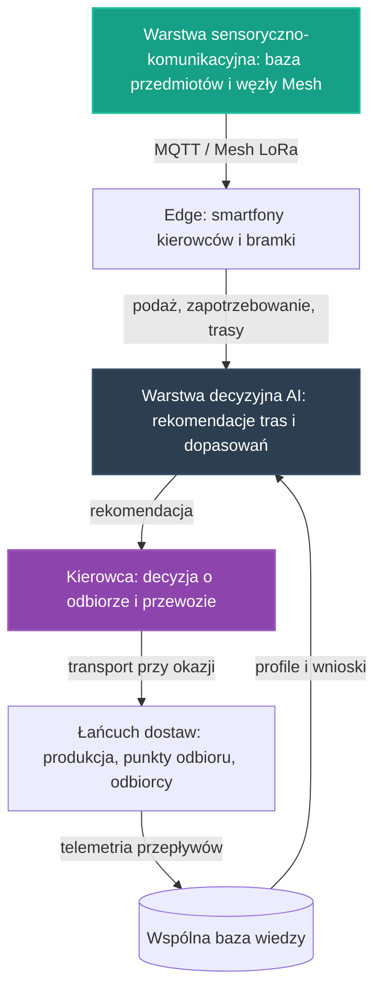

# 28. Koncepcyjny Pilotaż Logistyki Sąsiedzkiej

## **Intelekt wyprzedza Kapitał!**

## Opis Projektu
Ten dokument definiuje koncepcję pilotażu dla osi **Logistyka i transport** — piątej z [głównych osi rozwoju](../README.md) NARODOWYCH SIŁ INTELEKTUALNYCH POLSKI. Zgodnie z brzmieniem tej osi w [README](../README.md) chodzi o **wykorzystanie AI do inteligentnego zarządzania łańcuchami dostaw** — wraz z **systemem rekomendacji do nawigacji, który sugeruje odbiór potrzebnych przedmiotów na trasie** oraz z **Ekonomią Współdzielenia**: kierowcy realizujący transport „przy okazji" budują swój status w społeczności Straży Przyszłości, odblokowując bonusy w systemach automatyzacji oraz priorytet dostępu do wspólnych zasobów lub darmowych usług serwisowych AI, jednocześnie drastycznie oszczędzając paliwo dzięki wykorzystaniu tras, które i tak są realizowane. Celem pilotażu jest zaprojektowanie otwartego, niskokosztowego wzorca logistycznego, który porządkuje organizację pracy: od rejestracji podaży i zapotrzebowania, przez lokalną analizę i rekomendacje na trasie, po decyzję przewozową należącą wyłącznie do człowieka-kierowcy.

> [!IMPORTANT]
> **Zakres dokumentu:** opisujemy wyłącznie koncepcję organizacji pracy i architekturę narzędzi — bez danych technicznych, parametrów i wyników liczbowych. Zasadą pracy całego pilotażu, przejętą ze wzorca pilotaży medycznego i energetycznego, jest to, że **AI rekomenduje, zamiast decydować za kierowcę** — każda rekomendacja odbioru, zjazdu z trasy czy przewiezienia przedmiotu jest tylko propozycją, a decyzja końcowa zawsze pozostaje po stronie człowieka-kierowcy.

Pilotaż nie zaczyna od zera. W repozytorium istnieją już zalążki tego kierunku:

* **[18. Automatyzacja Transportu i Logistyki](18_automatyzacja_transportu_i_logistyki.md)** — łączenie darmowej podaży przedmiotów z realnym zapotrzebowaniem społeczności i istniejącymi trasami kierowców: rekomendacje trasy w nawigacji, personalizowane zapotrzebowanie oraz model „BlablaCar dla rzeczy",
* **[20. Logistyka Sąsiedzka i Optymalizacja Tras](20_logistyka_sasiadzka_nawigacja.md)** — logistyka „przy okazji": algorytm odstępstwa od trasy, ekonomia współdzielenia budująca status kierowców w społeczności oraz suwerenność danych logistycznych,
* **[19. Społeczna Baza Przedmiotów „Zero Waste"](19_spoleczna_baza_przedmiotow.md)** — suwerenna baza podaży i zapotrzebowania, z automatycznym rozpoznawaniem przedmiotów ze zdjęcia i dopasowywaniem potrzeb w czasie rzeczywistym,
* **[10. Łączność Mesh i LoRa](10_lacznosc_mesh_lora.md)** — sieć Mesh jako „Nerw Gospodarczy", w tym scenariusz logistyki gospodarczej: suwerenny komunikator do wymiany informacji o zapotrzebowaniu i gotowości produktów do odbioru, niezależny od globalnych platform komunikacyjnych.

Wszystkie te zalążki opierają się na tych samych fundamentach opisanych w **[00. Fundamentach Technologicznych NSIP](00_fundamenty_technologiczne.md)**. Ten dokument przenosi na grunt logistyki wspólny wzorzec warstw wypracowany w pilotażach [25](25_pilot_automatyzacji_zywnosci.md), [26](26_pilot_ai_w_medycynie.md) i [27](27_pilot_sieci_energetycznej.md): warstwy sensorycznej, decyzyjnej AI na krawędzi oraz pętli nauki z telemetrii. Zgodnie z [Mapą drogową](../ROADMAPA.md) jest to przykład projektu pilotażowego z Fazy 1: niewielka, weryfikowalna realizacja, która dowodzi słuszności koncepcji i staje się wzorcem do powielenia w fazie skalowania.

---

## Proponowane moduły koncepcyjne

Pilotaż projektujemy jako zespół współpracujących warstw, z których każda powstaje w oparciu o gotowe, otwarte komponenty zebrane w repozytorium — zgodnie z Naszą zasadą, że kod już istnieje, a zadaniem twórców jest jego twórcza adaptacja.

### Moduł 1: Warstwa sensoryczno-komunikacyjna
* Fundamenty z **[00. Fundamentów Technologicznych NSIP](00_fundamenty_technologiczne.md)**: **Home Assistant** jako lokalny mózg automatyzacji, **ESPHome** do błyskawicznego tworzenia firmware'u dla czujników i elementów wykonawczych oraz **MQTT** jako lekki protokół komunikacyjny urządzeń IoT — także w społecznych punktach przekazania przedmiotów i paczek.
* Edge computing w duchu projektów **[06. Smartfony jako Sterowniki](06_smartfony_jako_sterowniki.md)** i **[21. Home Assistant na Smartfonie](21_home_assistant_na_telefonie.md)**: smartfony z odzysku pełnią rolę węzłów kierowcy (nawigacja, powiadomienia, dokumentacja przedmiotu) oraz bramek danych w punktach odbioru.
* Podaż i zapotrzebowanie — „sensoryka" logistyki — pochodzą ze **[Społecznej Bazy Przedmiotów „Zero Waste"](19_spoleczna_baza_przedmiotow.md)**: wystarczy zdjęcie, aby AI rozpoznało kategorię i stan przedmiotu, opisało go i skatalogowało w suwerennej bazie, a system dopasowujący powiadomił osoby, które zgłosiły zapotrzebowanie.
* Łączność odporna na brak Internetu, w oparciu o sieć Mesh opisaną w **[10. Łączności Mesh i LoRa](10_lacznosc_mesh_lora.md)** — sieć jako „Nerw Gospodarczy" przenosi informacje o zapotrzebowaniu i gotowości produktów do odbioru z pełnym szyfrowaniem end-to-end, także tam, gdzie zawodzą globalne platformy; smartfon z odzysku służy jako brama, która zbiera dane z lokalnej sieci Mesh i przesyła je dalej, gdy tylko pojawi się zasięg komórkowy. Kolejność pracy warstwy jest względna: najpierw rejestracja podaży i zapotrzebowania, następnie transmisja przez sieć, na końcu przekazanie obserwacji do warstwy decyzyjnej.

### Moduł 2: Warstwa decyzyjna AI wspierająca kierowcę
* Modele uruchamiane na krawędzi (Edge AI) z użyciem silników wskazanych w fundamentach: **TensorFlow Lite** oraz **ONNX Runtime** — analiza wykonywana lokalnie, blisko danych, bez uzależnienia od zewnętrznych chmur.
* Kierunki prac wyznaczone przez sekcję „Logistyka i transport" w Fazie 1 [Mapy drogowej](../ROADMAPA.md): **optymalizacja tras i harmonogramów transportu**, **projekt sprawnego łańcucha dostaw dla produktów z naszych modułów produkcyjnych** oraz **wsparcie logistyki komunikacji zbiorowej**.
* Wzorzec pracy „edge-first" wypracowany w [projekcie 01](01_inteligentna_akwakultura.md): do wspólnej warstwy wiedzy trafia wynik analizy, a nie surowy strumień danych.
* Wynik analizy w ujednoliconej postaci rekomendacji (poziom ryzyka, rekomendacja, poziom pewności, kody przyczyn) — taki kształt wyniku analitycznego definiuje już kontrakt danych [projektu 01](01_inteligentna_akwakultura.md). Rekomendacja jest zawsze wejściem do decyzji człowieka, nigdy jej zamiennikiem: najpierw AI proponuje („Na Twojej trasie znajduje się przedmiot, na który ktoś czeka — czy możesz go odebrać i dostarczyć?"), następnie kierowca weryfikuje propozycję, a na końcu podejmuje decyzję o odbiorze, zjeździe z trasy i przewozie.
* **Rekomendacje na trasie i algorytm odstępstwa:** mechanizm z [projektów 18](18_automatyzacja_transportu_i_logistyki.md) i [20](20_logistyka_sasiadzka_nawigacja.md) — system sprawdza w bazie, czy na trasie kierowcy lub w zdefiniowanym promieniu odstępstwa od głównej nitki znajduje się przedmiot, na który istnieje zapotrzebowanie w miejscu docelowym lub po drodze, a algorytm odstępstwa wylicza optymalny zjazd z trasy tak, aby koszt energetyczny był minimalny w stosunku do korzyści z transportu.
* **Pull-logistics:** deklarowane zapotrzebowanie użytkownika ([projekt 18](18_automatyzacja_transportu_i_logistyki.md)) — powiadomienie przez komunikator, ilekroć pojawi się oferta pasująca do zgłoszonej potrzeby.
* **Ekonomia Współdzielenia i status kierowcy:** kierowcy realizujący transport „przy okazji" budują swój status w społeczności Straży Przyszłości, odblokowując bonusy w systemach automatyzacji oraz priorytet dostępu do wspólnych zasobów lub darmowych usług serwisowych AI — tak określa to [README](../README.md), a wzorzec grywalizacji i reputacji rozwija [projekt 18](18_automatyzacja_transportu_i_logistyki.md). Zamiast generować nowy ruch, system wykorzystuje trasy, które i tak są realizowane, zamieniając „puste przebiegi" istniejącego ruchu w łańcuch dostaw dla gospodarki obiegu zamkniętego — zgodnie z misją inicjatywy, która wygospodarowuje realne zasoby na **WSPÓLNE DOBRO**.

### Moduł 3: Pętla nauki z telemetrii
* Najpierw węzeł zbiera obserwacje i zdarzenia z warstwy sensoryczno-komunikacyjnej — podaż, zapotrzebowanie, przyjęte i odrzucone rekomendacje, zrealizowane przewozy — następnie warstwa decyzyjna porównuje je z dotychczasową wiedzą o przepływach, w kolejnym etapie koryguje rekomendacje tras i dopasowania, a na końcu zapisuje wniosek do wspólnej bazy wiedzy.
* Konwencja z [projektu 01](01_inteligentna_akwakultura.md): surowe odczyty — w tym trasy użytkowników — trafiają do warstwy operacyjnej poza repozytorium, natomiast do repozytorium wraca wyłącznie wiedza opracowana: snapshoty, raporty zbiorcze i udokumentowane przypadki pracy węzłów.
* **Suwerenność danych logistycznych:** w duchu [projektu 20](20_logistyka_sasiadzka_nawigacja.md) dane o przepływach towarów i trasach użytkowników nie służą profilowaniu reklamowemu, lecz wyłącznie optymalizacji wspólnej gospodarki zasobami — i pozostają własnością społeczności, zgodnie z zasadą suwerennej infrastruktury danych [projektu 19](19_spoleczna_baza_przedmiotow.md).
* Wiedza zapisywana jest jako otwarte, wspólne profile w formatach JSON/YAML, na wzór receptur klimatycznych z [projektu 24](24_automatyzacja_hodowli_grzybow.md) — dzięki temu każdy kolejny węzeł rozpoczyna pracę z dorobkiem poprzedników.

---

## Zależności od pozostałych osi i pilotaży

Pilotaż nie jest wyspą — korzysta z dorobku sąsiednich osi i sam spina je w działający system, zgodnie z zasadą spójności opisaną w [Mapie drogowej](../ROADMAPA.md). [Mapa drogowa](../ROADMAPA.md) mówi o tej osi wprost: **spina pozostałe obszary w jeden działający system: łączy produkcję z odbiorcą, a ochronę zdrowia z pacjentem**.

### Energia (oś trzecia)
Stabilna i tania energia to, jak stanowi [Mapa drogowa](../ROADMAPA.md), warunek pracy systemów obliczeniowych całej inicjatywy — a więc także węzłów logistycznych, smartfonów-bramek i nawigacji działającej na krawędzi. Dlatego pilotaż projektujemy tak, aby najpierw mierzył własne zużycie energii, w kolejnym etapie ograniczał je na drodze optymalizacji, a docelowo korzystał z systemów planowania, magazynowania i dystrybucji energii rozwijanych na osi Energia. Istotą samej logistyki „przy okazji" jest przy tym ochrona przed marnotrawstwem energii — [projekt 18](18_automatyzacja_transportu_i_logistyki.md) opisuje wykorzystanie istniejących przebiegów zamiast generowania nowego ruchu.

### Optymalizacja zużycia zasobów strategicznych (oś czwarta)
Logistyka sąsiedzka powstaje po to, by istniejące zasoby nie marnowały się: przedmioty, które zamiast trafić do punktu zbiórki odpadów otrzymują drugie życie ([projekt 19](19_spoleczna_baza_przedmiotow.md)), oraz wolne miejsca i przebiegi, które i tak się odbywają ([projekt 18](18_automatyzacja_transportu_i_logistyki.md)). Pilotaż dostarcza tej osi telemetrię przepływów i zużycia, następnie korzysta ze wspólnych narzędzi analitycznych, a w późniejszym etapie z modeli wspierających decyzje o alokacji zasobów. Sprzęt węzłów — sterowniki, bramki i węzły kierowcy — powstaje z odzysku, w duchu projektów [06](06_smartfony_jako_sterowniki.md) i [21](21_home_assistant_na_telefonie.md).

### Żywność, medycyna i pilotaże produkcyjne (spinka systemu)
[Mapa drogowa](../ROADMAPA.md) wskazuje wprost kierunek: **projekt sprawnego łańcucha dostaw dla produktów z naszych modułów produkcyjnych** oraz projekt dystrybucji żywności oparty na narzędziach z sąsiedniej osi logistycznej. Ten pilotaż dostarcza tych narzędzi: przenosi informację o gotowości produktów do odbioru, zgłaszaną przez sieć Mesh ([projekt 10](10_lacznosc_mesh_lora.md)), z węzłów produkcji żywności ([projekt 25](25_pilot_automatyzacji_zywnosci.md)) i energetyki ([projekt 27](27_pilot_sieci_energetycznej.md)) do odbiorców, a ta sama warstwa logistyczna — narzędzia z [projektów 18](18_automatyzacja_transportu_i_logistyki.md) i [20](20_logistyka_sasiadzka_nawigacja.md) — wspiera logistykę ochrony zdrowia w [pilotażu medycznym](26_pilot_ai_w_medycynie.md). Kolejność prac jest względna: najpierw węzły i rekomendacje w ramach społeczności, następnie spięcie z pilotażami produkcyjnymi, a przed skalowaniem — pełny łańcuch produkcja–dystrybucja.

---

## Miejsce pilotażu na mapie drogowej

* **Faza 0 (Krystalizacja):** ten dokument jest produktem burzy mózgów, analizy i planowania — precyzyjną koncepcją, która powstaje intelektem, nie budżetem.
* **Faza 1 (Pierwsze projekty pilotażowe):** tu jest miejsce tego pilotażu. [Mapa drogowa](../ROADMAPA.md) wprost wymienia Logistykę wśród osi Fazy 1 i wskazuje kierunki prac koncepcyjnych: optymalizację tras i harmonogramów transportu, projekt sprawnego łańcucha dostaw dla produktów z modułów produkcyjnych oraz wsparcie logistyki komunikacji zbiorowej.
* **Faza 2 (Skalowanie i samonapędzająca się gospodarka):** gdy pilotaż potwierdzi zasadność koncepcji, logistyka — zgodnie z opisem Fazy 2 — **spina produkcję z dystrybucją**: łączy węzły produkcji żywności i energii z odbiorcami, a wspólne dane i doświadczenia z każdej realizacji poprawiają działanie pozostałych, obniżając koszt następnego projektu.
* **Faza 3 (Finansowanie Dochodu Gwarantowanego):** docelowy punkt — nadwyżki wypracowane przez system wracają do **WSPÓLNEGO DOBRA NARODOWEGO**, finansując **Dochód Gwarantowany (UBI)**.

Granice między fazami są jakościowe, a nie kalendarzowe: fazę zamyka realne osiągnięcie, a nie data. Kolejność prac wewnątrz Fazy 1 nie jest sztywna — osie wzajemnie się napędzają.

---

## Jak społeczność może rozwinąć ten projekt

Ten projekt jest własnością społeczności i tak ma być rozwijany — w otwartym modelu współtworzenia opisanym w **[CONTRIBUTING.md](../CONTRIBUTING.md)**.

* **Dyskusja i analiza:** pytania, pomysły i zastrzeżenia zgłaszaj w zakładce Issues repozytorium — to serce projektu, w którym ma się roić jak w ulu. Każdy komentarz merytoryczny to cenny wkład w **NARODOWY WYSIŁEK INTELEKTUALNY**.
* **Pull Requesty:** dojrzałe zmiany — rozszerzenia koncepcji, dokumentacja, profile wiedzy, adaptery — trafiają do plików poprzez Pull Requesty, dokładnie według instrukcji z [CONTRIBUTING.md](../CONTRIBUTING.md).
* **Ścieżki wkładu:**
  * sensory, edge i łączność — węzły Mesh i bramki z odzysku, smartfon jako węzeł kierowcy, adaptacja społecznych punktów przekazania,
  * analiza i dopasowanie — lekkie modele na krawędzi, algorytmy odstępstwa od trasy, ujednolicony kształt rekomendacji, dopasowywanie podaży z zapotrzebowaniem,
  * kontrakty danych i suwerenność — mapowanie podaży, zapotrzebowania i przepływów do wspólnego schematu, ochrona prywatności tras,
  * grywalizacja i społeczność — projekty statusów, reputacji i bonusów w systemach automatyzacji,
  * dokumentacja i kuracja wiedzy — opisy przypadków przewozów, snapshoty, wspólne profile przepływów,
  * eksperci dziedzinowi — [Mapa drogowa](../ROADMAPA.md) wymienia logistykę wśród dziedzin, z których eksperci są potrzebni społeczności od samego początku.

Pełnoprawny wkład jest możliwy także bez własnego sprzętu: projektowanie schematów, analiza organizacji pracy i dokumentacja to praca intelektualna tej samej rangi. Oceniamy pomysły i kod, nie ludzi — a liczy się wyłącznie dokonanie.

---

## Zasoby wewnętrzne w repozytorium
* **[00. Fundamenty Technologiczne NSIP](00_fundamenty_technologiczne.md)** — Home Assistant, ESPHome, MQTT, Edge AI, Mesh.
* **[25. Zintegrowany Pilotaż Automatyzacji Produkcji Żywności](25_pilot_automatyzacji_zywnosci.md)** — wzorzec warstw i pętli nauki, od którego dziedziczymy format.
* **[26. Koncepcyjny Pilotaż AI w Medycynie](26_pilot_ai_w_medycynie.md)** i **[27. Koncepcyjny Pilotaż Sieci Energetycznej](27_pilot_sieci_energetycznej.md)** — wzorzec decyzji końcowej zawsze po stronie człowieka.
* **[01. Inteligentna Akwakultura](01_inteligentna_akwakultura.md)** — wzorzec edge-first, kontrakt danych i pętla wiedzy.
* **[18. Automatyzacja Transportu i Logistyki](18_automatyzacja_transportu_i_logistyki.md)** — rekomendacje trasy w nawigacji, pull-logistics, model „BlablaCar dla rzeczy", grywalizacja i reputacja.
* **[20. Logistyka Sąsiedzka i Optymalizacja Tras](20_logistyka_sasiadzka_nawigacja.md)** — algorytm odstępstwa, ekonomia współdzielenia, suwerenność danych logistycznych.
* **[19. Społeczna Baza Przedmiotów „Zero Waste"](19_spoleczna_baza_przedmiotow.md)** — suwerenna baza podaży i zapotrzebowania.
* **[10. Łączność Mesh i LoRa](10_lacznosc_mesh_lora.md)** — „Nerw Gospodarczy" i scenariusz logistyki gospodarczej.
* **[06. Smartfony jako Sterowniki](06_smartfony_jako_sterowniki.md)** i **[21. Home Assistant na Smartfonie](21_home_assistant_na_telefonie.md)** — edge computing z odzysku.
* **[24. Automatyzacja Hodowli Grzybów](24_automatyzacja_hodowli_grzybow.md)** — otwarte profile wiedzy w formatach JSON/YAML.
* **[Mapa drogowa (ROADMAPA.md)](../ROADMAPA.md)** — fazy rozwoju i zasady ich przechodzenia.
* **[CONTRIBUTING.md](../CONTRIBUTING.md)** — jak zgłaszać pomysły i współtworzyć repozytorium.

---
*Intelekt wyprzedza Kapitał!*

**Nawet tu kod już jest — brakuje tylko Ciebie.**
