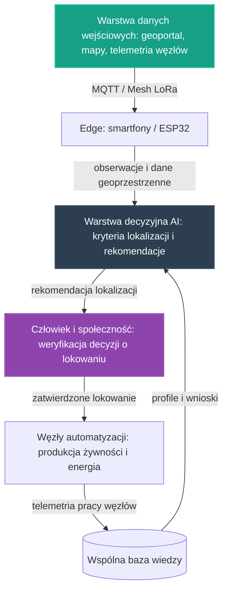

# 29. Koncepcyjny Pilotaż Planowania Przestrzennego i Rozwoju

## **Intelekt wyprzedza Kapitał!**

## Opis Projektu
Ten dokument definiuje koncepcję pilotażu dla osi **Planowanie Przestrzenne i Rozwój** — siódmej z [głównych osi rozwoju](../README.md) NARODOWYCH SIŁ INTELEKTUALNYCH POLSKI. Zgodnie z brzmieniem tej osi w [README](../README.md) chodzi o **wykorzystanie danych geoprzestrzennych do optymalnego lokowania automatyzacji**. Celem pilotażu jest zaprojektowanie otwartego, niskokosztowego procesu decyzji o lokalizacji węzłów: od danych wejściowych, przez kryteria i rekomendacje AI, po weryfikację decyzji przez człowieka i społeczność.

> [!IMPORTANT]
> **Zakres dokumentu:** opisujemy wyłącznie koncepcję organizacji pracy i architekturę narzędzi. Nie wskazujemy żadnych konkretnych lokalizacji, gmin, regionów ani współrzędnych — ani jako przykładów, ani jako rekomendacji; każde takie wskazanie ma powstać dopiero na podstawie realnych danych, w drodze procesu opisanego w tym dokumencie. Kolejność prac jest wyłącznie względna („najpierw…, w kolejnym etapie…, przed skalowaniem"). Zasadę pracy przejmujemy z [projektu 16](16_geoportal_potencjal_rozwoju.md): **„Rekomendacje, nie Nakazy"** — AI przygotowuje bazę do decyzji, które podejmują ludzie.

Pilotaż nie zaczyna od zera. W repozytorium istnieją już zalążki tego kierunku:

* **[16. Agentyczna Analiza Geoprzestrzenna i Logistyczna](16_geoportal_potencjal_rozwoju.md)** — główny wzorzec tego pilotażu: analiza terytorium pod kątem rozmieszczenia procesów automatyzacji, „Rekomendacje, nie Nakazy", analiza konfliktów potencjału i ewaluacja dobrostanu,
* **[19. Społeczna Baza Przedmiotów "Zero Waste"](19_spoleczna_baza_przedmiotow.md)** — suwerenna baza danych o zasobach i zapotrzebowaniu społeczności; wzorzec zasady, że dane o zasobach należą do społeczeństwa,
* **[06. Smartfony jako Sterowniki](06_smartfony_jako_sterowniki.md)** — edge computing z odzysku: węzły pomiarowe, bramki danych, kamery inspekcyjne i precyzyjna lokalizacja GPS,
* **[21. Home Assistant na Starym Smartfonie](21_home_assistant_na_telefonie.md)** — opcjonalne udostępnianie zanonimizowanych odczytów do wspólnego API NSIP, „budując mapę potencjału kraju".

Wszystkie te zalążki opierają się na tych samych fundamentach opisanych w **[00. Fundamentach Technologicznych NSIP](00_fundamenty_technologiczne.md)** — w tym na sekcji **„Narzędzia GIS i Planowanie"** (GDAL do manipulacji danymi geoprzestrzennymi oraz Leaflet do interaktywnych map logistyki i monitoringu). Zgodnie z [Mapą drogową](../ROADMAPA.md) Faza 1 polega m.in. na uzupełnianiu osi o brakujące kierunki, a każda oś to kandydat na kolejny pilotaż — ten dokument jest właśnie takim uzupełnieniem: niewielką, weryfikowalną koncepcją, która ma dowodzić słuszności pomysłu i stać się wzorcem do powielenia w fazie skalowania.

---

## Proponowane moduły koncepcyjne

Pilotaż projektujemy jako zespół współpracujących warstw, z których każda powstaje w oparciu o gotowe, otwarte komponenty zebrane w repozytorium — zgodnie z Naszą zasadą, że kod już istnieje, a zadaniem twórców jest jego twórcza adaptacja.

### Moduł 1: Warstwa danych wejściowych (geoprzestrzenna i telemetryczna)
* Narzędzia GIS z **[00. Fundamentów Technologicznych NSIP](00_fundamenty_technologiczne.md)**: **GDAL** do manipulacji danymi geoprzestrzennymi oraz **Leaflet** do interaktywnych map logistyki i monitoringu.
* Klasy danych wejściowych według [projektu 16](16_geoportal_potencjal_rozwoju.md): geoportal i mapy (ukształtowanie terenu, zalesienie, sieć hydrologiczna, dostępność gruntów), logistyka i infrastruktura (bliskość węzłów transportowych, potencjał dla logistyki dronowej i autonomicznego transportu kołowego) oraz zasoby i ludzie (dane o lokalnych specjalizacjach, potrzebach społeczności i dostępnych zasobach surowcowych).
* Telemetria z już pracujących węzłów inicjatywy: zanonimizowane odczyty z [Węzłów NSIP](21_home_assistant_na_telefonie.md), budujące mapę potencjału kraju, oraz dane o zasobach i zapotrzebowaniu z [społecznej bazy przedmiotów](19_spoleczna_baza_przedmiotow.md).
* Edge computing w duchu projektów **[06. Smartfony jako Sterowniki](06_smartfony_jako_sterowniki.md)** i **[21. Home Assistant na Smartfonie](21_home_assistant_na_telefonie.md)**: stare urządzenia z odzysku pełnią rolę węzłów pomiarowych, bramek danych i kamer inspekcyjnych, z wykorzystaniem GPS z sensorów smartfona.
* Łączność odporna na brak Internetu, w oparciu o sieć Mesh opisaną w **[10. Łączności Mesh i LoRa](10_lacznosc_mesh_lora.md)** — pełniącą w inicjatywie rolę „Nerwu Gospodarczego" — dla węzłów pracujących daleko od infrastruktury; kierunek rozwoju z [projektu 21](21_home_assistant_na_telefonie.md): telefon jako bramka między siecią Mesh a Home Assistantem.
* Wzorzec pracy „edge-first" wypracowany w [projekcie 01](01_inteligentna_akwakultura.md): do wspólnej warstwy wiedzy trafia wynik analizy, a nie surowy strumień danych.

### Moduł 2: Warstwa decyzyjna AI — kryteria lokalizacji
* Modele uruchamiane na krawędzi (Edge AI) z użyciem silników wskazanych w fundamentach: **TensorFlow Lite** oraz **ONNX Runtime** — analiza wykonywana lokalnie, blisko danych, bez uzależnienia od zewnętrznych chmur.
* Kierunki prac z [projektu 16](16_geoportal_potencjal_rozwoju.md): **Vision AI** — automatyczna segmentacja i klasyfikacja zdjęć satelitarnych pod kątem przydatności dla OZE (PV na dachach, mikrowodnie); **Multi-Agent Systems** — agenci specjalizujący się w różnych dziedzinach (energia, transport, rolnictwo, socjologia), negocjujący wspólną „Mapę Rekomendacji"; **Predictive Analytics** — przewidywanie wąskich gardeł logistycznych i zmian demograficznych w celu wyprzedzającego planowania infrastruktury automatyzacji.
* Kryteria lokowania zgodne z filarami [projektu 16](16_geoportal_potencjal_rozwoju.md): potencjał terenowy i zasobowy, dostępność logistyczna oraz kapitał ludzki i potrzeby społeczności — wraz z **analizą konfliktów potencjału** (ryzyko kolizji między priorytetami technokratycznymi a potrzebami lokalnej społeczności) i **ewaluacją dobrostanu** (dane o jakości życia, lokalnej kulturze i aspiracjach mieszkańców jako równorzędne parametry optymalizacji).
* Kryterium energetyczne: zgodnie z [Mapą drogową](../ROADMAPA.md) stabilna i tania energia jest warunkiem pracy systemów obliczeniowych całej inicjatywy — dlatego dane o zapotrzebowaniu energetycznym węzłów i o pracy sieci energetycznej wchodzą do zbioru kryteriów wprost (zob. zależności poniżej).
* Wynik analizy w ujednoliconej postaci rekomendacji (poziom ryzyka, rekomendacja, poziom pewności, kody przyczyn) — taki kształt wyniku analitycznego definiuje już kontrakt danych [projektu 01](01_inteligentna_akwakultura.md). Rekomendacja jest zawsze wejściem do decyzji człowieka, nigdy jej zamiennikiem.

### Moduł 3: Weryfikacja przez człowieka i decyzja o lokowaniu
* Kolejność procesu jest względna: najpierw AI proponuje kandydatury lokalizacji wraz z pełnym kontekstem kryteriów, następnie człowiek-operator oraz zainteresowana społeczność weryfikują rekomendację i jej założenia, a na końcu zatwierdzają lub korygują decyzję o lokowaniu węzła — według wzorca decyzji końcowej zawsze po stronie człowieka, wypracowanego w [pilotażu medycznym](26_pilot_ai_w_medycynie.md) i [pilotażu energetycznym](27_pilot_sieci_energetycznej.md).
* Jak stanowi [projekt 16](16_geoportal_potencjal_rozwoju.md): system generuje niezobowiązujące sugestie rozwoju, które stanowią bazę do decyzji podejmowanych przez ludzi — narzucenie procesów wbrew woli mieszkańców niszczy potencjał społeczny i generuje opór, co jest kontrproduktywne.
* Decyzję poprzedza wyjaśnialny zestaw kryteriów (poziomy pewności i kody przyczyn), aby weryfikujący mogli ocenić, skąd wynika rekomendacja — i móc ją świadomie odrzucić albo skorygować.

### Moduł 4: Pętla nauki z telemetrii
* Najpierw węzeł — po zatwierdzeniu lokalizacji — dostarcza telemetrię swojej pracy, następnie warstwa decyzyjna porównuje faktyczne wyniki z przewidywaniami kryteriów, w kolejnym etapie koryguje kryteria i rekomendacje, a na końcu zapisuje wniosek do wspólnej bazy wiedzy. Pętla uczy procesu lokowania: każdy zrealizowany węzeł poprawia jakość następnej decyzji, zanim ruszy skalowanie.
* Konwencja z [projektu 01](01_inteligentna_akwakultura.md): surowe odczyty trafiają do warstwy operacyjnej poza repozytorium, natomiast do repozytorium wraca wyłącznie wiedza opracowana — snapshoty, raporty zbiorcze i udokumentowane przypadki decyzji o lokowaniu.
* Wiedza zapisywana jest jako otwarte, wspólne profile w formatach JSON/YAML, na wzór receptur klimatycznych z [projektu 24](24_automatyzacja_hodowli_grzybow.md) — dzięki temu każdy kolejny proces lokowania rozpoczyna pracę z dorobkiem poprzedników.

---

## Zależności od pozostałych osi i pilotaży

Pilotaż nie jest wyspą — korzysta z dorobku sąsiednich osi i sam zasila je, zgodnie z zasadą spójności opisaną w [Mapie drogowej](../ROADMAPA.md).

### Przedmiot lokowania: węzły produkcji żywności i energii
Ten pilotaż nie buduje własnych, fizycznych węzłów — jego przedmiotem jest decyzja, **gdzie powstają kolejne węzły innych pilotaży**:

* **[25. Zintegrowany Pilotaż Automatyzacji Produkcji Żywności](25_pilot_automatyzacji_zywnosci.md)** — autonomiczne węzły produkcji żywności; przed skalowaniem, przy ich powielaniu, rozmieszczenie ma wynikać z danych geoprzestrzennych i kryteriów opisanych w tym dokumencie,
* **[27. Koncepcyjny Pilotaż Sieci Energetycznej](27_pilot_sieci_energetycznej.md)** — węzły energetyczne; ich planowanie opisane w pilotażu energetycznym naturalnie uzupełnia się z procesem lokowania z tego dokumentu.

Kolejność jest względna: najpierw pilotaże 25 i 27 dowodzą słuszności koncepcji węzłów, w kolejnym etapie ten pilotaż porządkuje ich rozmieszczenie przed skalowaniem, a docelowo obie strony wymieniają się danymi — węzły dostarczają telemetrię, a mapa rekomendacji wskazuje kolejne lokalizacje.

### Energia jako warunek lokowania
Sekcja „Energia" w [Mapie drogowej](../ROADMAPA.md) stwierdza wprost: **„Ta oś zasila wszystkie pozostałe: stabilna i tania energia to warunek autonomicznej produkcji żywności oraz pracy systemów obliczeniowych całej inicjatywy."** Z tej zależności wynika, że kryteria lokowania muszą uwzględniać warunki energetyczne wprost: najpierw obserwacja zapotrzebowania energetycznego istniejących węzłów, następnie współpraca z planowaniem, magazynowaniem i dystrybucją energii rozwijanymi na osi Energia, a docelowo wspólne lokowanie węzłów produkcyjnych, obliczeniowych i energetycznych tam, gdzie wzajemnie się wspierają.

### Suwerenne dane o zasobach, potrzebach i logistyce
* [README](../README.md) w sekcji o suwerenności cyfrowej deklaruje budowę Polskiej Bazy Danych — suwerennego zasobu informacji o zasobach, potrzebach i logistyce. Warstwa danych wejściowych tego pilotażu jest kontynuacją tej zasady na gruncie geoprzestrzennym.
* [Projekt 19](19_spoleczna_baza_przedmiotow.md) ustala wzorzec: bazy danych o zapotrzebowaniu i zasobach powinny należeć do społeczeństwa i służyć dobru wspólnemu. [Projekt 21](21_home_assistant_na_telefonie.md) dodaje opcjonalny, zanonimizowany strumień odczytów budujący mapę potencjału kraju. Dane tego pilotażu mają podlegać tej samej regule.

### Osie sąsiednie
* **Optymalizacja zużycia zasobów strategicznych (oś czwarta):** racjonalne, poparte zaawansowaną analizą danych zarządzanie wodą, surowcami i ziemią — tak definiuje tę oś [README](../README.md) — jest jednocześnie kryterium gruntowym lokowania; pilotaż zwraca tej osi telemetrię o realnym wykorzystaniu ziemi i zasobów przez zlokalizowane węzły.
* **Logistyka i transport (oś piąta):** bliskość węzłów transportowych to jedno z kryteriów z [projektu 16](16_geoportal_potencjal_rozwoju.md), a narzędzia optymalizacji tras z [18. Automatyzacji Transportu i Logistyki](18_automatyzacja_transportu_i_logistyki.md) mogą w kolejnym etapie zasilać kryteria dostępności logistycznej.

---

## Miejsce pilotażu na mapie drogowej

* **Faza 0 (Krystalizacja):** ten dokument jest produktem burzy mózgów, analizy i planowania — precyzyjną koncepcją, która powstaje intelektem, nie budżetem.
* **Faza 1 (Pierwsze projekty pilotażowe):** tu jest miejsce tego pilotażu. [Mapa drogowa](../ROADMAPA.md) stwierdza, że Faza 1 polega także na uzupełnianiu osi o brakujące kierunki, a każda oś z [README](../README.md) jest kandydatem na kolejny pilotaż — oś **Planowanie Przestrzenne i Rozwój** jest takim uzupełnieniem: przed skalowaniem porządkuje rozmieszczenie węzłów, które powstają na pozostałych osiach.
* **Faza 2 (Skalowanie i samonapędzająca się gospodarka):** gdy pilotaż potwierdzi zasadność koncepcji, powielanie węzłów — produkcji żywności, energii i pozostałych — opiera się na mapie rekomendacji, a dane i doświadczenia z każdej realizacji poprawiają działanie pozostałych.
* **Faza 3 (Finansowanie Dochodu Gwarantowanego):** docelowy punkt — nadwyżki wypracowane przez system wracają do **WSPÓLNEGO DOBRA NARODOWEGO**.

Granice między fazami są jakościowe, a nie kalendarzowe: fazę zamyka realne osiągnięcie, a nie data. Kolejność prac wewnątrz Fazy 1 nie jest sztywna — osie wzajemnie się napędzają.

---

## Jak społeczność może rozwinąć ten projekt

Ten projekt jest własnością społeczności i tak ma być rozwijany — w otwartym modelu współtworzenia opisanym w **[CONTRIBUTING.md](../CONTRIBUTING.md)**.

* **Dyskusja i analiza:** pytania, pomysły i zastrzeżenia zgłaszaj w zakładce Issues repozytorium — to serce projektu, w którym ma się roić jak w ulu. Każdy komentarz merytoryczny to cenny wkład w **NARODOWY WYSIŁEK INTELEKTUALNY**.
* **Pull Requesty:** dojrzałe zmiany — rozszerzenia koncepcji, dokumentacja, profile wiedzy, adaptery — trafiają do plików poprzez Pull Requesty, dokładnie według instrukcji z [CONTRIBUTING.md](../CONTRIBUTING.md).
* **Ścieżki wkładu:**
  * dane geoprzestrzenne i GIS — narzędzia z fundamentów (GDAL, Leaflet), koncepcje pipeline'ów analizy opisanych w [projekcie 16](16_geoportal_potencjal_rozwoju.md),
  * kryteria i modele — ujednolicony kształt rekomendacji, projekty agentów dziedzinowych negocjujących wspólną „Mapę Rekomendacji", predykcja wąskich gardeł logistycznych,
  * edge i łączność — węzły pomiarowe ze starych smartfonów, bramki Mesh–Home Assistant,
  * eksperci dziedzinowi — w duchu [projektu 16](16_geoportal_potencjal_rozwoju.md): agenci specjalizujący się w różnych dziedzinach, od energii i transportu po socjologię; analiza dobrostanu wymaga perspektywy społecznej,
  * dokumentacja i kuracja wiedzy — opisy przypadków decyzji o lokowaniu, snapshoty, wspólne profile.

Pełnoprawny wkład jest możliwy także bez własnego sprzętu: projektowanie schematów, analiza organizacji pracy i dokumentacja to praca intelektualna tej samej rangi. Oceniamy pomysły i kod, nie ludzi — a liczy się wyłącznie dokonanie.

---

## Zasoby wewnętrzne w repozytorium
* **[00. Fundamenty Technologiczne NSIP](00_fundamenty_technologiczne.md)** — Home Assistant, ESPHome, MQTT, Edge AI, Mesh oraz narzędzia GIS (GDAL, Leaflet).
* **[16. Agentyczna Analiza Geoprzestrzenna i Logistyczna](16_geoportal_potencjal_rozwoju.md)** — główny wzorzec: „Rekomendacje, nie Nakazy", analiza konfliktów potencjału, ewaluacja dobrostanu.
* **[19. Społeczna Baza Przedmiotów "Zero Waste"](19_spoleczna_baza_przedmiotow.md)** — suwerenna baza zasobów i zapotrzebowania społeczności.
* **[06. Smartfony jako Sterowniki](06_smartfony_jako_sterowniki.md)** i **[21. Home Assistant na Smartfonie](21_home_assistant_na_telefonie.md)** — edge computing z odzysku, GPS, mapa potencjału kraju.
* **[10. Łączność Mesh i LoRa](10_lacznosc_mesh_lora.md)** — suwerenna łączność „Nerwu Gospodarczego" dla węzłów pracujących daleko od infrastruktury.
* **[25. Zintegrowany Pilotaż Automatyzacji Produkcji Żywności](25_pilot_automatyzacji_zywnosci.md)** i **[27. Koncepcyjny Pilotaż Sieci Energetycznej](27_pilot_sieci_energetycznej.md)** — węzły, których rozmieszczenie jest przedmiotem tego pilotażu.
* **[26. Koncepcyjny Pilotaż AI w Medycynie](26_pilot_ai_w_medycynie.md)** — wzorzec decyzji końcowej zawsze po stronie człowieka.
* **[01. Inteligentna Akwakultura](01_inteligentna_akwakultura.md)** — wzorzec edge-first, kontrakt danych i pętla wiedzy.
* **[24. Automatyzacja Hodowli Grzybów](24_automatyzacja_hodowli_grzybow.md)** — otwarte profile wiedzy w formatach JSON/YAML.
* **[18. Automatyzacja Transportu i Logistyki](18_automatyzacja_transportu_i_logistyki.md)** — narzędzia dla kryteriów dostępności logistycznej.
* **[Mapa drogowa (ROADMAPA.md)](../ROADMAPA.md)** — fazy rozwoju i zasady ich przechodzenia.
* **[CONTRIBUTING.md](../CONTRIBUTING.md)** — jak zgłaszać pomysły i współtworzyć repozytorium.

---
*Intelekt wyprzedza Kapitał!*

**Nawet tu kod już jest — brakuje tylko Ciebie.**
