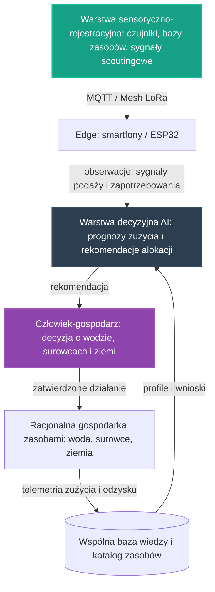

# 30. Koncepcyjny Pilotaż Gospodarki Zasobami Strategicznymi

## **Intelekt wyprzedza Kapitał!**

## Opis Projektu
Ten dokument definiuje koncepcję pilotażu dla osi **Optymalizacja zużycia zasobów strategicznych** — czwartej z [głównych osi rozwoju](../README.md) NARODOWYCH SIŁ INTELEKTUALNYCH POLSKI. Zgodnie z pełnym brzmieniem tej osi w [README](../README.md) chodzi o **racjonalne, poparte zaawansowaną analizą danych, zarządzanie wodą, surowcami i ziemią, eliminujące gospodarkę rabunkową**. Celem pilotażu jest zaprojektowanie otwartego, niskokosztowego wzorca gospodarki zasobami, który porządkuje organizację pracy: od pomiaru i rejestracji zasobów, przez lokalną analizę i rekomendacje alokacji, po decyzję wykonawczą weryfikowaną przez człowieka.

> [!IMPORTANT]
> **Zakres dokumentu:** opisujemy wyłącznie koncepcję organizacji pracy i architekturę narzędzi — bez danych technicznych, parametrów i wyników liczbowych oraz bez wskazywania konkretnych lokalizacji. Zasadę pracy przejmujemy ze wzorca pilotaży medycznego, energetycznego i logistycznego: **AI rekomenduje, zamiast decydować za człowieka** — każda rekomendacja dotycząca wody, surowców i ziemi jest tylko propozycją, a decyzja końcowa zawsze pozostaje po stronie człowieka-gospodarza węzła oraz społeczności, według zasady „Rekomendacje, nie Nakazy" z [projektu 16](16_geoportal_potencjal_rozwoju.md).

Pilotaż nie zaczyna od zera. W repozytorium istnieją już zalążki tego kierunku:

* **[17. Autonomiczne Przetwarzanie Elektrośmieci na Hardware](17_autonomiczne_przetwarzanie_elektrosmieci_na_hardware.md)** — pierwszy, materialny pilot resource scoutingu: elektrośmieci traktowane jako pierwsza dobrze rozpoznana klasa zasobów materialnych, z pętlą „identyfikacja → odzysk → testowanie → katalog → projektowanie reuse → budowa urządzeń", katalogiem donorów i modułów oraz statusami kwalifikacji odzysku,
* **[19. Społeczna Baza Przedmiotów „Zero Waste"](19_spoleczna_baza_przedmiotow.md)** — suwerenna infrastruktura danych o zasobach społeczności: automatyczne rozpoznanie przedmiotu ze zdjęcia, katalogowanie w bazie należącej do społeczności oraz ocena potencjału naprawy i upcyklingu,
* **[05. Laserowy Recykling Paneli PV](05_recykling_pv_laserem.md)** — inspiracja wprost wskazana dla tej osi w [README](../README.md): delaminacja laserowa, która odzyskuje najcenniejsze komponenty zamiast ich niszczyć — wzorzec decyzji „odzysk zamiast gospodarki rabunkowej",
* **[15. Analiza Social Media dla Recyklingu](15_analiza_social_media_recykling.md)** — warstwa resource scoutingu o wysokiej dźwigni: wykrywanie sygnałów darmowej lub taniej podaży, zgłoszeń zapotrzebowania, lokalizacji i czasu odbioru oraz ocena potencjału relacyjnego powstającego z ich połączenia,
* **[README, sekcja „W Przygotowaniu: Autonomiczna Optymalizacja, Analiza Potencjału i Resource Scouting"](../README.md)** — elektrośmieci są pierwszym strategicznym zasobem rozpoznanym ręcznie, a docelowo automatyzacja ma sama wykrywać, klasyfikować i porównywać także inne zasoby: sprzęt, moc obliczeniową, dane, energię, materiały i wolne moce wykonawcze społeczności.

Ten dokument przenosi na grunt gospodarki zasobami wspólny wzorzec warstw wypracowany w pilotażach [25](25_pilot_automatyzacji_zywnosci.md), [26](26_pilot_ai_w_medycynie.md), [27](27_pilot_sieci_energetycznej.md) i [28](28_pilot_logistyki_sasiadzkiej.md): warstwy sensorycznej, decyzyjnej AI na krawędzi oraz pętli nauki z telemetrii. Zgodnie z [Mapą drogową](../ROADMAPA.md) jest to przykład projektu pilotażowego z Fazy 1: niewielka, weryfikowalna realizacja, która dowodzi słuszności koncepcji i staje się wzorcem do powielenia w fazie skalowania.

---

## Proponowane moduły koncepcyjne

Pilotaż projektujemy jako zespół współpracujących warstw, z których każda powstaje w oparciu o gotowe, otwarte komponenty zebrane w repozytorium — zgodnie z Naszą zasadą, że kod już istnieje, a zadaniem twórców jest jego twórcza adaptacja.

### Moduł 1: Warstwa sensoryczno-rejestracyjna
* Fundamenty z **[00. Fundamentów Technologicznych NSIP](00_fundamenty_technologiczne.md)**: **Home Assistant** jako lokalny mózg automatyzacji, **ESPHome** do błyskawicznego tworzenia firmware'u dla czujników i elementów wykonawczych oraz **MQTT** jako lekki protokół komunikacyjny urządzeń IoT.
* Sensorika zużycia — woda i klimat: pomiar jakości wody i przepływu wypracowany w [Inteligentnej Akwakulturze](01_inteligentna_akwakultura.md) oraz pomiar klimatu i sterowanie efektorami z [Automatyzacji Hodowli Grzybów](24_automatyzacja_hodowli_grzybow.md). To dokładnie ta telemetria zużycia — wody w akwakulturze oraz substratów w hodowli grzybów — którą [pilotaż żywnościowy](25_pilot_automatyzacji_zywnosci.md) dostarcza osi czwartej, zgodnie z opisem synergii w [Mapie drogowej](../ROADMAPA.md).
* Rejestracja zasobów materialnych — „sensoryka" tej osi nie kończy się na czujnikach: sygnały podaży, zapotrzebowania i lokalizacji z [projektu 15](15_analiza_social_media_recykling.md), katalog przedmiotów rozpoznawanych ze zdjęcia w [projekcie 19](19_spoleczna_baza_przedmiotow.md), katalog urządzeń-dawców i części z [projektu 13](13_baza_czesci_recykling/README.md) oraz pętla odzysku z [projektu 17](17_autonomiczne_przetwarzanie_elektrosmieci_na_hardware.md) ze statusami kwalifikacji odzysku — od surowego materiału po część ponownie używaną.
* Ziemia: dane geoprzestrzenne i analiza potencjału rozwoju z [projektu 16](16_geoportal_potencjal_rozwoju.md) — analiza terytorium jako podstawa decyzji o lokowaniu procesów automatyzacji, podejmowanych przez ludzi.
* Edge computing w duchu projektów **[06. Smartfony jako Sterowniki](06_smartfony_jako_sterowniki.md)** i **[21. Home Assistant na Smartfonie](21_home_assistant_na_telefonie.md)**: stare urządzenia z odzysku pełnią rolę węzłów pomiarowych, bramek danych i terminali gospodarza.
* Łączność odporna na brak Internetu, w oparciu o sieć Mesh opisaną w **[10. Łączności Mesh i LoRa](10_lacznosc_mesh_lora.md)** — sieć służąca, jak stanowi [README](../README.md), monitorowaniu zasobów gospodarczych także tam, gdzie zawodzi infrastruktura. Kolejność pracy warstwy jest względna: najpierw pomiar i rejestracja zasobu, następnie transmisja przez sieć, na końcu przekazanie obserwacji do warstwy decyzyjnej.

### Moduł 2: Warstwa decyzyjna AI wspierająca alokację zasobów
* Modele uruchamiane na krawędzi (Edge AI) z użyciem silników wskazanych w fundamentach: **TensorFlow Lite** oraz **ONNX Runtime** — analiza wykonywana lokalnie, blisko czujników i baz zasobów, bez uzależnienia od zewnętrznych chmur.
* Kierunki prac wyznaczone przez sekcję „Optymalizacja zużycia zasobów strategicznych" w Fazie 1 [Mapy drogowej](../ROADMAPA.md): **systemy monitoringu i prognozowania zużycia zasobów**, **modele wspierające decyzje o ich alokacji** oraz **narzędzia analityczne pomagające eliminować gospodarkę rabunkową**.
* Kierunek resource scoutingu z [README](../README.md): docelowo automatyzacja ma sama wykrywać, klasyfikować i porównywać klasy zasobów — od elektrośmieci, przez sprzęt i moc obliczeniową, po dane, energię, materiały i wolne moce wykonawcze społeczności — korzystając z metod optymalizacji przywołanych w sekcji README „W Przygotowaniu: Autonomiczna Optymalizacja, Analiza Potencjału i Resource Scouting". [Projekt 17](17_autonomiczne_przetwarzanie_elektrosmieci_na_hardware.md) zapisuje to jako pytanie, które system stawia otoczeniu: jakie zasoby istnieją w otoczeniu i jak przekształcić je w zdolność dalszej automatyzacji.
* Wzorce oceny potencjału: [projekt 15](15_analiza_social_media_recykling.md) ocenia potencjał relacyjny — najwyższy priorytet dostają okazje, w których jednocześnie występują podaż, realne zapotrzebowanie, bliska logistyka i znana ścieżka wykorzystania zasobu; [projekt 19](19_spoleczna_baza_przedmiotow.md) ocenia potencjał naprawy i upcyklingu; [projekt 05](05_recykling_pv_laserem.md) daje wzorzec decyzji technologicznej, w której delaminacja odzyskuje najcenniejsze komponenty tam, gdzie proste mielenie niszczyłoby je bezpowrotnie.
* Wzorzec pracy „edge-first" wypracowany w [projekcie 01](01_inteligentna_akwakultura.md): do wspólnej warstwy wiedzy trafia wynik analizy, a nie surowy strumień danych.
* Wynik analizy w ujednoliconej postaci rekomendacji (poziom ryzyka, rekomendacja, poziom pewności, kody przyczyn) — taki kształt wyniku analitycznego definiuje już kontrakt danych [projektu 01](01_inteligentna_akwakultura.md). Rekomendacja jest zawsze wejściem do decyzji człowieka, nigdy jej zamiennikiem: najpierw AI proponuje plan gospodarki zasobem, następnie człowiek-gospodarz węzła weryfikuje rekomendację, a na końcu zatwierdza lub koryguje decyzję wykonawczą — w sprawach wody, surowców i ziemi głos ludzi pozostaje, zgodnie z [projektem 16](16_geoportal_potencjal_rozwoju.md), słowem rozstrzygającym.

### Moduł 3: Pętla nauki z telemetrii
* Najpierw węzeł zbiera obserwacje i zdarzenia z warstwy sensoryczno-rejestracyjnej — odczyty zużycia, sygnały podaży i zapotrzebowania, przyjęte i odrzucone rekomendacje — następnie warstwa decyzyjna porównuje je z dotychczasową wiedzą o pracy węzła, w kolejnym etapie koryguje prognozy zużycia i rekomendacje alokacji, a na końcu zapisuje wniosek do wspólnej bazy wiedzy.
* Konwencja z [projektu 01](01_inteligentna_akwakultura.md): surowe odczyty trafiają do warstwy operacyjnej poza repozytorium, natomiast do repozytorium wraca wyłącznie wiedza opracowana — snapshoty, raporty zbiorcze i udokumentowane przypadki gospodarki zasobami.
* Katalog zasobów rośnie z każdym cyklem: pętla z [projektu 17](17_autonomiczne_przetwarzanie_elektrosmieci_na_hardware.md) pokazuje, że z odzyskanych zasobów powstaje sprzęt wspierający kolejne procesy — a więc i kolejne pomiary. Wiedza zapisywana jest jako otwarte, wspólne profile w formatach JSON/YAML, na wzór receptur klimatycznych z [projektu 24](24_automatyzacja_hodowli_grzybow.md) — dzięki temu każdy kolejny węzeł rozpoczyna pracę z dorobkiem poprzedników.
* Suwerenność danych o zasobach: w duchu [projektu 19](19_spoleczna_baza_przedmiotow.md) dane o zasobach, potrzebach i zużyciu pozostają własnością społeczności i służą wyłącznie optymalizacji wspólnej gospodarki zasobami, a nie monetyzacji przez komercyjne korporacje.

---

## Zależności od pozostałych osi i pilotaży

Pilotaż nie jest wyspą — korzysta z dorobku sąsiednich osi i sam je wzmacnia, zgodnie z zasadą spójności opisaną w [Mapie drogowej](../ROADMAPA.md). [Mapa drogowa](../ROADMAPA.md) stwierdza wprost: **dorobek tej osi bezpośrednio wzmacnia produkcję żywności (woda, ziemia) oraz gospodarkę energetyczną (surowce)**.

### Żywność (oś pierwsza)
[Zintegrowany Pilotaż Automatyzacji Produkcji Żywności](25_pilot_automatyzacji_zywnosci.md) dostarcza tej osi telemetrię zużycia — wody w akwakulturze oraz substratów w hodowli grzybów — a w kolejnym etapie korzystać będzie z jej narzędzi analitycznych i modeli wspierających decyzje o alokacji zasobów między węzłami produkcji; tak opisuje to synergia osi w [Mapie drogowej](../ROADMAPA.md). Kolejność jest względna: najpierw monitorowanie zużycia w węzłach, następnie wspólne narzędzia analityczne, a przed skalowaniem — modele alokacji między węzłami.

### Energia (oś trzecia)
Surowce z odzysku wzmacniają gospodarkę energetyczną: [Laserowy Recykling Paneli PV](05_recykling_pv_laserem.md) odzyskuje ogniwa ze zużytych modułów zamiast je niszczyć, a [Upcykling LED TV](04_lampa_z_recyklingu_tv.md) zamienia elektrośmieci w działające oświetlenie off-grid — oba projekty są wprost wskazane jako inspiracje tej osi w [README](../README.md). Z kolei [Koncepcyjny Pilotaż Sieci Energetycznej](27_pilot_sieci_energetycznej.md) mierzy własne zużycie energii i w kolejnym etapie współpracuje ze wspólnymi narzędziami analitycznymi tej osi. Elektronika węzłów pomiarowych powstaje z odzysku w duchu [Autonomicznych PCB ze śmieci](12_autonomiczne_pcb_ze_smieci.md).

### Logistyka (oś piąta)
Alokacja zasobów między węzłami wymaga przeniesienia ich w przestrzeni — narzędzia z [Automatyzacji Transportu i Logistyki](18_automatyzacja_transportu_i_logistyki.md) oraz [Logistyki Sąsiedzkiej](20_logistyka_sasiadzka_nawigacja.md), spięte w [Koncepcyjnym Pilotażu Logistyki Sąsiedzkiej](28_pilot_logistyki_sasiadzkiej.md), realizują fizyczną stronę rekomendacji tej osi. Ta sama logika porządkuje sygnały z [projektu 15](15_analiza_social_media_recykling.md): podaż bez logistyki i znanej ścieżki wykorzystania pozostaje potencjałem, nie zasobem.

### Planowanie przestrzenne (oś siódma)
Ziemia to jeden z zasobów tej osi, a decyzje o jej gospodarowaniu opierają się na danych geoprzestrzennych z [projektu 16](16_geoportal_potencjal_rozwoju.md) oraz procesie decyzji o lokalizacji węzłów opisanym w [Koncepcyjnym Pilotażu Planowania Przestrzennego](29_pilot_planowania_przestrzennego.md) — według tej samej zasady „Rekomendacje, nie Nakazy", którą cały ten pilotaż przejmuje.

---

## Miejsce pilotażu na mapie drogowej

* **Faza 0 (Krystalizacja):** ten dokument jest produktem burzy mózgów, analizy i planowania — precyzyjną koncepcją, która powstaje intelektem, nie budżetem.
* **Faza 1 (Pierwsze projekty pilotażowe):** tu jest miejsce tego pilotażu. [Mapa drogowa](../ROADMAPA.md) wprost wymienia tę oś wśród osi Fazy 1 i wskazuje kierunki prac koncepcyjnych: systemy monitoringu i prognozowania zużycia zasobów, modele wspierające decyzje o ich alokacji oraz narzędzia analityczne pomagające eliminować gospodarkę rabunkową.
* **Faza 2 (Skalowanie i samonapędzająca się gospodarka):** gdy pilotaż potwierdzi zasadność koncepcji, produkcja żywności korzysta — zgodnie z opisem Fazy 2 — z energii i optymalizacji zużycia zasobów, logistyka spina produkcję z dystrybucją, a dane i doświadczenia z każdej realizacji poprawiają działanie pozostałych, obniżając koszt następnego projektu.
* **Faza 3 (Finansowanie Dochodu Gwarantowanego):** docelowy punkt — nadwyżki wypracowane przez system wracają do **WSPÓLNEGO DOBRA NARODOWEGO**, finansując **Dochód Gwarantowany (UBI)**.

Granice między fazami są jakościowe, a nie kalendarzowe: fazę zamyka realne osiągnięcie, a nie data. Kolejność prac wewnątrz Fazy 1 nie jest sztywna — osie wzajemnie się napędzają.

---

## Jak społeczność może rozwinąć ten projekt

Ten projekt jest własnością społeczności i tak ma być rozwijany — w otwartym modelu współtworzenia opisanym w **[CONTRIBUTING.md](../CONTRIBUTING.md)**.

* **Dyskusja i analiza:** pytania, pomysły i zastrzeżenia zgłaszaj w zakładce Issues repozytorium — to serce projektu, w którym ma się roić jak w ulu. Każdy komentarz merytoryczny to cenny wkład w **NARODOWY WYSIŁEK INTELEKTUALNY**.
* **Pull Requesty:** dojrzałe zmiany — rozszerzenia koncepcji, dokumentacja, profile wiedzy, adaptery — trafiają do plików poprzez Pull Requesty, dokładnie według instrukcji z [CONTRIBUTING.md](../CONTRIBUTING.md).
* **Ścieżki wkładu:**
  * sensory i węzły pomiarowe z odzysku — czujniki wody i klimatu w węzłach gospodarki zasobami, Home Assistant i ESPHome, adaptacja starych smartfonów,
  * resource scouting i analiza potencjału — rozwój skanowania sygnałów podaży i zapotrzebowania, katalogowanie zasobów i statusów odzysku, ocena potencjału relacyjnego,
  * prognozy i modele alokacji — lekkie modele na krawędzi, ujednolicony kształt rekomendacji, projekty algorytmów alokacji wody, surowców i ziemi,
  * dane geoprzestrzenne i ziemia — praca na danych z [projektu 16](16_geoportal_potencjal_rozwoju.md) według zasady „Rekomendacje, nie Nakazy",
  * kontrakty danych i suwerenność — mapowanie telemetrii zużycia i sygnałów do wspólnego schematu, ochrona danych o zasobach społeczności,
  * eksperci dziedzinowi — [Mapa drogowa](../ROADMAPA.md) wymienia od samego początku ekspertów m.in. od agronomii, bo dorobek tej osi wprost wzmacnia produkcję żywności,
  * dokumentacja i kuracja wiedzy — opisy przypadków gospodarki zasobami, snapshoty, wspólne profile.

Pełnoprawny wkład jest możliwy także bez własnego sprzętu: projektowanie schematów, walidacja danych, analiza przypadków i dokumentacja to praca intelektualna tej samej rangi. Oceniamy pomysły i kod, nie ludzi — a liczy się wyłącznie dokonanie.

---

## Zasoby wewnętrzne w repozytorium
* **[00. Fundamenty Technologiczne NSIP](00_fundamenty_technologiczne.md)** — Home Assistant, ESPHome, MQTT, Edge AI, Mesh.
* **[25. Zintegrowany Pilotaż Automatyzacji Produkcji Żywności](25_pilot_automatyzacji_zywnosci.md)** — wzorzec warstw i pętli nauki, od którego dziedziczymy format.
* **[26. Koncepcyjny Pilotaż AI w Medycynie](26_pilot_ai_w_medycynie.md)**, **[27. Koncepcyjny Pilotaż Sieci Energetycznej](27_pilot_sieci_energetycznej.md)** i **[28. Koncepcyjny Pilotaż Logistyki Sąsiedzkiej](28_pilot_logistyki_sasiadzkiej.md)** — wzorzec decyzji końcowej zawsze po stronie człowieka.
* **[01. Inteligentna Akwakultura](01_inteligentna_akwakultura.md)** — wzorzec edge-first, kontrakt danych, pomiar jakości wody i przepływu.
* **[24. Automatyzacja Hodowli Grzybów](24_automatyzacja_hodowli_grzybow.md)** — sterowanie klimatem i otwarte profile wiedzy w formatach JSON/YAML.
* **[17. Autonomiczne Przetwarzanie Elektrośmieci na Hardware](17_autonomiczne_przetwarzanie_elektrosmieci_na_hardware.md)** — materialny pilot resource scoutingu, katalog donorów i statusy odzysku.
* **[19. Społeczna Baza Przedmiotów „Zero Waste"](19_spoleczna_baza_przedmiotow.md)** — suwerenna baza zasobów społeczności i ocena potencjału upcyklingu.
* **[15. Analiza Social Media dla Recyklingu](15_analiza_social_media_recykling.md)** — warstwa resource scoutingu o wysokiej dźwigni i ocena potencjału relacyjnego.
* **[13. GitHub-first baza części z recyklingu](13_baza_czesci_recykling/README.md)** — katalog urządzeń-dawców i części.
* **[05. Laserowy Recykling Paneli PV](05_recykling_pv_laserem.md)** — odzysk zamiast niszczenia; inspiracja wprost wskazana dla tej osi w README.
* **[04. Upcykling LED TV](04_lampa_z_recyklingu_tv.md)** — elektrośmieci jako źródło działającego sprzętu i kapitału dla **WSPÓLNEGO DOBRA**.
* **[12. Autonomiczne PCB ze śmieci](12_autonomiczne_pcb_ze_smieci.md)** — suwerenna elektronika z odzysku.
* **[16. Geoportal i Potencjał Rozwoju](16_geoportal_potencjal_rozwoju.md)** — dane geoprzestrzenne i zasada „Rekomendacje, nie Nakazy".
* **[29. Koncepcyjny Pilotaż Planowania Przestrzennego](29_pilot_planowania_przestrzennego.md)** — proces decyzji o lokalizacji węzłów na danych geoprzestrzennych.
* **[18. Automatyzacja Transportu i Logistyki](18_automatyzacja_transportu_i_logistyki.md)** oraz **[20. Logistyka Sąsiedzka i Optymalizacja Tras](20_logistyka_sasiadzka_nawigacja.md)** — fizyczna strona alokacji zasobów między węzłami.
* **[06. Smartfony jako Sterowniki](06_smartfony_jako_sterowniki.md)** i **[21. Home Assistant na Smartfonie](21_home_assistant_na_telefonie.md)** — edge computing z odzysku.
* **[10. Łączność Mesh i LoRa](10_lacznosc_mesh_lora.md)** — suwerenna łączność do monitorowania zasobów gospodarczych.
* **[Mapa drogowa (ROADMAPA.md)](../ROADMAPA.md)** — fazy rozwoju, kierunki prac tej osi i zasady ich przechodzenia.
* **[CONTRIBUTING.md](../CONTRIBUTING.md)** — jak zgłaszać pomysły i współtworzyć repozytorium.

---
*Intelekt wyprzedza Kapitał!*

**Nawet tu kod już jest — brakuje tylko Ciebie.**
