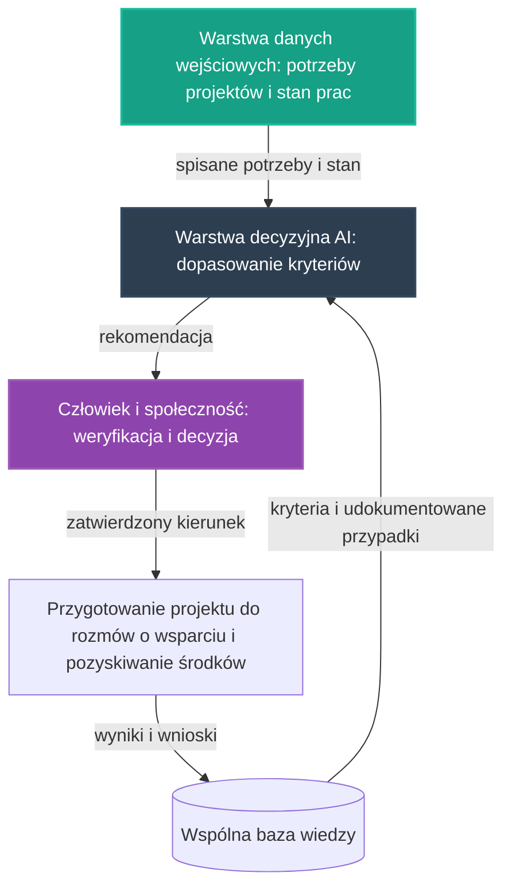

# 31. Koncepcyjny Pilotaż Finansowania Inicjatywy

## **Intelekt wyprzedza Kapitał!**

## Opis Projektu
Ten dokument definiuje koncepcję pilotażu dla osi **Finanse (Fundusze)** — szóstej z [głównych osi rozwoju](../README.md) NARODOWYCH SIŁ INTELEKTUALNYCH POLSKI. Zgodnie z brzmieniem tej osi w [README](../README.md) chodzi o **pozyskiwanie środków strategicznych oraz inteligentny wybór programów grantowych i inwestycji dla nowo powstających projektów**. Celem pilotażu jest zaprojektowanie otwartego, powtarzalnego **procesu decyzji o wspieraniu projektów**: od spisanych potrzeb i realnego stanu prac, przez analizę AI dopasowującą kryteria, po weryfikację i decyzję, która zawsze należy do człowieka i społeczności.

> [!IMPORTANT]
> **Zakres dokumentu:** opisujemy wyłącznie koncepcję organizacji procesu — kryteria wyboru, kolejność względną, weryfikację przez ludzi i przejrzystość. To **proces, nie katalog**: nie wymieniamy żadnych nazw programów, instytucji ani podmiotów i nie podajemy kwot, procentów, dat ani terminów. Miarą postępu jest stan prac i jakość treści, a nie kalendarz — dokładnie tak, jak czytamy w [MARKETING.md](../MARKETING.md). Zasadą pracy pilotażu, przejętą ze wzorca pilotażu medycznego i energetycznego, jest to, że **AI wspiera decyzje, zamiast zastępować człowieka** — rekomendacja jest zawsze wejściem do decyzji człowieka, nigdy jej zamiennikiem.

Pilotaż nie zaczyna od zera. W repozytorium istnieją już zalążki tego kierunku:

* **[25. Zintegrowany Pilotaż Automatyzacji Produkcji Żywności](25_pilot_automatyzacji_zywnosci.md)** — wspólny wzorzec warstw: sensorycznej, decyzyjnej AI na krawędzi oraz pętli nauki z telemetrii; ten dokument przenosi ten wzorzec na grunt finansów, zamieniając warstwy sensoryczne na warstwy procesu decyzyjnego,
* **[26. Koncepcyjny Pilotaż AI w Medycynie](26_pilot_ai_w_medycynie.md)**, **[27. Koncepcyjny Pilotaż Sieci Energetycznej](27_pilot_sieci_energetycznej.md)**, **[28. Koncepcyjny Pilotaż Logistyki Sąsiedzkiej](28_pilot_logistyki_sasiadzkiej.md)** i **[29. Koncepcyjny Pilotaż Planowania Przestrzennego](29_pilot_planowania_przestrzennego.md)** — dowiodły, że wspólny wzorzec da się przenieść na dowolny grunt; [projekt 29](29_pilot_planowania_przestrzennego.md) opisuje już proces decyzji o lokowaniu węzłów według zasady **„Rekomendacje, nie Nakazy"** — tu tę samą zasadę stosujemy do decyzji o wspieraniu projektów,
* **[04. Upcykling LED TV](04_lampa_z_recyklingu_tv.md)** — przykład finansowania wskazany wprost w [README](../README.md): upcykling elektrośmieci zamienia odpady w kapitał wspierający wspólne dobro,
* pierwsze realne kroki pozyskiwania środków opisuje również [README](../README.md) — zrzutka na dokończenie i skalowanie systemu **Trash-to-Cash**, której środki przeznaczane są m.in. na opłaty API dla modeli AI, budowę ogólnopolskiej bazy wyceny e-odpadów oraz formalizację inicjatywy; pilotaż porządkuje ten rodzaj działań we wspólny, powtarzalny proces, zamiast pozostawiać go przypadkowi.

[Mapa drogowa](../ROADMAPA.md) w sekcji o synergii osi pisze wprost, że oś **Finanse (Fundusze)** — „zasilająca rozwój kolejnych projektów" — wraz z logistyką stanowi element spinający całości, a jej konkretne spięcia z pilotażem żywności „to kierunki dalszych projektów – miejsce na kolejne koncepcje, nie deklaracje". Ten dokument jest właśnie taką koncepcją. Zgodnie z [Mapą drogową](../ROADMAPA.md) jest to przykład projektu pilotażowego z Fazy 1: niewielka, weryfikowalna realizacja, która dowodzi słuszności koncepcji i staje się wzorcem do powielenia.

---

## Proponowane moduły koncepcyjne

Pilotaż projektujemy jako zespół współpracujących warstw. Zamiast czujników i efektorów — jak w pilotażach produkcji — warstwami są tu etapy procesu decyzji o wspieraniu projektów. Każda warstwa powstaje w oparciu o wzorce już wypracowane w repozytorium — zgodnie z Naszą zasadą, że kod już istnieje, a zadaniem twórców jest jego twórcza adaptacja.

### Moduł 1: Warstwa danych wejściowych — potrzeby projektów i stan prac
* Źródłem danych wejściowych są realne zasoby repozytorium: koncepcje projektów w folderze **PROJEKTY** (m.in. pilotaże [25](25_pilot_automatyzacji_zywnosci.md), [26](26_pilot_ai_w_medycynie.md), [27](27_pilot_sieci_energetycznej.md), [28](28_pilot_logistyki_sasiadzkiej.md) i [29](29_pilot_planowania_przestrzennego.md)), dyskusje w Issues oraz [Mapa drogowa](../ROADMAPA.md).
* Dla każdego projektu spisujemy dwie rzeczy: **potrzeby** — jakiego wsparcia projekt wymaga (środki strategiczne, przygotowanie do rozmów o wsparciu, partnerzy, wiedza ekspertów) — oraz **stan projektu** — co już realnie powstało: koncepcja, zalążek, dokumentacja, pierwsze dokonania.
* Wzorzec pracy „edge-first" wypracowany w [projekcie 01](01_inteligentna_akwakultura.md), adaptowany do tego procesu: do wspólnej warstwy wiedzy trafia wynik analizy, a nie surowe materiały źródłowe projektów.
* Kolejność pracy warstwy jest względna: najpierw spisane potrzeby i stan prac, dopiero potem analiza. Projekt bez opisanego stanu prac nie wchodzi do porównania — w tej inicjatywie liczą się wyłącznie dokonania.

### Moduł 2: Warstwa decyzyjna AI — dopasowanie kryteriów
* Warstwa analizy porównuje spisane potrzeby i stan prac z zestawem kryteriów zaczerpniętych wprost z dokumentów inicjatywy:
  * **zgodność z misją WSPÓLNEGO DOBRA** — [Mapa drogowa](../ROADMAPA.md) stanowi: „jeśli pomysł temu nie służy, nie należy do naszej mapy";
  * **zgodność z sekcją „Czego NIE robimy"** [Mapy drogowej](../ROADMAPA.md) — m.in. brak uzależniania się od podmiotów zewnętrznych, synergia z gospodarką państwową zamiast rywalizacji oraz zasada, że kapitał nigdy nie stoi ponad intelektem;
  * **gotowość koncepcyjna** — zgodnie z [Mapą drogową](../ROADMAPA.md) środki z osi finansowej wspierają projekty najbliżej gotowości koncepcyjnej;
  * **zależności między osiami** — jak w pilotażu [25](25_pilot_automatyzacji_zywnosci.md) stabilna i tania energia jest warunkiem produkcji, tak kolejność wspierania projektów uwzględnia spięcia osi opisane w [Mapie drogowej](../ROADMAPA.md);
  * **rodzaj potrzebnego wsparcia** — [Mapa drogowa](../ROADMAPA.md) wymienia tu przygotowanie projektów z pozostałych osi do rozmów o wsparciu oraz budowę fundamentów relacji partnerskich, przy czym współpraca B2B i sponsoring to, zgodnie z [MARKETING.md](../MARKETING.md), działania późniejszego etapu.
* Wynik analizy w ujednoliconej postaci rekomendacji (poziom ryzyka, rekomendacja, poziom pewności, kody przyczyn) — taki kształt wyniku analitycznego definiuje kontrakt danych [projektu 01](01_inteligentna_akwakultura.md), a przejmują go pilotaże [25](25_pilot_automatyzacji_zywnosci.md) i [27](27_pilot_sieci_energetycznej.md).
* Analiza uszeregowuje projekty i proponuje kierunek wsparcia — nigdy nie przesądza go sama.

### Moduł 3: Weryfikacja przez ludzi — decyzja zawsze należy do człowieka
* Rekomendacja AI jest zawsze wejściem do decyzji człowieka, nigdy jej zamiennikiem: najpierw AI proponuje uszeregowanie projektów, następnie ludzie weryfikują kryteria oraz kontekst, którego analiza mogła nie uwzględnić, a na końcu człowiek i społeczność zatwierdzają lub korygują decyzję.
* Zasada **„Rekomendacje, nie Nakazy"** — wywodząca się z [projektu 16](16_geoportal_potencjal_rozwoju.md) i stosowana w [projekcie 29](29_pilot_planowania_przestrzennego.md) — obowiązuje tu w pełni: AI proponuje, a decydują ludzie.
* W miarę rozwoju inicjatywy decyzje o kierunku zmian należą do **Opiekunów Projektu** — jak opisuje [CONTRIBUTING.md](../CONTRIBUTING.md), wyłanianych wyłącznie spośród najbardziej zaangażowanych twórców; [Mapa drogowa](../ROADMAPA.md) powierza Opiekunom dbanie o to, by kolejne etapy opierały się na realnych dokonaniach, a nie na deklaracjach.
* Każda decyzja pozostawia publiczny ślad w Issues i Pull Requestach — według konwencji ewidencji efektów z [MARKETING.md](../MARKETING.md): opis stanu prac i jakości treści, bez metryk liczbowych. Przejrzystość jest warunkiem zaufania, a zaufanie — warunkiem pozyskiwania środków.

### Moduł 4: Pętla nauki z wyników decyzji
* Najpierw proces zbiera podjęte decyzje i ich uzasadnienia, następnie porównuje je z rekomendacjami warstwy decyzyjnej, w kolejnym etapie koryguje zestaw kryteriów i ich wagę, a na końcu zapisuje wniosek do wspólnej bazy wiedzy.
* Konwencja z [projektu 01](01_inteligentna_akwakultura.md): do repozytorium wraca wyłącznie wiedza opracowana — udokumentowane przypadki decyzji, uzasadnienia kryteriów i wnioski — dzięki czemu każdy kolejny cykl wsparcia rozpoczyna pracę z dorobkiem poprzedników.
* Dokumentowanie efektów nie jest formalnością — jest służbą dla **WSPÓLNEGO DOBRA**, jak czytamy w [MARKETING.md](../MARKETING.md): praca udokumentowana w repozytorium zostaje i przemawia sama za siebie — także wtedy, gdy jej autor odpoczywa.

---

## Zasady porządkujące proces

* **Decyzja zawsze należy do człowieka.** AI dopasowuje kryteria i proponuje uszeregowanie; zatwierdza je człowiek i społeczność.
* **Przejrzystość.** Kryteria są jawne i oparte na dokumentach inicjatywy, a decyzje zostawiają publiczny ślad w Issues i Pull Requestach — jedynym rejestrem jest samo repozytorium, jak czytamy w [MARKETING.md](../MARKETING.md).
* **Kolejność względna, nie kalendarz.** Sekwencję działań przejmujemy z [MARKETING.md](../MARKETING.md): najpierw treści i jakość samego repozytorium, w kolejnym etapie komunikacja opowiadająca o owocach tej pracy, a na końcu kapitał zewnętrzny, który wspiera to, co już działa — „Partnerów przyciąga nie obietnica, lecz dokonanie". Przed skalowaniem proces wspiera przede wszystkim dojrzewanie projektów; relacje partnerskie budowane są w późniejszym etapie, na widocznych dokonaniach.
* **Środki wspierają projekty, nie odwrotnie.** Zgodnie z [Mapą drogową](../ROADMAPA.md) to środki z osi finansowej wspierają projekty najbliżej gotowości koncepcyjnej — nigdy projekt nie jest dopasowywany do pieniędzy za wszelką cenę.
* **Bez liczb i bez obietnic.** Nie operujemy kwotami ani terminami; mierzymy stanem prac i jakością treści, a o przejściu do kolejnych etapów decydują realne osiągnięcia — nie deklaracje.

---

## Zależności od pozostałych osi i pilotaży

Pilotaż nie jest wyspą — korzysta z dorobku sąsiednich osi i sam zasila je, zgodnie z zasadą spójności opisaną w [Mapie drogowej](../ROADMAPA.md).

### Oś finansowa jako pomost między koncepcją a produkcją
[Mapa drogowa](../ROADMAPA.md) pisze wprost: „Ta oś jest pomostem między koncepcją a uruchomieniem produkcji: intelekt wyprzedza kapitał, ale kapitał w służbie idei musi najpierw znaleźć swoją drogę." Pilotaż buduje właśnie tę drogę jako proces: projekt najpierw dojrzewa intelektem — w burzy mózgów i pracach koncepcyjnych — następnie przechodzi przez spisanie potrzeb i analizę kryteriów, a wsparcie trafia do projektów najbliżej gotowości koncepcyjnej.

### Pilotaże osi technologicznych — odbiorcy i dostawcy danych
* Koncepcyjne pilotaże [25](25_pilot_automatyzacji_zywnosci.md), [26](26_pilot_ai_w_medycynie.md), [27](27_pilot_sieci_energetycznej.md), [28](28_pilot_logistyki_sasiadzkiej.md) i [29](29_pilot_planowania_przestrzennego.md) zasilają warstwę danych wejściowych swoimi potrzebami i stanem prac — a w drugą stronę korzystają z uporządkowanego, przejrzystego procesu wsparcia.
* [Mapa drogowa](../ROADMAPA.md) w opisie Fazy 2 („Od projektów do systemu") stawia finansowanie w środku tego obiegu: „finanse zasilają rozwój kolejnych projektów". Ten pilotaż jest koncepcją pierwszego ogniwa tego obiegu.

### MARKETING.md: relacje partnerskie w późniejszym etapie
Sekcja „5. Współpraca B2B / Sponsoring (w późniejszym etapie)" [MARKETING.md](../MARKETING.md) opisuje budowanie relacji partnerskich z podmiotami mogącymi wesprzeć projekt zasięgowo, a sekcja 6 porządkuje kolejność: relacje te powstają dopiero po zbudowaniu realnych dokonań. Pilotaż przyjmuje tę sekwencję jako własną: najpierw przygotowanie projektów i jakość repozytorium, w późniejszym etapie — fundamenty relacji partnerskich oparte na dokonaniach, nigdy na obietnicach.

### Synergia z gospodarką państwową
[README](../README.md) stanowi: **„Naszym celem jest synergia, a nie rywalizacja."** [Mapa drogowa](../ROADMAPA.md) rozwija to w sekcjach o synergii z tradycyjną gospodarką państwową oraz w „Czego NIE robimy": nie konkurujemy z gospodarką państwową i nie uzależniamy się od struktur oraz podmiotów zewnętrznych. Proces z tego pilotażu sprawdza wprost każdy projekt i każde potencjalne wsparcie pod tym kątem — wspieramy to, co wzmacnia gospodarkę państwową, a inicjatywa pozostaje całkowicie oddolna.

---

## Miejsce pilotażu na mapie drogowej

* **Faza 0 (Krystalizacja):** ten dokument jest produktem burzy mózgów, analizy i planowania — precyzyjną koncepcją, która powstaje intelektem, nie budżetem.
* **Faza 1 (Pierwsze projekty pilotażowe):** tu jest miejsce tego pilotażu. [Mapa drogowa](../ROADMAPA.md) wprost wymienia **Finanse (Fundusze)** wśród osi Fazy 1 i wskazuje kierunki prac koncepcyjnych: opracowanie metod oceny, które projekty uruchamiać w pierwszej kolejności, przygotowanie projektów z pozostałych osi do rozmów o wsparciu oraz budowę fundamentów relacji partnerskich — przy czym współpraca B2B i sponsoring to, zgodnie z [MARKETING.md](../MARKETING.md), działania późniejszego etapu.
* **Faza 2 (Skalowanie i samonapędzająca się gospodarka):** gdy pilotaż potwierdzi zasadność koncepcji, proces decyzji wspiera dyscyplinę zwrotu opisaną w [Mapie drogowej](../ROADMAPA.md): wygenerowany produkt i zysk nie są konsumowane, lecz wracają do systemu — finansują kolejne projekty koncepcyjne, kolejne moduły produkcyjne i rozwój pozostałych osi.
* **Faza 3 (Finansowanie Dochodu Gwarantowanego):** docelowy punkt. [Mapa drogowa](../ROADMAPA.md) stanowi: **„Do tej fazy nie przechodzimy obietnicami, lecz zasobami."** Dyscyplina wyćwiczona w tym pilotażu — decyzje na podstawie realnego stanu prac, weryfikacja przez ludzi, przejrzysta ewidencja — jest bezpośrednim treningiem tej zasady: społeczność i Opiekunowie Projektu potwierdzają wtedy gotowość systemu do zwrotu wartości na rzecz ogółu obywateli, a nadwyżki wypracowane przez system wracają do **WSPÓLNEGO DOBRA NARODOWEGO**.

Granice między fazami są jakościowe, a nie kalendarzowe: fazę zamyka realne osiągnięcie, a nie data. Kolejność prac wewnątrz Fazy 1 nie jest sztywna — osie wzajemnie się napędzają.

---

## Jak społeczność może rozwinąć ten projekt

Ten projekt jest własnością społeczności i tak ma być rozwijany — w otwartym modelu współtworzenia opisanym w **[CONTRIBUTING.md](../CONTRIBUTING.md)**.

* **Dyskusja i analiza:** pytania, pomysły i zastrzeżenia zgłaszaj w zakładce Issues repozytorium — to serce projektu, w którym ma się roić jak w ulu. Każdy komentarz merytoryczny to cenny wkład w **NARODOWY WYSIŁEK INTELEKTUALNY**.
* **Pull Requesty:** dojrzałe zmiany — rozszerzenia koncepcji, dokumentacja, uszczegółowienia kryteriów — trafiają do plików poprzez Pull Requesty, dokładnie według instrukcji z [CONTRIBUTING.md](../CONTRIBUTING.md).
* **Ścieżki wkładu:**
  * analiza i kryteria — praca nad zestawem kryteriów dopasowania, ich przejrzystym opisem i uzasadnieniami,
  * przygotowanie projektów — spisywanie potrzeb i stanu prac projektów z pozostałych osi do rozmów o wsparciu (kierunek wprost z [Mapy drogowej](../ROADMAPA.md)),
  * eksperci dziedzinowi — [Mapa drogowa](../ROADMAPA.md) wymienia finanse wśród dziedzin, z których eksperci są potrzebni społeczności od samego początku,
  * dokumentacja i kuracja wiedzy — udokumentowane przypadki decyzji, uzasadnienia kryteriów i wnioski trafiające do wspólnej bazy wiedzy.

Pełnoprawny wkład jest możliwy także bez własnego sprzętu i bez budżetu: projektowanie procesu, analiza kryteriów i dokumentacja to praca intelektualna tej samej rangi. Oceniamy pomysły i kod, nie ludzi — a liczy się wyłącznie dokonanie.

---

## Zasoby wewnętrzne w repozytorium
* **[Mapa drogowa (ROADMAPA.md)](../ROADMAPA.md)** — oś Finanse (Fundusze) w Fazie 1, fazy rozwoju, Faza 3 („Do tej fazy nie przechodzimy obietnicami, lecz zasobami"), synergie osi i sekcja „Czego NIE robimy".
* **[MARKETING.md](../MARKETING.md)** — sekcja 5 „Współpraca B2B / Sponsoring (w późniejszym etapie)", sekcja 6 o względnej kolejności działań oraz sekcja 8 o ewidencji efektów.
* **[CONTRIBUTING.md](../CONTRIBUTING.md)** — jak zgłaszać pomysły i współtworzyć; rola i decyzje Opiekunów Projektu.
* **[README](../README.md)** — oś 6 „Finanse (Fundusze)", przykład finansowania przez upcykling, zrzutka Trash-to-Cash oraz zasada „Naszym celem jest synergia, a nie rywalizacja".
* **[04. Upcykling LED TV](04_lampa_z_recyklingu_tv.md)** — przykład finansowania wskazany wprost w README.
* **[16. Geoportal i Potencjał Rozwoju](16_geoportal_potencjal_rozwoju.md)** — źródło zasady „Rekomendacje, nie Nakazy".
* **[01. Inteligentna Akwakultura](01_inteligentna_akwakultura.md)** — wzorzec edge-first, kontrakt danych i kształt rekomendacji.
* **[25. Zintegrowany Pilotaż Automatyzacji Produkcji Żywności](25_pilot_automatyzacji_zywnosci.md)** — wspólny wzorzec warstw i pętli nauki, od którego dziedziczymy format.
* **[26. Koncepcyjny Pilotaż AI w Medycynie](26_pilot_ai_w_medycynie.md)**, **[27. Koncepcyjny Pilotaż Sieci Energetycznej](27_pilot_sieci_energetycznej.md)**, **[28. Koncepcyjny Pilotaż Logistyki Sąsiedzkiej](28_pilot_logistyki_sasiadzkiej.md)** i **[29. Koncepcyjny Pilotaż Planowania Przestrzennego](29_pilot_planowania_przestrzennego.md)** — wzorce przenoszenia wspólnego formatu na kolejne osie oraz pierwsi odbiorcy procesu wsparcia.

---
*Intelekt wyprzedza Kapitał!*

**Nawet tu kod już jest — brakuje tylko Ciebie.**
