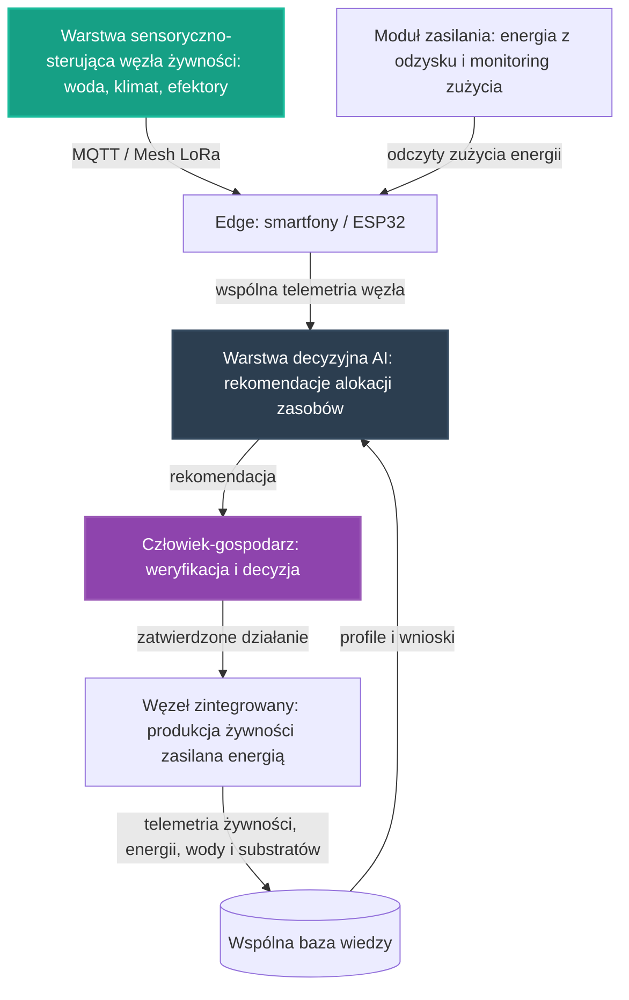

# 32. Koncepcyjny Pilotaż Węzła Zintegrowanego

## **Intelekt wyprzedza Kapitał!**

## Opis Projektu
Ten dokument definiuje koncepcję pierwszego pilotażu poprzecznego [głównych osi rozwoju](../README.md) NARODOWYCH SIŁ INTELEKTUALNYCH POLSKI — spięcia, które łączy trzy osie naraz w jednym, wspólnym węźle: **węzeł produkcji żywności** według wzorca pilotażu żywnościowego, **zasilany energią** według wzorca pilotażu energetycznego oraz **zarządzany zasobami** według wzorca pilotażu gospodarki zasobami (woda i substraty, wspólna telemetria). Celem pilotażu jest zaprojektowanie otwartego, niskokosztowego wzorca **węzła zintegrowanego**: jednej realizacji, w której warstwy wypracowane osobno na poszczególnych osiach pracują razem — od pomiaru, przez lokalną analizę i rekomendacje, po decyzje wykonawcze weryfikowane przez człowieka.

> [!IMPORTANT]
> **Zakres dokumentu:** opisujemy wyłącznie koncepcję organizacji pracy i architekturę narzędzi — bez danych technicznych, parametrów i wyników liczbowych oraz bez wskazywania konkretnych lokalizacji. Zasadę pracy przejmujemy ze wzorca pilotaży, na których się opieramy: **rekomendacja jest zawsze wejściem do decyzji człowieka, nigdy jej zamiennikiem** — każda rekomendacja dotycząca produkcji, energii, wody i substratów jest tylko propozycją, a decyzja końcowa zawsze pozostaje po stronie człowieka-gospodarza węzła oraz społeczności.

Pilotaż nie zaczyna od zera. W repozytorium istnieją już zalążki tego kierunku:

* **[25. Zintegrowany Pilotaż Automatyzacji Produkcji Żywności](25_pilot_automatyzacji_zywnosci.md)** — wspólny wzorzec autonomicznego węzła produkcji żywności: warstwa sensoryczna i sterowanie (Home Assistant, ESPHome, MQTT), warstwa decyzyjna AI na krawędzi oraz pętla nauki z telemetrii; pilotaż od pierwszego szkicu projektowany jest tak, aby najpierw mierzyć własne zużycie energii, a dostarczana przez niego telemetria zużycia — wody w akwakulturze oraz substratów w hodowli grzybów — zasila oś czwartą,
* **[27. Koncepcyjny Pilotaż Sieci Energetycznej](27_pilot_sieci_energetycznej.md)** — wzorzec węzła energetycznego: od pomiaru i łączności, przez lokalną analizę i prognozy, po decyzje wykonawcze weryfikowane przez człowieka; kolejność względna: najpierw pomiar własnego zużycia, w kolejnym etapie jego ograniczanie, a docelowo korzystanie z planowania, magazynowania i dystrybucji energii,
* **[30. Koncepcyjny Pilotaż Gospodarki Zasobami Strategicznymi](30_pilot_gospodarki_zasobami.md)** — wzorzec gospodarki zasobami: rejestracja i scouting zasobów, prognozy zużycia oraz rekomendacje alokacji na krawędzi, z decyzją zawsze po stronie człowieka-gospodarza — według zasady „pomiar, rekomendacja, decyzja człowieka, a wypracowany wniosek wraca do wspólnej bazy wiedzy".

Motywacją tego dokumentu jest sekcja **„Synergie osi"** [Mapy drogowej](../ROADMAPA.md): pokazuje ona [pilotaż żywnościowy](25_pilot_automatyzacji_zywnosci.md) jako punkt styku osi, a jej podsekcja **„Kolejne spięcia osi"** opisuje pierwsze odpowiedzi na zaproszenie do łączenia osi — [pilotaż gospodarki zasobami](30_pilot_gospodarki_zasobami.md) oraz [pilotaż finansowania](31_pilot_finansowania_inicjatywy.md). Ten dokument jest kolejną odpowiedzią na to samo zaproszenie: spinamy w jednym węźle spięcie, które [Mapa drogowa](../ROADMAPA.md) opisuje w podrozdziale **„Od projektów do systemu"** zdaniem: **produkcja żywności korzysta z energii i optymalizacji zużycia zasobów**. Zgodnie z [Mapą drogową](../ROADMAPA.md) jest to przykład projektu pilotażowego z Fazy 1: niewielka, weryfikowalna realizacja, która dowodzi słuszności koncepcji i staje się wzorcem do powielenia w fazie skalowania.

---

## Proponowane moduły koncepcyjne

Pilotaż projektujemy jako zespół współpracujących warstw. Warstwy te nie są nowe — to te same warstwy, które pilotaże [25](25_pilot_automatyzacji_zywnosci.md), [27](27_pilot_sieci_energetycznej.md) i [30](30_pilot_gospodarki_zasobami.md) wypracowały osobno na swoich osiach; nowością jest ich wspólne życie w jednym węźle. Każda warstwa powstaje w oparciu o gotowe, otwarte komponenty zebrane w repozytorium — zgodnie z Naszą zasadą, że kod już istnieje, a zadaniem twórców jest jego twórcza adaptacja.

### Moduł 1: Warstwa sensoryczno-sterująca węzła żywności — konwencja [pilotażu 25](25_pilot_automatyzacji_zywnosci.md)
* Fundamenty z **[00. Fundamentów Technologicznych NSIP](00_fundamenty_technologiczne.md)**: **Home Assistant** jako lokalny mózg automatyzacji, **ESPHome** do błyskawicznego tworzenia firmware'u dla czujników i elementów wykonawczych oraz **MQTT** jako lekki protokół komunikacyjny urządzeń IoT — dokładnie tak, jak opisuje to [pilotaż żywnościowy](25_pilot_automatyzacji_zywnosci.md).
* Sensorika zaczerpnięta z zalążków, z których korzysta [pilotaż 25](25_pilot_automatyzacji_zywnosci.md): pomiar jakości wody i przepływu z [Inteligentnej Akwakultury](01_inteligentna_akwakultura.md) oraz pomiar klimatu (temperatura, wilgotność, stężenie dwutlenku węgla) i sterowanie efektorami komory z [Automatyzacji Hodowli Grzybów](24_automatyzacja_hodowli_grzybow.md).
* Edge computing w duchu projektów **[06. Smartfony jako Sterowniki](06_smartfony_jako_sterowniki.md)** i **[21. Home Assistant na Smartfonie](21_home_assistant_na_telefonie.md)**: stare urządzenia z odzysku pełnią rolę węzłów sterujących, bramek danych i kamer inspekcyjnych.
* Łączność odporna na brak Internetu, w oparciu o sieć Mesh opisaną w **[10. Łączności Mesh i LoRa](10_lacznosc_mesh_lora.md)** — dla węzłów pracujących daleko od infrastruktury.

### Moduł 2: Zasilanie i monitoring zużycia energii — konwencja [pilotażu 27](27_pilot_sieci_energetycznej.md)
* Kolejność pracy przejęta wprost z [pilotażu energetycznego](27_pilot_sieci_energetycznej.md): najpierw węzeł mierzy własne zużycie energii, w kolejnym etapie ogranicza je na drodze optymalizacji sterowania, a docelowo korzysta z planowania, magazynowania i dystrybucji energii rozwijanych na osi Energia — bo to stabilna i tania energia, jak stanowi [Mapa drogowa](../ROADMAPA.md), jest warunkiem autonomicznej produkcji żywności.
* Elementy zasilania powstają z odzysku, nie z zakupów: [Laserowy Recykling Paneli PV](05_recykling_pv_laserem.md) odzyskuje ogniwa ze zużytych modułów zamiast je niszczyć, [Upcykling LED TV](04_lampa_z_recyklingu_tv.md) pokazuje układy off-grid zasilane panelami solarnymi i akumulatorami, a [projekt 06](06_smartfony_jako_sterowniki.md) wskazuje stare smartfony jako centralne sterowniki systemów off-grid i magazynów energii.
* Odczyty zużycia energii trafiają do tej samej warstwy decyzyjnej co telemetria produkcji — dzięki temu węzeł widzi pracę żywności, energii i zasobów jako jedną całość, a nie trzy osobne strumienie danych.

### Moduł 3: Warstwa decyzyjna AI wspierająca alokację zasobów — konwencja [pilotażu 30](30_pilot_gospodarki_zasobami.md)
* Modele uruchamiane na krawędzi (Edge AI) z użyciem silników wskazanych w fundamentach: **TensorFlow Lite** oraz **ONNX Runtime** — analiza wykonywana lokalnie, blisko czujników, bez uzależnienia od zewnętrznych chmur.
* Kierunki prac wyznaczone przez sekcję „Optymalizacja zużycia zasobów strategicznych" w Fazie 1 [Mapy drogowej](../ROADMAPA.md): **systemy monitoringu i prognozowania zużycia zasobów**, **modele wspierające decyzje o ich alokacji** oraz **narzędzia analityczne pomagające eliminować gospodarkę rabunkową**.
* Materiał wejściowy tej warstwy to wspólna telemetria węzła: zużycie wody w akwakulturze oraz substratów w hodowli grzybów — dokładnie te dane, które [pilotaż żywnościowy](25_pilot_automatyzacji_zywnosci.md) dostarcza osi czwartej — uzupełnione o odczyty zużycia energii z modułu zasilania. Wynik analizy ma ujednoliconą postać rekomendacji (poziom ryzyka, rekomendacja, poziom pewności, kody przyczyn) — taki kształt wyniku analitycznego definiuje kontrakt danych [projektu 01](01_inteligentna_akwakultura.md).
* **Zasada nadrzędna, przejęta z [pilotażu gospodarki zasobami](30_pilot_gospodarki_zasobami.md): rekomendacja jest zawsze wejściem do decyzji człowieka, nigdy jej zamiennikiem.** Najpierw AI proponuje plan gospodarowania zasobami węzła, następnie człowiek-gospodarz weryfikuje rekomendację, a na końcu zatwierdza lub koryguje decyzję wykonawczą — według zasady „Rekomendacje, nie Nakazy" z [projektu 16](16_geoportal_potencjal_rozwoju.md).

### Moduł 4: Pętla nauki ze wspólną telemetrią
* Najpierw węzeł zbiera obserwacje i zdarzenia ze wszystkich swoich warstw — cykle produkcyjne, odczyty zużycia energii, zużycie wody i substratów, przyjęte i odrzucone rekomendacje — następnie warstwa decyzyjna porównuje je z dotychczasową wiedzą o pracy węzła, w kolejnym etapie koryguje sterowanie i rekomendacje alokacji, a na końcu zapisuje wniosek do wspólnej bazy wiedzy.
* Konwencja z [projektu 01](01_inteligentna_akwakultura.md): surowe odczyty trafiają do warstwy operacyjnej poza repozytorium, natomiast do repozytorium wraca wyłącznie wiedza opracowana — snapshoty, raporty zbiorcze i udokumentowane przypadki pracy węzła zintegrowanego.
* Wiedza zapisywana jest jako otwarte, wspólne profile w formatach JSON/YAML, na wzór receptur klimatycznych z [projektu 24](24_automatyzacja_hodowli_grzybow.md) — dzięki temu każdy kolejny węzeł, także czysto żywnościowy czy czysto energetyczny, rozpoczyna pracę z dorobkiem poprzedników.
* To jest koncepcyjna realizacja spięcia opisanego w [Mapie drogowej](../ROADMAPA.md): **dane i doświadczenia z każdej realizacji poprawiają działanie pozostałych** — telemetria węzła zintegrowanego zasila jednocześnie wzorzec produkcji żywności, wzorzec gospodarki energetycznej oraz wspólne narzędzia analityczne osi zasobów.

---

## Zależności od pozostałych osi i pilotaży

Pilotaż nie jest wyspą — sam jest spięciem osi, więc jego zależności są podwójne: korzysta z dorobku trzech pilotaży osiowych i zarazem zasila je wspólną telemetrią, zgodnie z zasadą spójności opisaną w [Mapie drogowej](../ROADMAPA.md).

### Żywność (oś pierwsza)
Węzeł produkcji żywności to rdzeń węzła zintegrowanego — jego warstwy, sensorika i pętla nauki pochodzą wprost z [Zintegrowanego Pilotażu Automatyzacji Produkcji Żywności](25_pilot_automatyzacji_zywnosci.md). [Mapa drogowa](../ROADMAPA.md) w sekcji o synergii osi opisuje ten pilotaż jako punkt styku osi, projektowany od pierwszego szkicu tak, by korzystał z dorobku sąsiednich osi — ten dokument realizuje tę zapowiedź w jednej, wspólnej realizacji.

### Energia (oś trzecia)
[Mapa drogowa](../ROADMAPA.md) stwierdza wprost: **„Ta oś zasila wszystkie pozostałe: stabilna i tania energia to warunek autonomicznej produkcji żywności oraz pracy systemów obliczeniowych całej inicjatywy."** [Koncepcyjny Pilotaż Sieci Energetycznej](27_pilot_sieci_energetycznej.md) daje wzorzec tej zależności: najpierw pomiar własnego zużycia, w kolejnym etapie jego optymalizacja, a docelowo korzystanie z planowania, magazynowania i dystrybucji energii. Węzeł zintegrowany czyni tę zależność fizycznie widoczną: pomiar energii jest częścią tego samego węzła, co pomiar wody i klimatu.

### Optymalizacja zużycia zasobów strategicznych (oś czwarta)
[Koncepcyjny Pilotaż Gospodarki Zasobami Strategicznymi](30_pilot_gospodarki_zasobami.md) wypracował wzorzec, który ten pilotaż przyjmuje w całości: **pomiar, rekomendacja, decyzja człowieka, a wypracowany wniosek wraca do wspólnej bazy wiedzy** — tak opisuje ten kierunek synergia osi w [Mapie drogowej](../ROADMAPA.md). Węzeł zintegrowany dostarcza tej osi telemetrię zużycia — wody, substratów i energii — a w kolejnym etapie korzystać będzie z jej wspólnych narzędzi analitycznych i modeli wspierających decyzje o alokacji zasobów między węzłami.

### Elektronika i sterowniki z odzysku
Sterowniki, węzły pomiarowe i elektronika węzła zintegrowanego powstają z odzysku, nie z zakupów: [Smartfony jako Sterowniki](06_smartfony_jako_sterowniki.md) dostarczają węzłów sterujących, bramek danych i sterowników systemów off-grid, a [Autonomiczne PCB ze śmieci](12_autonomiczne_pcb_ze_smieci.md) pokazują drogę suwerennej elektroniki łączącej AI z recyklingiem e-odpadów. To ta sama droga „odzysk zamiast gospodarki rabunkowej", którą [Mapa drogowa](../ROADMAPA.md) opisuje przy synergii osi.

### Łączność i wspólne dane
Odporną na brak Internetu łączność dla węzłów pracujących daleko od infrastruktury zapewnia [Łączność Mesh i LoRa](10_lacznosc_mesh_lora.md), przywoływana wprost zarówno przez [pilotaż żywnościowy](25_pilot_automatyzacji_zywnosci.md), jak i [pilotaż energetyczny](27_pilot_sieci_energetycznej.md). Wzorzec pracy „edge-first" z [projektu 01](01_inteligentna_akwakultura.md) spina warstwy węzła ze wspólną bazą wiedzy: trafia do niej wynik analizy, a nie surowy strumień danych.

---

## Miejsce pilotażu na mapie drogowej

* **Faza 0 (Krystalizacja):** ten dokument jest produktem burzy mózgów, analizy i planowania — precyzyjną koncepcją, która powstaje intelektem, nie budżetem; jest też odpowiedzią na zaproszenie z sekcji **„Synergie osi"** [Mapy drogowej](../ROADMAPA.md), po pilotażach gospodarki zasobami i finansowania, które odpowiedziały na nie jako pierwsze.
* **Faza 1 (Pierwsze projekty pilotażowe):** tu jest miejsce tego pilotażu. Kolejność jest względna: najpierw pilotaże osiowe — [25](25_pilot_automatyzacji_zywnosci.md), [27](27_pilot_sieci_energetycznej.md) i [30](30_pilot_gospodarki_zasobami.md) — potwierdzają swoje wzorce, w kolejnym etapie węzeł zintegrowany spina je w jednej realizacji, a przed skalowaniem następuje powielanie węzłów i dołączanie kolejnych spięć osi.
* **Faza 2 (Skalowanie i samonapędzająca się gospodarka):** podrozdział **„Od projektów do systemu"** opisuje dokładnie to, co ten pilotaż koncepcyjnie realizuje: produkcja żywności korzysta z energii i optymalizacji zużycia zasobów, a dane i doświadczenia z każdej realizacji poprawiają działanie pozostałych. Każdy zrealizowany projekt obniża koszt następnego, bo wiedza, narzędzia i doświadczenie pozostają wspólne.
* **Faza 3 (Finansowanie Dochodu Gwarantowanego):** docelowy punkt. [Mapa drogowa](../ROADMAPA.md) stanowi: **„Do tej fazy nie przechodzimy obietnicami, lecz zasobami."** Węzeł zintegrowany ćwiczy właśnie tę dyscyplinę — o spięciu osi rozstrzyga realna praca węzła i wspólna telemetria, nie deklaracje — a nadwyżki wypracowane przez system wracają do **WSPÓLNEGO DOBRA NARODOWEGO**, finansując **Dochód Gwarantowany (UBI)**.

Granice między fazami są jakościowe, a nie kalendarzowe: fazę zamyka realne osiągnięcie, a nie data. Kolejność prac wewnątrz Fazy 1 nie jest sztywna — osie wzajemnie się napędzają.

---

## Jak społeczność może rozwinąć ten projekt

Ten projekt jest własnością społeczności i tak ma być rozwijany — w otwartym modelu współtworzenia opisanym w **[CONTRIBUTING.md](../CONTRIBUTING.md)**.

* **Dyskusja i analiza:** pytania, pomysły i zastrzeżenia zgłaszaj w zakładce Issues repozytorium — to serce projektu, w którym ma się roić jak w ulu. Każdy komentarz merytoryczny to cenny wkład w **NARODOWY WYSIŁEK INTELEKTUALNY**.
* **Pull Requesty:** dojrzałe zmiany — rozszerzenia koncepcji, dokumentacja, profile wiedzy, adaptery — trafiają do plików poprzez Pull Requesty, dokładnie według instrukcji z [CONTRIBUTING.md](../CONTRIBUTING.md).
* **Ścieżki wkładu:**
  * sensory i sterowanie węzła żywności — Home Assistant i ESPHome w układzie z [pilotażu 25](25_pilot_automatyzacji_zywnosci.md), adaptacja starych smartfonów i elektroniki z odzysku,
  * zasilanie i monitoring energii — węzły pomiarowe i sterowniki off-grid w konwencji [pilotażu 27](27_pilot_sieci_energetycznej.md), elementy z odzysku paneli i elektrośmieci,
  * prognozy i alokacja zasobów — lekkie modele na krawędzi, ujednolicony kształt rekomendacji, projekty algorytmów gospodarowania wodą, substratami i energią węzła,
  * łączność — sieć Mesh dla węzłów zintegrowanych pracujących daleko od infrastruktury,
  * eksperci dziedzinowi — [Mapa drogowa](../ROADMAPA.md) wymienia agronomię i energetykę wśród dziedzin, z których eksperci są potrzebni społeczności od samego początku,
  * dokumentacja i kuracja wiedzy — opisy przypadków pracy węzła zintegrowanego, snapshoty, wspólne profile.

Pełnoprawny wkład jest możliwy także bez własnego sprzętu: projektowanie schematów, walidacja danych, analiza przypadków i dokumentacja to praca intelektualna tej samej rangi. Oceniamy pomysły i kod, nie ludzi — a liczy się wyłącznie dokonanie.

---

## Zasoby wewnętrzne w repozytorium
* **[00. Fundamenty Technologiczne NSIP](00_fundamenty_technologiczne.md)** — Home Assistant, ESPHome, MQTT, Edge AI, Mesh.
* **[25. Zintegrowany Pilotaż Automatyzacji Produkcji Żywności](25_pilot_automatyzacji_zywnosci.md)** — rdzeń węzła: wzorzec warstw, sensorika i pętla nauki.
* **[27. Koncepcyjny Pilotaż Sieci Energetycznej](27_pilot_sieci_energetycznej.md)** — wzorzec zasilania i monitoringu zużycia energii.
* **[30. Koncepcyjny Pilotaż Gospodarki Zasobami Strategicznymi](30_pilot_gospodarki_zasobami.md)** — wzorzec alokacji zasobów i decyzji człowieka.
* **[01. Inteligentna Akwakultura](01_inteligentna_akwakultura.md)** — wzorzec edge-first, kontrakt danych, pomiar jakości wody i przepływu.
* **[24. Automatyzacja Hodowli Grzybów](24_automatyzacja_hodowli_grzybow.md)** — sterowanie klimatem i otwarte profile wiedzy w formatach JSON/YAML.
* **[06. Smartfony jako Sterowniki](06_smartfony_jako_sterowniki.md)** i **[21. Home Assistant na Smartfonie](21_home_assistant_na_telefonie.md)** — edge computing z odzysku, sterowniki systemów off-grid.
* **[12. Autonomiczne PCB ze śmieci](12_autonomiczne_pcb_ze_smieci.md)** — suwerenna elektronika z odzysku.
* **[10. Łączność Mesh i LoRa](10_lacznosc_mesh_lora.md)** — suwerenna łączność dla węzłów terenowych.
* **[05. Laserowy Recykling Paneli PV](05_recykling_pv_laserem.md)** — odzysk ogniw zamiast niszczenia; inspiracja wprost wskazana dla osi Energia w README.
* **[04. Upcykling LED TV](04_lampa_z_recyklingu_tv.md)** — oświetlenie off-grid z elektrośmieci.
* **[16. Geoportal i Potencjał Rozwoju](16_geoportal_potencjal_rozwoju.md)** — źródło zasady „Rekomendacje, nie Nakazy".
* **[31. Koncepcyjny Pilotaż Finansowania Inicjatywy](31_pilot_finansowania_inicjatywy.md)** — pierwsza odpowiedź na zaproszenie z sekcji „Synergie osi" po stronie osi szóstej.
* **[Mapa drogowa (ROADMAPA.md)](../ROADMAPA.md)** — sekcja „Synergie osi", fazy rozwoju oraz zasada „Do tej fazy nie przechodzimy obietnicami, lecz zasobami".
* **[CONTRIBUTING.md](../CONTRIBUTING.md)** — jak zgłaszać pomysły i współtworzyć repozytorium.

---
*Intelekt wyprzedza Kapitał!*

**Nawet tu kod już jest — brakuje tylko Ciebie.**
