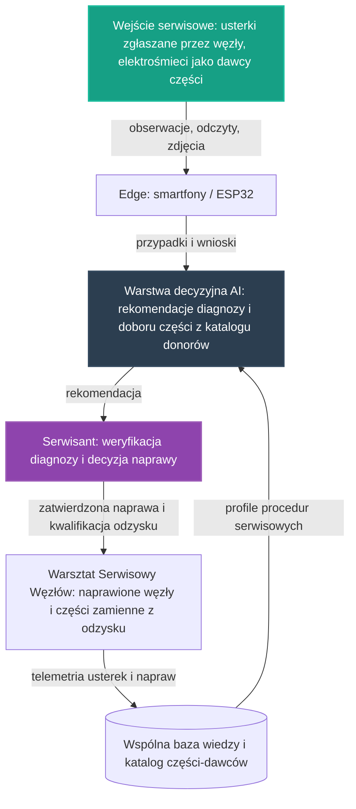

# 33. Koncepcyjny Pilotaż Warsztatu Serwisowego Węzłów

## **Intelekt wyprzedza Kapitał!**

## Opis Projektu

Ten dokument definiuje koncepcję pilotażu poprzecznego [głównych osi rozwoju](../README.md) NARODOWYCH SIŁ INTELEKTUALNYCH POLSKI — spięcia, które nie buduje kolejnego węzła, lecz odpowiada za jego dalsze życie: **Warsztat Serwisowy Węzłów** to wspólny wzorzec zaplecza utrzymaniowego, które domyka cykl życia węzłów z pilotaży [25](25_pilot_automatyzacji_zywnosci.md)–[32](32_pilot_wezla_zintegrowanego.md) po stronie utrzymania w ruchu i odzysku części. Tam, gdzie wcześniejsze pilotaże projektują, jak węzeł powstaje z odzysku i jak pracuje, ten pilotaż stawia pytanie, które nasila się wraz z każdym kolejnym węzłem: **kto utrzyma rosnący park węzłów w ruchu** — kto postawi diagnozę, gdy sterownik zawiódł, kto wykona naprawę, a kto dostarczy część zamienną, zanim stanie węzeł produkcji żywności, węzeł energetyczny czy węzeł gospodarki zasobami.

> [!IMPORTANT]
> **Zakres dokumentu:** opisujemy wyłącznie koncepcję organizacji pracy i architekturę narzędzi — bez danych technicznych, parametrów i wyników liczbowych oraz bez wskazywania konkretnych lokalizacji. Zasadę pracy przejmujemy ze wzorca pilotaży, na których się opieramy: **naprawa i odzysk zamiast wymiany i gospodarki rabunkowej** — a rekomendacja serwisowa AI jest zawsze wejściem do decyzji człowieka-serwisanta, nigdy jej zamiennikiem. Diagnoza i naprawa pozostają odpowiedzialnością ludzi, których AI wspiera wiedzą zgromadzoną we wspólnej bazie.

Pilotaż nie zaczyna od zera. W repozytorium istnieją już zalążki tego kierunku:

* **[06. Smartfony jako Sterowniki](06_smartfony_jako_sterowniki.md)** — stare urządzenia z odzysku jako węzły sterujące, bramki danych i sterowniki systemów off-grid; projekt wprost opisuje tematy, które stają się tematami serwisowymi: inteligentne zarządzanie ładowaniem, aby zapobiegać degradacji i puchnięciu baterii przy ciągłej pracy pod zasilaczem, komunikację USB OTG z konwerterami USB-UART do sterowania elektroniką wykonawczą oraz firmware i debugowanie — od bootloadera ułatwiającego uruchamianie alternatywnych systemów, przez lekki firmware dla starszych chipsetów, po prawdziwy Linux dla telefonów,
* **[12. Autonomiczne PCB ze śmieci](12_autonomiczne_pcb_ze_smieci.md)** — reuse elektroniki: ecoEDA sugeruje użycie komponentów odzyskanych z e-waste zamiast kupowania nowych części i generuje Bill of Teardowns — instrukcję, które urządzenia (np. stary router czy dekoder) rozmontować, aby uzyskać części do projektu; Ki-nTree z InvenTree dają AI „widzialność" zasobów, a moduł OCR rozpoznaje chip na starej płycie i tworzy rekord w bazie — skatalogowany „wylut" jest od razu dostępny dla AI projektującej nową PCB,
* **[17. Autonomiczne Przetwarzanie Elektrośmieci na Hardware](17_autonomiczne_przetwarzanie_elektrosmieci_na_hardware.md)** — pętla odzysku z jawnym etapem **testowania i kwalifikacji**: testy elektryczne i funkcjonalne, klasyfikacja jakości odzysku oraz statusy od surowego materiału po część ponownie używaną; wśród urządzeń budowanych z odzysku projekt wymienia wprost stanowiska naprawcze i testowe oraz tester komponentów,
* **[\[PROJEKT 13\] GitHub-First Baza Czesci z Recyklingu](13_baza_czesci_recykling/README.md)** — kanoniczny katalog urządzeń-dawców i części: GitHub przechowuje kuratorowaną, wersjonowaną bazę wiedzy, sygnały (Telegram, OCR, scraping forów, dokumenty techniczne, teardowny) trafiają do kolejki kuracji, a autonomiczny Łowca Części analizuje filmy z napraw elektroniki i zasila bazę zweryfikowanymi częściami.

Motywacją tego dokumentu jest sekcja **„Zależności od pozostałych osi i pilotaży"** [Koncepcyjnego Pilotażu Węzła Zintegrowanego](32_pilot_wezla_zintegrowanego.md): jego podsekcja **„Elektronika i sterowniki z odzysku"** wskazuje [Smartfony jako Sterowniki](06_smartfony_jako_sterowniki.md) jako źródło węzłów sterujących, bramek danych i sterowników systemów off-grid, a [Autonomiczne PCB ze śmieci](12_autonomiczne_pcb_ze_smieci.md) jako drogę suwerennej elektroniki. Zasada **„odzysk zamiast gospodarki rabunkowej"** powtarza się w kolejnych pilotażach — od żywnościowego, przez energetyczny, po gospodarkę zasobami — a każdy kolejny węzeł oznacza kolejne urządzenia pracujące w terenie.

Stąd luka, którą ten pilotaż domyka: pilotaże [25](25_pilot_automatyzacji_zywnosci.md), [27](27_pilot_sieci_energetycznej.md), [30](30_pilot_gospodarki_zasobami.md) i [32](32_pilot_wezla_zintegrowanego.md) budują wspólny wzorzec węzła — produkcji żywności, energetycznego, gospodarki zasobami oraz węzła zintegrowanego — wszystkie opierają się na fundamentach opisanych w **[00. Fundamentach Technologicznych NSIP](00_fundamenty_technologiczne.md)**, a elektronikę czerpią z odzysku. Im więcej węzłów powstaje, tym bardziej widoczna staje się luka: **żaden z pilotaży nie projektuje jeszcze zaplecza, które utrzyma je w ruchu.** Warsztat Serwisowy Węzłów jest odpowiedzią — wspólnym wzorcem diagnostyki, napraw, kwalifikacji części z odzysku i dokumentacji serwisowej, który domyka cykl życia węzła: od budowy z odzysku, przez pracę i usterkę, po naprawę częścią z odzysku i powrót wniosku do wspólnej bazy wiedzy. Zgodnie z [Mapą drogową](../ROADMAPA.md) jest to przykład projektu pilotażowego z Fazy 1: niewielka, weryfikowalna realizacja, która dowodzi słuszności koncepcji i staje się wzorcem do powielenia w fazie skalowania.

---

## Proponowane moduły koncepcyjne

Pilotaż projektujemy jako zespół współpracujących warstw. Warstwy te nie są nowe — to zasady, które wypracowały już [projekty odzysku](17_autonomiczne_przetwarzanie_elektrosmieci_na_hardware.md) oraz pilotaże [25](25_pilot_automatyzacji_zywnosci.md) i [30](30_pilot_gospodarki_zasobami.md); nowością jest ich wspólne życie po stronie utrzymania w ruchu. Każda warstwa powstaje w oparciu o gotowe, otwarte komponenty zebrane w repozytorium — zgodnie z Naszą zasadą, że kod już istnieje, a zadaniem twórców jest jego twórcza adaptacja.

### Moduł 1: Diagnostyka i naprawa sterowników z odzysku — konwencja [projektu 06](06_smartfony_jako_sterowniki.md)
* Sterowniki węzłów to w dużej mierze stare smartfony: [projekt 06](06_smartfony_jako_sterowniki.md) opisuje pracę z ekranem jako interaktywny panel sterujący oraz pracę bez ekranu, przy której urządzenie staje się realnym kandydatem w zastosowaniach niskomocowych. Ta sama dokumentacja opisuje sensorykę, wizję i audio — w tym detekcję anomalii akustycznych, jak nieprawidłowa praca silników i pomp, oraz inspekcję wizualną kamerą. Węzeł, który sam zgłasza nieprawidłowości, to połowa diagnozy — warsztat przejmuje ją, gdy sygnał już płynie.
* Profilaktyka zapisana wprost w [projekcie 06](06_smartfony_jako_sterowniki.md): inteligentne zarządzanie ładowaniem, które zapobiega degradacji i puchnięciu baterii przy ciągłej pracy pod zasilaczem. W warsztacie jest to procedura przyjęcia sterownika: kontrola stanu zasilania i baterii przed tym, zanim urządzenie wróci do terenu.
* Naprawa oprogramowania zamiast wymiany sprzętu: narzędzia wskazane w [projekcie 06](06_smartfony_jako_sterowniki.md) — customowy bootloader ułatwiający uruchamianie alternatywnych systemów i debugowanie, eksperymentalny lekki firmware dla starszych chipsetów oraz Linux dla telefonów pozwalający budować stabilny terminal lub serwer embedded — dają drogę przywracania sterownika do pracy i ponownej adaptacji do roli węzła.
* Naturalny obiekt utrzymania to węzły budowane w konwencji **[21. Home Assistant na Smartfonie](21_home_assistant_na_telefonie.md)** — **Węzła NSIP**, gotowego rozwiązania do masowego wdrażania automatyzacji zintegrowanego z inicjatywą Straży Przyszłości.

### Moduł 2: Naprawa i ponowne użycie elektroniki — konwencja [projektu 12](12_autonomiczne_pcb_ze_smieci.md)
* ecoEDA, wtyczka do KiCada opisana w [projekcie 12](12_autonomiczne_pcb_ze_smieci.md), sugeruje użycie komponentów odzyskanych z e-waste zamiast kupowania nowych — w tym zamienników o zbliżonych parametrach lub obudowach. To serce dobierania części zamiennych do naprawy: nie „gdzie kupić", lecz „co już mamy i które urządzenie rozmontować", bo Bill of Teardowns generuje instrukcję pozyskania części z konkretnych elektrośmieci.
* Ki-nTree z InvenTree to silnik inwentaryzacji dający AI „widzialność" zasobów: moduł OCR rozpoznaje chip na starej płycie i tworzy rekord w bazie, a skatalogowany „wylut" jest od razu dostępny jako symbol dla AI projektującej nową PCB. W warsztacie jest to most między szufladą z częściami a dokumentacją naprawy — część istnieje dla systemu dopiero wtedy, gdy jest skatalogowana.
* KiCAD-MCP-Server pozwala modelom językowym na bezpośrednią ingerencję w pliki projektowe KiCada: AI projektuje schematy, układa elementy i wykonuje routing na podstawie opisu w języku naturalnym — wsparcie przy odtwarzaniu uszkodzonych fragmentów układów i adaptacji płytek. Algorytm zastępuje kosztowny proces inżynieryjny — dokładnie w duchu zasady **Intelekt wyprzedza Kapitał**.
* Wyjście do warstwy sprzętowej z [projektu 12](12_autonomiczne_pcb_ze_smieci.md): z odzyskanych modułów obliczeniowych, zasilaczy, przetwornic, sensorów, układów sterujących, obudów i elementów mechanicznych powstają urządzenia dla dalszych automatyzacji. Łańcuch „elektrośmieci → katalog → reuse electronics → nowe urządzenie → kolejna automatyzacja" jest jednocześnie drogą życia części w warsztacie — od rozbiórki, przez naprawę, po powrót do terenu.

### Moduł 3: Odzysk części z elektrośmieci i kwalifikacja odzysku — konwencja [projektu 17](17_autonomiczne_przetwarzanie_elektrosmieci_na_hardware.md)
* Trzy strumienie odzysku opisane w [projekcie 17](17_autonomiczne_przetwarzanie_elektrosmieci_na_hardware.md) to jednocześnie mapa magazynu części zamiennych warsztatu: warstwa obliczeniowa (stare smartfony, routery, TV boxy, mini-PC, laptopy po częściowej degradacji, płyty główne ze sprawnym SoC, RAM i storage), warstwa sensoryczna i wykonawcza (przetwornice, zasilacze, przekaźniki, moduły radiowe, wyświetlacze, kamery, wentylatory, czujniki, silniki, pompy, elementy mechaniczne i montażowe) oraz warstwa komponentowa (układy scalone, MOSFET-y, stabilizatory, rezystory, kondensatory, złącza, cewki, elementy RF, moduły pamięci).
* Etap testowania i kwalifikacji z [projektu 17](17_autonomiczne_przetwarzanie_elektrosmieci_na_hardware.md) to serce warsztatu: testy elektryczne, testy funkcjonalne, klasyfikacja jakości odzysku oraz oznaczanie stanu `raw / harvested / tested / reusable / reserved / consumed`. To warunek przejścia od „złomu" do realnego zasobu infrastrukturalnego — część bez statusu nie wchodzi do naprawy.
* Resource scouting po stronie warsztatu: AI klasyfikuje urządzenia nie po nazwie, lecz po potencjale odzysku — obliczeniowym, sensorycznym, zasilania, części do nowych PCB, mechanicznym i konstrukcyjnym — a następnie wspiera rozpoznawanie urządzeń-dawców, wykrywanie części i modułów oraz sugerowanie kolejności demontażu.
* Kryterium sukcesu przejęte z [projektu 17](17_autonomiczne_przetwarzanie_elektrosmieci_na_hardware.md): odzysk zadziałał naprawdę, gdy z odzyskanych zasobów powstało urządzenie, które działa, wspiera kolejny proces inicjatywy, powstało na podstawie udokumentowanego katalogu i review oraz zmniejsza koszt wejścia w następne automatyzacje. Warsztat mierzy się dokładnie tym samym kryterium.

### Moduł 4: Baza części-dawców jako magazyn warsztatu — konwencja [\[PROJEKT 13\] GitHub-First Baza Czesci z Recyklingu](13_baza_czesci_recykling/README.md)
* GitHub jako źródło prawdy: kuratorowany, publiczny, przeglądalny i wersjonowany katalog urządzeń-dawców, części i relacji donorowych, w którym zmiany można recenzować przez commit i Pull Request — w duchu [CONTRIBUTING.md](../CONTRIBUTING.md); z jednego źródła odtwarzane są eksporty dla narzędzi opisanych w modułach 2 i 3.
* Łowca Części: agent analizujący filmy z napraw elektroniki, z dwuetapową weryfikacją — część musi zostać zauważona w kontekście filmu, a następnie potwierdzona na stopklatce przez niezależny model OCR; niepewne trafienia trafiają do kolejki społeczności z linkem czasowym, aby człowiek mógł je zweryfikować.
* Kolejka kuracji: sygnały z Telegrama, OCR, forów, dokumentów technicznych i teardownów są porządkowane do kanonicznego katalogu. W warsztacie jest to odpowiednik przyjmowania części do magazynu — najpierw kolejka i weryfikacja, dopiero potem zapis do zasobu wspólnego, nigdy odwrotnie.
* Operacyjny dostęp z terenu: zgodnie z [README](../README.md) funkcja budowania i przeszukiwania bazy jest już zintegrowana z botem Telegram — serwisant przy stole może sprawdzić urządzenie-dawcę i dostępną część, nie przerywając pracy.

### Moduł 5: Dokumentacja serwisowa i pętla nauki warsztatu — konwencja [pilotaży 25](25_pilot_automatyzacji_zywnosci.md) i [30](30_pilot_gospodarki_zasobami.md)
* Pętla nauki w wersji serwisowej: najpierw warsztat zbiera obserwacje i zdarzenia — usterki zgłaszane przez węzły, wyniki diagnoz, wykonane naprawy, wymienione części, przyjęte i odrzucone rekomendacje — następnie warstwa analityczna porównuje je z dotychczasową wiedzą o pracy parku, w kolejnym etapie koryguje procedury i rekomendacje serwisowe, a na końcu zapisuje wniosek do wspólnej bazy wiedzy.
* Konwencja „edge-first" wypracowana w [projekcie 01](01_inteligentna_akwakultura.md), którą przyjmują oba pilotaże: surowe dane — zdjęcia usterek, logi, odczyty — pozostają w warstwie operacyjnej poza repozytorium, a do repozytorium wraca wyłącznie wiedza opracowana: udokumentowane przypadki napraw, snapshoty i raporty zbiorcze.
* Wiedza zapisywana jest jako otwarte, wspólne profile w formatach JSON/YAML, na wzór receptur klimatycznych z [projektu 24](24_automatyzacja_hodowli_grzybow.md) — dzięki temu każdy kolejny warsztat i każdy kolejny węzeł rozpoczyna pracę z dorobkiem poprzedników.
* Zasada nadrzędna, przejęta z [pilotażu gospodarki zasobami](30_pilot_gospodarki_zasobami.md): **rekomendacja jest zawsze wejściem do decyzji człowieka, nigdy jej zamiennikiem.** Najpierw AI proponuje diagnozę i dobór części, następnie serwisant weryfikuje rekomendację, a na końcu zatwierdza lub koryguje decyzję naprawy.

---

## Zależności od pozostałych osi i pilotaży

Pilotaż nie jest wyspą — jest zapleczem dla węzłów z pilotaży 25–32 i zarazem korzysta z dorobku projektów odzysku, zgodnie z zasadą spójności opisaną w [Mapie drogowej](../ROADMAPA.md).

### Elektronika, odzysk i części z odzysku (projekty 06, 12, 17 i 13)
Sterowniki, węzły pomiarowe i elektronika węzłów powstają z odzysku, nie z zakupów: [Smartfony jako Sterowniki](06_smartfony_jako_sterowniki.md) dostarczają węzłów sterujących, bramek danych i sterowników systemów off-grid, a [Autonomiczne PCB ze śmieci](12_autonomiczne_pcb_ze_smieci.md) pokazują drogę suwerennej elektroniki łączącej AI z recyklingiem e-odpadów — tak opisuje to podsekcja „Elektronika i sterowniki z odzysku" [pilotażu 32](32_pilot_wezla_zintegrowanego.md). Warsztat dorzuca do tego spięcia brakujące ogniwa: [projekt 17](17_autonomiczne_przetwarzanie_elektrosmieci_na_hardware.md) definiuje, jak z elektrośmieci powstaje zweryfikowana część — z testowaniem, kwalifikacją i statusami — a [\[PROJEKT 13\] GitHub-First Baza Czesci z Recyklingu](13_baza_czesci_recykling/README.md) utrzymuje katalog, w którym tę część można znaleźć i do której można wrócić po kolejną. To ta sama zasada **„odzysk zamiast gospodarki rabunkowej"**, którą [Mapa drogowa](../ROADMAPA.md) opisuje przy synergii osi — przełożona z budowy węzłów na ich utrzymanie w ruchu.

### Wspólna telemetria i decyzje człowieka (wzorzec pilotażu 30)
[Koncepcyjny Pilotaż Gospodarki Zasobami Strategicznymi](30_pilot_gospodarki_zasobami.md) wypracował wzorzec, który ten pilotaż przyjmuje w całości: **pomiar, rekomendacja, decyzja człowieka, a wypracowany wniosek wraca do wspólnej bazy wiedzy**. W wersji serwisowej: pomiarem jest diagnoza usterki oraz stan zasobów warsztatu, rekomendacją — proponowana naprawa i dobór części, decyzją — rozstrzygnięcie serwisanta, a wnioskiem — udokumentowany przypadek, który wraca do wspólnej bazy wiedzy i w kolejnym obiegu koryguje procedury. Do bazy trafia wynik analizy, a nie surowy strumień danych — według konwencji „edge-first" z [projektu 01](01_inteligentna_akwakultura.md).

### Powiązanie z węzłem zintegrowanym (pilotaż 32)
[Koncepcyjny Pilotaż Węzła Zintegrowanego](32_pilot_wezla_zintegrowanego.md) spina w jednym węźle produkcję żywności według wzorca [pilotażu 25](25_pilot_automatyzacji_zywnosci.md), zasilanie energią według [pilotażu 27](27_pilot_sieci_energetycznej.md) oraz zarządzanie zasobami według [pilotażu 30](30_pilot_gospodarki_zasobami.md) — a jego elektronika powstaje z odzysku. Ten pilotaż odpowiada na kolejne pytanie z tego samego łańcucha: co się dzieje, gdy ten sterownik ulegnie awarii i skąd wziąć część zamienną, nim węzeł stanie. Kolejność jest względna: najpierw węzły pracują według swoich wzorców i budują telemetrię, w późniejszym etapie rosnący park potrzebuje zaplecza serwisowego, a warsztat działa jako wspólna infrastruktura utrzymaniowa dla wszystkich tych pilotaży naraz.

---

## Miejsce pilotażu na mapie drogowej

* **Faza 0 (Krystalizacja):** ten dokument jest produktem burzy mózgów, analizy i planowania — precyzyjną koncepcją, która powstaje intelektem, nie budżetem.
* **Faza 1 (Pierwsze projekty pilotażowe):** tu jest miejsce tego pilotażu. Kolejność jest względna: najpierw pilotaże osiowe — [25](25_pilot_automatyzacji_zywnosci.md), [27](27_pilot_sieci_energetycznej.md) i [30](30_pilot_gospodarki_zasobami.md) — oraz węzeł zintegrowany [32](32_pilot_wezla_zintegrowanego.md) potwierdzają swoje wzorce i budują park pracujących węzłów, w późniejszym etapie ten park potrzebuje utrzymania w ruchu, a przed skalowaniem warsztat musi mieć gotowe wzorce diagnostyki, kwalifikacji odzysku i wspólnej bazy części.
* **Faza 2 (Skalowanie i samonapędzająca się gospodarka):** podrozdział **„Od projektów do systemu"** [Mapy drogowej](../ROADMAPA.md) opisuje, że dane i doświadczenia z każdej realizacji poprawiają działanie pozostałych, a każdy zrealizowany projekt obniża koszt następnego. Warsztat realizuje to dosłownie: naprawiony węzeł nie wymaga budowy nowego, a część z odzysku, kwalifikowana we wspólnym katalogu, obniża koszt kolejnej naprawy i kolejnego węzła. To dyscyplina zwrotu Fazy 2 — wypracowane zasoby wracają do systemu, zamiast być marnowane.
* **Faza 3 (Finansowanie Dochodu Gwarantowanego):** docelowy punkt. [Mapa drogowa](../ROADMAPA.md) stanowi: **„Do tej fazy nie przechodzimy obietnicami, lecz zasobami."** Warsztat ćwiczy tę dyscyplinę na najtwardszym materiale: o utrzymaniu parku w ruchu rozstrzygają realne naprawy i realne części, nie deklaracje — a węzły utrzymane w ruchu generują nadwyżki, które wracają do **WSPÓLNEGO DOBRA NARODOWEGO**, finansując **Dochód Gwarantowany (UBI)**.

Granice między fazami są jakościowe, a nie kalendarzowe: fazę zamyka realne osiągnięcie, a nie data. Kolejność prac wewnątrz Fazy 1 nie jest sztywna — osie wzajemnie się napędzają.

---

## Jak społeczność może rozwinąć ten projekt

Ten projekt jest własnością społeczności i tak ma być rozwijany — w otwartym modelu współtworzenia opisanym w **[CONTRIBUTING.md](../CONTRIBUTING.md)**.

* **Dyskusja i analiza:** pytania, pomysły i zastrzeżenia zgłaszaj w zakładce Issues repozytorium — to serce projektu, w którym ma się roić jak w ulu. Każdy komentarz merytoryczny to cenny wkład w **NARODOWY WYSIŁEK INTELEKTUALNY**.
* **Pull Requesty:** dojrzałe zmiany — rozszerzenia koncepcji, dokumentacja, procedury serwisowe, profile wiedzy — trafiają do plików poprzez Pull Requesty, dokładnie według instrukcji z [CONTRIBUTING.md](../CONTRIBUTING.md).
* **Ścieżki wkładu:**
  * diagnostyka i naprawa sterowników — adaptacja firmware'u i debugowanie w konwencji [projektu 06](06_smartfony_jako_sterowniki.md), procedury kontroli zasilania i baterii sterowników pracujących pod zasilaczem,
  * naprawa i ponowne użycie elektroniki — Bill of Teardowns, inwentaryzacja i dobór zamienników o zbliżonych parametrach w konwencji [projektu 12](12_autonomiczne_pcb_ze_smieci.md),
  * odzysk i kwalifikacja — procedury testów elektrycznych i funkcjonalnych, klasyfikacja jakości odzysku i statusy z [projektu 17](17_autonomiczne_przetwarzanie_elektrosmieci_na_hardware.md), projektowanie stanowisk testowych,
  * baza części-dawców — kuracja rekordów katalogu, weryfikacja niepewnych trafień Łowcy Części w kolejce społeczności, praca nad eksportami w duchu [\[PROJEKT 13\] GitHub-First Baza Czesci z Recyklingu](13_baza_czesci_recykling/README.md),
  * dokumentacja serwisowa — udokumentowane przypadki napraw, snapshoty i wspólne profile procedur wracające do bazy wiedzy,
  * eksperci dziedzinowi — [Mapa drogowa](../ROADMAPA.md) wymienia inżynierów wśród twórców potrzebnych społeczności od samego początku; w tym pilotażu ich wiedza wraca do wspólnej bazy jako procedury i udokumentowane przypadki serwisowe.

Pełnoprawny wkład jest możliwy także bez własnego sprzętu: analiza filmów z napraw w kolejce społeczności, projektowanie procedur, walidacja rekordów katalogu i dokumentacja to praca intelektualna tej samej rangi. Oceniamy pomysły i kod, nie ludzi — a liczy się wyłącznie dokonanie.

---

## Zasoby wewnętrzne w repozytorium
* **[00. Fundamenty Technologiczne NSIP](00_fundamenty_technologiczne.md)** — wspólne narzędzia węzłów: Home Assistant, ESPHome, MQTT, Edge AI.
* **[06. Smartfony jako Sterowniki](06_smartfony_jako_sterowniki.md)** — sterowniki, bramki danych i sterowniki off-grid z odzysku; firmware, debugowanie i serwisowa tematyka zasilania.
* **[21. Home Assistant na Smartfonie](21_home_assistant_na_telefonie.md)** — Węzeł NSIP: flota, którą warsztat utrzymuje w ruchu.
* **[12. Autonomiczne PCB ze śmieci](12_autonomiczne_pcb_ze_smieci.md)** — reuse elektroniki, Bill of Teardowns i inwentaryzacja zamiast zakupów.
* **[17. Autonomiczne Przetwarzanie Elektrośmieci na Hardware](17_autonomiczne_przetwarzanie_elektrosmieci_na_hardware.md)** — pętla odzysku: testowanie, kwalifikacja i statusy części.
* **[\[PROJEKT 13\] GitHub-First Baza Czesci z Recyklingu](13_baza_czesci_recykling/README.md)** — katalog urządzeń-dawców i części, kolejka kuracji i Łowca Części.
* **[25. Zintegrowany Pilotaż Automatyzacji Produkcji Żywności](25_pilot_automatyzacji_zywnosci.md)** — węzeł produkcji żywności; wzorzec pętli nauki z telemetrii.
* **[27. Koncepcyjny Pilotaż Sieci Energetycznej](27_pilot_sieci_energetycznej.md)** — węzeł energetyczny; sterowniki off-grid wymagające zaplecza serwisowego.
* **[30. Koncepcyjny Pilotaż Gospodarki Zasobami Strategicznymi](30_pilot_gospodarki_zasobami.md)** — wzorzec „pomiar, rekomendacja, decyzja człowieka, wniosek wraca do bazy".
* **[32. Koncepcyjny Pilotaż Węzła Zintegrowanego](32_pilot_wezla_zintegrowanego.md)** — źródło motywacji: podsekcja „Elektronika i sterowniki z odzysku".
* **[01. Inteligentna Akwakultura](01_inteligentna_akwakultura.md)** — wzorzec edge-first: do bazy wraca wynik analizy, nie surowy strumień danych.
* **[24. Automatyzacja Hodowli Grzybów](24_automatyzacja_hodowli_grzybow.md)** — otwarte, wspólne profile wiedzy w formatach JSON/YAML.
* **[Mapa drogowa (ROADMAPA.md)](../ROADMAPA.md)** — fazy rozwoju, zasada „odzysk zamiast gospodarki rabunkowej" oraz zdanie „Do tej fazy nie przechodzimy obietnicami, lecz zasobami".
* **[README](../README.md)** — Osiągnięcia Straży Przyszłości: Łowca Części i integracja przeszukiwania bazy z botem Telegram.
* **[CONTRIBUTING.md](../CONTRIBUTING.md)** — jak zgłaszać pomysły i współtworzyć repozytorium.

---
*Intelekt wyprzedza Kapitał!*

**Nawet tu kod już jest — brakuje tylko Ciebie.**
