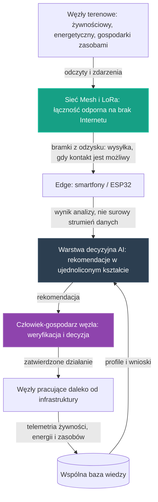

# 34. Koncepcyjny Pilotaż Łączności i Wspólnej Telemetrii Węzłów

## **Intelekt wyprzedza Kapitał!**

Zanim powstanie fizyczna sieć węzłów pracujących daleko od infrastruktury, projektujemy intelektem to, co najtrudniejsze: odporną łączność oraz jeden, wspólny kształt danych, którym te węzły będą się porozumiewać. Wszystkie potrzebne elementy już istnieją w otwartych repozytoriach zebranych w tym projekcie — zadaniem twórców jest ich twórcze spięcie, nie zakup sprzętu.

## Opis Projektu

Ten dokument definiuje koncepcję pilotażu poprzecznego [głównych osi rozwoju](../README.md) NARODOWYCH SIŁ INTELEKTUALNYCH POLSKI — spięcia projektów **10 + 25 + 27 + 30**, które nie buduje kolejnego węzła, lecz projektuje **wspólną warstwę telemetrii wielu węzłów**: węzła żywnościowego według wzorca pilotażu żywnościowego, węzła energetycznego według wzorca pilotażu energetycznego oraz węzła gospodarki zasobami według wzorca pilotażu zasobowego — na łączności Mesh/LoRa z projektu [Łączność Mesh i LoRa](10_lacznosc_mesh_lora.md), z wzorcem pracy „edge-first" wypracowanym w [Inteligentnej Akwakulturze](01_inteligentna_akwakultura.md). Celem pilotażu jest zaprojektowanie odpornych łączności i wspólnego kształtu danych dla węzłów pracujących daleko od infrastruktury: **do wspólnej bazy wiedzy trafia wynik analizy, a nie surowy strumień danych**.

> [!IMPORTANT]
> **Zakres dokumentu:** opisujemy wyłącznie koncepcję organizacji pracy i architekturę narzędzi — bez danych technicznych, parametrów i wyników liczbowych oraz bez wskazywania konkretnych lokalizacji. Zasadę pracy przejmujemy ze wzorca pilotaży, na których się opieramy: **rekomendacja jest zawsze wejściem do decyzji człowieka, nigdy jej zamiennikiem** — a do wspólnej bazy wiedzy wraca wyłącznie wiedza opracowana, zgodnie z konwencją „edge-first".

Pilotaż nie zaczyna od zera. W repozytorium istnieją już zalążki tego kierunku:

* **[25. Zintegrowany Pilotaż Automatyzacji Produkcji Żywności](25_pilot_automatyzacji_zywnosci.md)** — węzeł żywnościowy, który od pierwszego szkicu korzysta z łączności Mesh „dla węzłów pracujących daleko od infrastruktury" i dostarcza telemetrię zużycia — wody w akwakulturze oraz substratów w hodowli grzybów,
* **[27. Koncepcyjny Pilotaż Sieci Energetycznej](27_pilot_sieci_energetycznej.md)** — węzeł energetyczny, którego warstwa sensoryczno-sterująca również opiera łączność na sieci Mesh z projektu 10, w tym na scenariuszu informowania o stanie sieci energetycznej bez użycia Internetu,
* **[30. Koncepcyjny Pilotaż Gospodarki Zasobami Strategicznymi](30_pilot_gospodarki_zasobami.md)** — węzeł gospodarki zasobami, dla którego sieć Mesh służy monitorowaniu zasobów gospodarczych także tam, gdzie zawodzi infrastruktura, a wzorcem pracy jest zasada „pomiar, rekomendacja, decyzja człowieka, a wypracowany wniosek wraca do wspólnej bazy wiedzy",
* **[10. Łączność Mesh i LoRa](10_lacznosc_mesh_lora.md)** — suwerenna, odporna na awarie infrastruktura komunikacyjna: sieci kratowe zbudowane wokół wbudowanych systemów łączności smartfonów z odzysku, uzupełnione technologią LoRa, opisane jako **„Nerw Gospodarczy"** inicjatywy,
* **[01. Inteligentna Akwakultura](01_inteligentna_akwakultura.md)** — wzorzec pracy „edge-first" oraz wspólny kontrakt danych: ujednolicony kształt wyniku analitycznego i konwencja identyfikacji providerów.

Motywacją tego dokumentu jest podsekcja **„Łączność i wspólne dane"** z sekcji „Zależności od pozostałych osi i pilotaży" [Koncepcyjnego Pilotażu Węzła Zintegrowanego](32_pilot_wezla_zintegrowanego.md): wskazuje ona wprost, że odporną na brak Internetu łączność dla węzłów pracujących daleko od infrastruktury zapewnia [Łączność Mesh i LoRa](10_lacznosc_mesh_lora.md) — przywoływana zarówno przez [pilotaż żywnościowy](25_pilot_automatyzacji_zywnosci.md), jak i [pilotaż energetyczny](27_pilot_sieci_energetycznej.md) — a wzorzec pracy „edge-first" z [projektu 01](01_inteligentna_akwakultura.md) spina warstwy węzła ze wspólną bazą wiedzy tak, że trafia do niej wynik analizy, a nie surowy strumień danych. To samo spięcie potwierdza sekcja **„Synergie osi"** [Mapy drogowej](../ROADMAPA.md), opisując wzorcowy przykład pilotażu żywnościowego jako punktu styku osi. Kolejność powstawania koncepcji jest względna: najpierw zaproszenie z sekcji „Synergie osi" przyjęły pilotaże gospodarki zasobami i finansowania — jak opisuje podsekcja **„Kolejne spięcia osi"** [Mapy drogowej](../ROADMAPA.md) — następnie powstały pilotaże poprzeczne: [węzła zintegrowanego](32_pilot_wezla_zintegrowanego.md) i [warsztatu serwisowego](33_pilot_warsztat_serwisowy.md), a ten dokument jest kolejną odpowiedzią na to samo zaproszenie, tym razem po stronie wspólnej łączności i wspólnych danych. Zgodnie z [Mapą drogową](../ROADMAPA.md) jest to przykład projektu pilotażowego z Fazy 1: niewielka, weryfikowalna realizacja, która dowodzi słuszności koncepcji i staje się wzorcem do powielenia w fazie skalowania.

---

## Proponowane moduły koncepcyjne

Pilotaż projektujemy jako zespół współpracujących warstw. Warstwy te nie są nowe — to zasady, które wypracowały już [projekt 01](01_inteligentna_akwakultura.md), [projekt 10](10_lacznosc_mesh_lora.md) oraz pilotaże [25](25_pilot_automatyzacji_zywnosci.md), [27](27_pilot_sieci_energetycznej.md) i [30](30_pilot_gospodarki_zasobami.md); nowością jest ich wspólne życie między wieloma węzłami naraz. Każda warstwa powstaje w oparciu o gotowe, otwarte komponenty zebrane w repozytorium — zgodnie z Naszą zasadą, że kod już istnieje, a zadaniem twórców jest jego twórcza adaptacja.

### Moduł 1: Wspólny kontrakt danych telemetrii — konwencja [projektu 01](01_inteligentna_akwakultura.md)
* Ujednolicony kształt wyniku analitycznego, który definiuje kontrakt danych [projektu 01](01_inteligentna_akwakultura.md): **poziom ryzyka, rekomendacja, poziom pewności i kody przyczyn** — uzupełnione o identyfikację providera i wersję schematu. Ten sam kształt przyjmują pilotaże [25](25_pilot_automatyzacji_zywnosci.md), [27](27_pilot_sieci_energetycznej.md) i [30](30_pilot_gospodarki_zasobami.md); nowość tego pilotażu polega na tym, że jeden kontrakt obejmuje telemetrię żywności, energii i zasobów naraz, dzięki czemu węzły różnych osi stają się porównywalne.
* Rozróżnienie dwóch rodzajów danych z [projektu 01](01_inteligentna_akwakultura.md): pomiary trafiają do warstwy operacyjnej, natomiast wyniki analizy wykonywanej lokalnie — jako zdarzenia. Repozytorium nie jest miejscem składowania surowych, bieżących odczytów providerów.
* Rejestracja providerów i rotacja tokenów opisana w [projekcie 01](01_inteligentna_akwakultura.md): punkt rejestracji, jednorazowy token zapisu oraz wspólna konwencja `provider_id`, która pozwala odróżniać środowiska i uniknąć chaosu wśród społecznościowych węzłów.
* Ścieżka eksportu wiedzy z [projektu 01](01_inteligentna_akwakultura.md): provider przesyła dane do warstwy operacyjnej, dane pozostają poza repozytorium, z danych wyprowadzany jest snapshot wiedzy lub raport zbiorczy, a dopiero taki opracowany materiał trafia do repozytorium jako wkład społeczności.

### Moduł 2: Odporna łączność terenowa węzłów — konwencja [projektu 10](10_lacznosc_mesh_lora.md)
* Rola sieci przejęta wprost z [projektu 10](10_lacznosc_mesh_lora.md): sieć Mesh służy jako **„Nerw Gospodarczy"** — przesyła dane z sensorów, informuje o stanie sieci energetycznej i zabezpiecza komunikację bez polegania wyłącznie na zewnętrznych dostawcach.
* Fundament sprzętowy z [projektu 10](10_lacznosc_mesh_lora.md): wbudowane systemy łączności smartfonów z odzysku, uzupełnione technologią LoRa; smartfon z odzysku działa jako bramka, która zbiera dane z lokalnej sieci Mesh i przesyła je dalej, gdy tylko pojawi się zasięg komórkowy.
* Gotowe komponenty telemetrii z [projektu 10](10_lacznosc_mesh_lora.md): moduł telemetrii Meshtastic do automatycznego przesyłania danych z czujników środowiskowych oraz zdalne sterowanie pinami GPIO przez moduł Remote Hardware; stos Reticulum z protokołem wiadomości szyfrowanym end-to-end dla komunikacji maszyna-maszyna i człowiek-człowiek, a także gotowy komunikator graficzny do bezpiecznej wymiany raportów.
* Synchronizacja offline-first z [projektu 10](10_lacznosc_mesh_lora.md): protokoły P2P, dzięki którym aplikacje synchronizują się same, gdy urządzenia znajdą się w zasięgu, oraz „plotkowa" replikacja danych, odporna na brak stałego połączenia i działająca przy minimalnej przepustowości — to techniczne ogniwo, które naturalnie współgra z wzorcem „edge-first": przy takim kanale przesyłanie surowych strumieni nie ma sensu, więc przesyła się wynik analizy.
* Most do nadzoru AI z [projektu 10](10_lacznosc_mesh_lora.md) i [README](../README.md): pomost Internet-over-LoRa umożliwiający nadzór dużych modeli AI nad lokalnymi automatyzacjami, zapewniający łączność nawet w całkowitej izolacji od infrastruktury.
* Scenariusze PoC z [projektu 10](10_lacznosc_mesh_lora.md) jako wzorce dla wspólnej telemetrii: monitorowanie stanu infrastruktury energetycznej i magazynów energii — po wykryciu awarii przez sensory system przesyła przez sieć zapytanie o dostępność energii w sąsiednich mikrosieciach albo informuje operatora o lokalizacji usterki bez użycia Internetu; smartfony na obrożach z [projektu 09](09_monitoring_iot_livestock.md) jako ruchome węzły, które budują zasięg sieci tam, gdzie przebywa stado; oraz suwerenny komunikator logistyczny z szyfrowaniem end-to-end, niezależny od awarii globalnych platform komunikacyjnych.
* Suwerenność ekonomiczna z [projektu 10](10_lacznosc_mesh_lora.md): brak opłat za przesył danych i infrastruktura należąca do użytkowników, nie do korporacji — a zasięg sieci rośnie, ponieważ każdy kolejny węzeł może pełnić rolę przekaźnika.

### Moduł 3: Telemetria węzła żywnościowego — konwencja [pilotażu 25](25_pilot_automatyzacji_zywnosci.md)
* Materiał telemetrii przejęty wprost z [pilotażu żywnościowego](25_pilot_automatyzacji_zywnosci.md): zużycie wody w akwakulturze z [Inteligentnej Akwakultury](01_inteligentna_akwakultura.md) oraz zużycie substratów w hodowli grzybów z [Automatyzacji Hodowli Grzybów](24_automatyzacja_hodowli_grzybow.md) — dokładnie te dane, które [pilotaż 25](25_pilot_automatyzacji_zywnosci.md) dostarcza osi czwartej, zgodnie z opisem synergii w [Mapie drogowej](../ROADMAPA.md).
* Pętla nauki z [pilotażu 25](25_pilot_automatyzacji_zywnosci.md): najpierw węzeł zbiera obserwacje i zdarzenia, następnie warstwa decyzyjna porównuje je z dotychczasową wiedzą, w kolejnym etapie koryguje sterowanie efektorami, a na końcu zapisuje wniosek do wspólnej bazy wiedzy — a przez wspólną warstwę telemetrii ten wniosek staje się dostępny także dla węzłów innych osi.
* Łączność z [pilotażu 25](25_pilot_automatyzacji_zywnosci.md): odporna na brak Internetu sieć Mesh opisana w [projekcie 10](10_lacznosc_mesh_lora.md), wskazana wprost „dla węzłów pracujących daleko od infrastruktury" — ten pilotaż czyni z tego zapisu wspólny wzorzec wszystkich węzłów.
* Wiedza opracowana z [pilotażu 25](25_pilot_automatyzacji_zywnosci.md): otwarte, wspólne profile w formatach JSON/YAML, na wzór receptur klimatycznych z [projektu 24](24_automatyzacja_hodowli_grzybow.md) — dzięki temu każdy kolejny węzeł rozpoczyna pracę z dorobkiem poprzedników.

### Moduł 4: Telemetria węzła energetycznego — konwencja [pilotażu 27](27_pilot_sieci_energetycznej.md)
* Kolejność pracy przejęta wprost z [pilotażu energetycznego](27_pilot_sieci_energetycznej.md): najpierw węzeł mierzy własne zużycie energii, a w kolejnym etapie współpracuje ze wspólnymi narzędziami analitycznymi tej osi.
* Scenariusz sieciowy z [pilotażu 27](27_pilot_sieci_energetycznej.md), który czerpie z [projektu 10](10_lacznosc_mesh_lora.md): węzeł energetyczny współpracuje z siecią Mesh przy monitorowaniu stanu infrastruktury — od lokalnego pomiaru, przez transmisję przez sieć, po przekazanie obserwacji do warstwy decyzyjnej; wspólna warstwa telemetrii rozszerza ten scenariusz na węzły wszystkich osi naraz.
* Jeden strumień zamiast trzech osobnych: odczyty zużycia energii trafiają do tej samej warstwy decyzyjnej co telemetria produkcji żywności i gospodarki zasobami — w duchu [węzła zintegrowanego](32_pilot_wezla_zintegrowanego.md), w którym węzeł widzi pracę żywności, energii i zasobów jako jedną całość; ten pilotaż przenosi tę zasadę z jednego węzła na wiele węzłów połączonych wspólną łącznością.

### Moduł 5: Pętla nauki wielu węzłów i decyzja człowieka — konwencja [pilotażu 30](30_pilot_gospodarki_zasobami.md)
* Wzorzec nadrzędny przejęty z [pilotażu gospodarki zasobami](30_pilot_gospodarki_zasobami.md) i przywołany w [Mapie drogowej](../ROADMAPA.md): **pomiar, rekomendacja, decyzja człowieka, a wypracowany wniosek wraca do wspólnej bazy wiedzy**. Najpierw AI proponuje plan, następnie człowiek-gospodarz węzła weryfikuje rekomendację, a na końcu zatwierdza lub koryguje decyzję wykonawczą — według zasady „Rekomendacje, nie Nakazy" z [projektu 16](16_geoportal_potencjal_rozwoju.md).
* Zasięg pomiaru z [pilotażu 30](30_pilot_gospodarki_zasobami.md): sieć służy monitorowaniu zasobów gospodarczych także tam, gdzie zawodzi infrastruktura — dlatego wspólna telemetria projektowana jest od początku dla węzłów odciętych od Internetu, a nie jako dodatek do gotowej sieci.
* Wspólna baza wiedzy w wersji wielowęzłowej: do repozytorium wraca wyłącznie wiedza opracowana — snapshoty, raporty zbiorcze i udokumentowane przypadki pracy wielu węzłów; porównywanie przypadków między węzłami różnych osi jest tym, czego nie da osiągnąć żadna pojedyncza telemetria.
* Suwerenność danych w duchu [pilotażu 30](30_pilot_gospodarki_zasobami.md): dane o zasobach, potrzebach i zużyciu pozostają własnością społeczności i służą wyłącznie optymalizacji wspólnej gospodarki, a nie monetyzacji przez komercyjne korporacje.

---

## Zależności od pozostałych osi i pilotaży

Pilotaż nie jest wyspą — sam jest spięciem, więc jego zależności są podwójne: korzysta z łączności i kontraktu danych wypracowanych w repozytorium, a zarazem oddaje telemetrię wszystkich węzłów osiom i wspólnym narzędziom analitycznym, zgodnie z zasadą spójności opisaną w [Mapie drogowej](../ROADMAPA.md).

### Suwerenna łączność węzłów (projekt 10)
Cała warstwa transmisji tego pilotażu opiera się na [Łączności Mesh i LoRa](10_lacznosc_mesh_lora.md) — sieci opisanej jako **„Nerw Gospodarczy"**, przywoływanej wprost zarówno przez [pilotaż żywnościowy](25_pilot_automatyzacji_zywnosci.md), jak i [pilotaż energetyczny](27_pilot_sieci_energetycznej.md), a w [README](../README.md) wskazanej jako suwerenna sieć komunikacyjna do monitorowania zasobów gospodarczych. To samo spięcie potwierdza sekcja **„Synergie osi"** [Mapy drogowej](../ROADMAPA.md): odporną na brak Internetu łączność dla węzłów pracujących daleko od infrastruktury zapewnia projekt 10, przywołany w pilotażu żywnościowym wprost. Ten dokument rozszerza tę łączność z pojedynczych węzłów na wspólną warstwę telemetrii wielu węzłów.

### Żywność (oś pierwsza)
Węzeł żywnościowy to pierwszy dostawca danych dla wspólnej warstwy — jego sensorika, pętla nauki i zapis „dla węzłów pracujących daleko od infrastruktury" pochodzą wprost z [Zintegrowanego Pilotażu Automatyzacji Produkcji Żywności](25_pilot_automatyzacji_zywnosci.md). W zamian pilotaż oddaje tej osi gotowy kształt transmisji i kontrakt danych, dzięki którym kolejne węzły żywnościowe działają w terenie bez budowania łączności od nowa.

### Energia (oś trzecia)
Sekcja „Energia" w [Mapie drogowej](../ROADMAPA.md) stwierdza wprost: **„Ta oś zasila wszystkie pozostałe: stabilna i tania energia to warunek autonomicznej produkcji żywności oraz pracy systemów obliczeniowych całej inicjatywy."** [Koncepcyjny Pilotaż Sieci Energetycznej](27_pilot_sieci_energetycznej.md) dostarcza wzorca pomiaru zużycia i scenariusza współpracy z siecią Mesh przy monitorowaniu infrastruktury energetycznej — a wspólna telemetria sprawia, że odczyty zużycia energii płyną w tym samym kontrakcie danych co reszta węzła.

### Optymalizacja zużycia zasobów strategicznych (oś czwarta)
[Koncepcyjny Pilotaż Gospodarki Zasobami Strategicznymi](30_pilot_gospodarki_zasobami.md) wypracował wzorzec, który ten pilotaż przyjmuje w całości: **pomiar, rekomendacja, decyzja człowieka, a wypracowany wniosek wraca do wspólnej bazy wiedzy**. Węzły podłączone do wspólnej warstwy dostarczają tej osi telemetrię zużycia — wody, substratów i energii — z obszarów, gdzie zawodzi infrastruktura, a w kolejnym etapie korzystać będą z jej wspólnych narzędzi analitycznych i modeli wspierających decyzje o alokacji zasobów między węzłami.

### Wzorzec „edge-first" i wspólna baza wiedzy (projekt 01)
[Inteligentna Akwakultura](01_inteligentna_akwakultura.md) definiuje obie połówki tej warstwy: kontrakt danych z ujednoliconym kształtem wyniku analitycznego oraz zasadę, że do wspólnej warstwy wiedzy trafia wynik analizy, a nie surowy strumień danych. [README](../README.md) dodaje wymiar organizacyjny: inicjatywa rozdziela onboarding Strażnika od onboardingu providera danych — technicznej ścieżki dla węzłów pomiarowych, smartfonów edge, gospodarstw i partnerów, którzy chcą zasilać API. Wspólna telemetria jest materializacją obu zasad dla wielu węzłów naraz.

### Elektronika i bramki z odzysku (projekty 06, 21 i 12)
Bramki i węzły wspólnej warstwy powstają z odzysku, nie z zakupów: [projekt 10](10_lacznosc_mesh_lora.md) wprost opisuje smartfon z odzysku jako bramkę zbierającą dane z sieci Mesh, [Smartfony jako Sterowniki](06_smartfony_jako_sterowniki.md) wskazują stare urządzenia jako węzły sterujące i sterowniki systemów off-grid, a [Home Assistant na Smartfonie](21_home_assistant_na_telefonie.md) opisuje telefon jako bramkę między siecią Mesh a Home Assistantem oraz opcjonalne udostępnianie zanonimizowanych odczytów do wspólnego API. Elektronikę dedykowaną dostarczają [Autonomiczne PCB ze śmieci](12_autonomiczne_pcb_ze_smieci.md) — ta sama droga „odzysk zamiast gospodarki rabunkowej", którą [Mapa drogowa](../ROADMAPA.md) opisuje przy synergii osi.

### Powiązanie z pilotażami poprzecznymi (32 i 33)
Bezpośrednią motywacją jest podsekcja **„Łączność i wspólne dane"** [pilotażu węzła zintegrowanego](32_pilot_wezla_zintegrowanego.md), która wskazuje projekt 10 jako odporną łączność węzłów, a wzorzec „edge-first" z [projektu 01](01_inteligentna_akwakultura.md) jako spoinę ze wspólną bazą wiedzy — ten dokument nadaje obu wskazaniom formę samodzielnego pilotażu. Z kolei [Koncepcyjny Pilotaż Warsztatu Serwisowego Węzłów](33_pilot_warsztat_serwisowy.md) projektuje zaplecze utrzymaniowe, w którym węzły zgłaszają usterki — sygnały te płyną tą samą odporną łącznością i w tym samym kontrakcie danych co telemetria pracy. Kolejność jest względna: najpierw węzły pracują według wzorców pilotaży osiowych i budują własną telemetrię, w późniejszym etapie wspólna warstwa nadaje jednolity kształt danym wielu węzłów, a przed skalowaniem sieć węzłów pracujących daleko od infrastruktury musi mieć gotowe wzorce łączności i wspólny kontrakt danych.

---

## Miejsce pilotażu na mapie drogowej

* **Faza 0 (Krystalizacja):** ten dokument jest produktem burzy mózgów, analizy i planowania — precyzyjną koncepcją, która powstaje intelektem, nie budżetem; jest też kolejną odpowiedzią na zaproszenie z sekcji **„Synergie osi"** [Mapy drogowej](../ROADMAPA.md), po pilotażach gospodarki zasobami i finansowania, które odpowiedziały na nie jako pierwsze, oraz po pilotażach poprzecznych — [węzła zintegrowanego](32_pilot_wezla_zintegrowanego.md) i [warsztatu serwisowego](33_pilot_warsztat_serwisowy.md).
* **Faza 1 (Pierwsze projekty pilotażowe):** tu jest miejsce tego pilotażu. Kolejność jest względna: najpierw pilotaże osiowe — [25](25_pilot_automatyzacji_zywnosci.md), [27](27_pilot_sieci_energetycznej.md) i [30](30_pilot_gospodarki_zasobami.md) — potwierdzają swoje wzorce i budują telemetrię pojedynczych węzłów, w kolejnym etapie wspólna warstwa telemetrii spina te węzły odporną łącznością i jednym kontraktem danych, a przed skalowaniem powstaje wzorzec gotowy do powielenia przez węzły pracujące daleko od infrastruktury.
* **Faza 2 (Skalowanie i samonapędzająca się gospodarka):** podrozdział **„Od projektów do systemu"** opisuje, że dane i doświadczenia z każdej realizacji poprawiają działanie pozostałych, a każdy zrealizowany projekt obniża koszt następnego. Wspólna telemetria realizuje to zdanie dosłownie: jeden kontrakt danych i jedna sieć łączności sprawiają, że wniosek wypracowany przez węzeł żywnościowy jest od razu czytelny dla węzła energetycznego i węzła gospodarki zasobami — a kolejny węzeł dołącza do systemu, zamiast budować własną warstwę od zera.
* **Faza 3 (Finansowanie Dochodu Gwarantowanego):** docelowy punkt. [Mapa drogowa](../ROADMAPA.md) stanowi: **„Do tej fazy nie przechodzimy obietnicami, lecz zasobami."** Wspólna telemetria ćwiczy tę dyscyplinę na najtwardszym materiale: o wartości sieci rozstrzyga realna praca węzłów w terenie i realne dane, nie deklaracje — a nadwyżki wypracowane przez system wracają do **WSPÓLNEGO DOBRA NARODOWEGO**, finansując **Dochód Gwarantowany (UBI)**.

Granice między fazami są jakościowe, a nie kalendarzowe: fazę zamyka realne osiągnięcie, a nie data. Kolejność prac wewnątrz Fazy 1 nie jest sztywna — osie wzajemnie się napędzają.

---

## Jak społeczność może rozwinąć ten projekt

Ten projekt jest własnością społeczności i tak ma być rozwijany — w otwartym modelu współtworzenia opisanym w **[CONTRIBUTING.md](../CONTRIBUTING.md)**.

* **Dyskusja i analiza:** pytania, pomysły i zastrzeżenia zgłaszaj w zakładce Issues repozytorium — to serce projektu, w którym ma się roić jak w ulu. Każdy komentarz merytoryczny to cenny wkład w **NARODOWY WYSIŁEK INTELEKTUALNY**.
* **Pull Requesty:** dojrzałe zmiany — rozszerzenia koncepcji, dokumentacja, schematy kontraktów danych, adaptery — trafiają do plików poprzez Pull Requesty, dokładnie według instrukcji z [CONTRIBUTING.md](../CONTRIBUTING.md).
* **Ścieżki wkładu:**
  * kontrakty danych i schematy — projektowanie wspólnego kształtu telemetrii i rekomendacji w konwencji [projektu 01](01_inteligentna_akwakultura.md), adaptery providerów dla węzłów różnych osi,
  * łączność — projektowanie sieci Mesh dla węzłów pracujących daleko od infrastruktury w konwencji [projektu 10](10_lacznosc_mesh_lora.md), adaptacja smartfonów z odzysku jako bramek,
  * sensorika węzłów — pomiar wody, klimatu i zużycia energii w konwencji pilotaży [25](25_pilot_automatyzacji_zywnosci.md) i [27](27_pilot_sieci_energetycznej.md), rejestracja zasobów w konwencji [pilotażu 30](30_pilot_gospodarki_zasobami.md),
  * edge i analiza — lekkie modele na starych smartfonach, zamiana odczytów na wyniki analizy gotowe do przesłania minimalną przepustowością,
  * eksperci dziedzinowi — [Mapa drogowa](../ROADMAPA.md) wymienia agronomię i energetykę wśród dziedzin, z których eksperci są potrzebni społeczności od samego początku,
  * dokumentacja i kuracja wiedzy — snapshoty, raporty zbiorcze i udokumentowane przypadki pracy wielu węzłów wracające do wspólnej bazy wiedzy.

Pełnoprawny wkład jest możliwy także bez własnego sprzętu: projektowanie schematów, walidacja danych, analiza przypadków i dokumentacja to praca intelektualna tej samej rangi. Oceniamy pomysły i kod, nie ludzi — a liczy się wyłącznie dokonanie.

---

## Zasoby wewnętrzne w repozytorium
* **[10. Łączność Mesh i LoRa](10_lacznosc_mesh_lora.md)** — „Nerw Gospodarczy": suwerenna łączność, bramki z odzysku, moduły telemetrii i scenariusze PoC.
* **[01. Inteligentna Akwakultura](01_inteligentna_akwakultura.md)** — wzorzec edge-first, kontrakt danych i ścieżka eksportu wiedzy z warstwy operacyjnej.
* **[25. Zintegrowany Pilotaż Automatyzacji Produkcji Żywności](25_pilot_automatyzacji_zywnosci.md)** — węzeł żywnościowy: telemetria wody i substratów, pętla nauki i zapis o łączności Mesh.
* **[27. Koncepcyjny Pilotaż Sieci Energetycznej](27_pilot_sieci_energetycznej.md)** — węzeł energetyczny: kolejność pomiaru, optymalizacji i planowania energii.
* **[30. Koncepcyjny Pilotaż Gospodarki Zasobami Strategicznymi](30_pilot_gospodarki_zasobami.md)** — wzorzec „pomiar, rekomendacja, decyzja człowieka, wniosek wraca do bazy" oraz suwerenność danych.
* **[32. Koncepcyjny Pilotaż Węzła Zintegrowanego](32_pilot_wezla_zintegrowanego.md)** — źródło motywacji: podsekcja „Łączność i wspólne dane".
* **[33. Koncepcyjny Pilotaż Warsztatu Serwisowego Węzłów](33_pilot_warsztat_serwisowy.md)** — zaplecze utrzymaniowe, którego sygnały o usterkach płyną tą samą łącznością.
* **[00. Fundamenty Technologiczne NSIP](00_fundamenty_technologiczne.md)** — wspólne narzędzia węzłów: Home Assistant, ESPHome, MQTT, Edge AI, Mesh.
* **[09. Monitoring IoT i Akcelerometria](09_monitoring_iot_livestock.md)** — smartfony na obrożach jako ruchome węzły sieci, przywołane w scenariuszach projektu 10.
* **[24. Automatyzacja Hodowli Grzybów](24_automatyzacja_hodowli_grzybow.md)** — otwarte, wspólne profile wiedzy w formatach JSON/YAML.
* **[06. Smartfony jako Sterowniki](06_smartfony_jako_sterowniki.md)** i **[21. Home Assistant na Smartfonie](21_home_assistant_na_telefonie.md)** — edge computing z odzysku, bramka między siecią Mesh a Home Assistantem.
* **[12. Autonomiczne PCB ze śmieci](12_autonomiczne_pcb_ze_smieci.md)** — suwerenna elektronika z odzysku.
* **[16. Geoportal i Potencjał Rozwoju](16_geoportal_potencjal_rozwoju.md)** — źródło zasady „Rekomendacje, nie Nakazy".
* **[Mapa drogowa (ROADMAPA.md)](../ROADMAPA.md)** — sekcja „Synergie osi", fazy rozwoju oraz zasada „Do tej fazy nie przechodzimy obietnicami, lecz zasobami".
* **[README](../README.md)** — opisy osi, suwerenna sieć komunikacyjna do monitorowania zasobów gospodarczych oraz rozdzielenie onboardingu Strażnika i providera danych.
* **[CONTRIBUTING.md](../CONTRIBUTING.md)** — jak zgłaszać pomysły i współtworzyć repozytorium.

---
*Intelekt wyprzedza Kapitał!*

**Nawet tu kod już jest — brakuje tylko Ciebie.**
