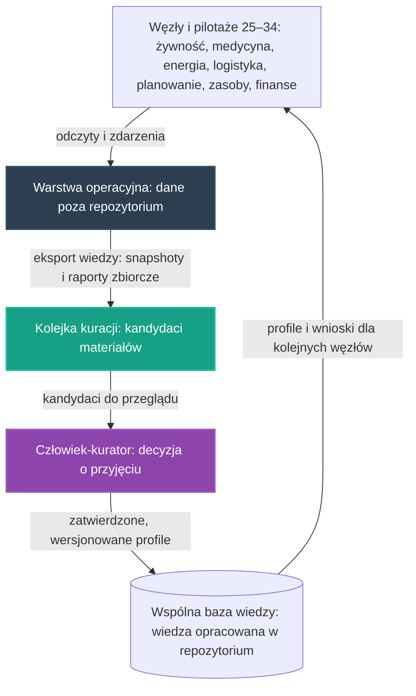

# 35. Koncepcyjny Pilotaż Wspólnej Bazy Wiedzy i Snapshotów

## **Intelekt wyprzedza Kapitał!**

Zanim kolejne węzły zaczną zapisywać do wspólnej bazy wiedzy to, czego się nauczyły, projektujemy intelektem to, co najtrudniejsze: wspólny magazyn dorobku wielu węzłów — przechowywanie wiedzy opracowanej, snapshotów i raportów zbiorczych oraz kurację, która rozstrzyga, co do tego dorobku trafia. Wszystkie potrzebne konwencje już istnieją w repozytorium — zadaniem twórców jest ich twórcze spięcie, nie budowa magazynu od zera.

## Opis Projektu

Ten dokument definiuje koncepcję czwartego pilotażu poprzecznego [głównych osi rozwoju](../README.md) NARODOWYCH SIŁ INTELEKTUALNYCH POLSKI — spięcia projektów **01 + 24 + 13 + 30**, które nie buduje kolejnego węzła, lecz projektuje **warstwę wspólną między węzłami**: wspólny magazyn dorobku wielu węzłów — przechowywanie i kurację wiedzy opracowanej, snapshotów oraz raportów zbiorczych — na wzorcach wypracowanych w [Inteligentnej Akwakulturze](01_inteligentna_akwakultura.md), [Automatyzacji Hodowli Grzybów](24_automatyzacja_hodowli_grzybow.md), [bazie części z recyklingu](13_baza_czesci_recykling/README.md) i [Koncepcyjnym Pilotażu Gospodarki Zasobami Strategicznymi](30_pilot_gospodarki_zasobami.md). Celem pilotażu jest zaprojektowanie wspólnej pamięci inicjatywy: **do bazy trafia wyłącznie wiedza opracowana — snapshoty, raporty zbiorcze i udokumentowane przypadki — po decyzji człowieka-kuratora, a nigdy surowy strumień danych.**

> [!IMPORTANT]
> **Zakres dokumentu:** opisujemy wyłącznie koncepcję organizacji pracy i architekturę narzędzi — bez danych technicznych, parametrów i wyników liczbowych oraz bez wskazywania konkretnych lokalizacji. Zasadę pracy przejmujemy ze wzorca pilotaży, na których się opieramy: **rekomendacja jest zawsze wejściem do decyzji człowieka, nigdy jej zamiennikiem** — a kuracja materiałów zgłaszanych do wspólnej bazy wiedzy pozostaje decyzją człowieka-kuratora, z propozycją przygotowaną przez AI jako wejściem do tej decyzji.

Pilotaż nie zaczyna od zera. W repozytorium istnieją już zalążki tego kierunku:

* **[01. Inteligentna Akwakultura](01_inteligentna_akwakultura.md)** — wzorzec pracy „edge-first", wspólny kontrakt danych oraz jawna ścieżka eksportu wiedzy: z danych wyprowadzany jest snapshot wiedzy lub raport zbiorczy, a dopiero taki opracowany materiał trafia do repozytorium; projekt zapisuje wprost, że obok schematów i modeli w repozytorium powinny być utrzymywane jawne runbooki i narzędzia dla maintainera,
* **[24. Automatyzacja Hodowli Grzybów](24_automatyzacja_hodowli_grzybow.md)** — otwarte receptury klimatyczne w formatach JSON/YAML jako wzorzec wiedzy opracowanej zapisywanej w wersjonowanych, wspólnych profilach,
* **[13. GitHub-first baza części z recyklingu](13_baza_czesci_recykling/README.md)** — katalog z kolejką kuracji i wersjonowaniem: sygnały surowe najpierw trafiają do kolejki kuracji, a dopiero po przeglądzie do kanonicznego katalogu w repo,
* **[30. Koncepcyjny Pilotaż Gospodarki Zasobami Strategicznymi](30_pilot_gospodarki_zasobami.md)** — pętla nauki z telemetrii i decyzja człowieka: pomiar, rekomendacja, decyzja człowieka, a wypracowany wniosek wraca do wspólnej bazy wiedzy,
* **[reports/README.md](../reports/README.md)** i **[`pipelines/export_knowledge_snapshot.py`](../pipelines/export_knowledge_snapshot.py)** — zalążki eksportu wiedzy z bazy operacyjnej: katalog raportów i snapshotów z jawną zasadą, że nie zapisujemy tam pełnych, surowych odczytów providerów, oraz generator minimalnego eksportu,
* **[00_knowledge_base/API_INVENTORY.md](00_knowledge_base/API_INVENTORY.md)** — spis API i narzędzi inicjatywy, w którym eksport paczki wiedzy jest odnotowany jako działający.

Motywacją tego dokumentu jest powtarzalny zapis, który w kolejnych pilotażach zawsze kończy opis pętli nauki: **wniosek zapisywany jest do wspólnej bazy wiedzy** — tak opisują pętlę pilotaże [25](25_pilot_automatyzacji_zywnosci.md), [26](26_pilot_ai_w_medycynie.md), [27](27_pilot_sieci_energetycznej.md), [28](28_pilot_logistyki_sasiadzkiej.md), [29](29_pilot_planowania_przestrzennego.md), [30](30_pilot_gospodarki_zasobami.md), [31](31_pilot_finansowania_inicjatywy.md), [32](32_pilot_wezla_zintegrowanego.md), [33](33_pilot_warsztat_serwisowy.md) i [34](34_pilot_lacznosci_wspolnej_telemetrii.md), a obok tego powraca konwencja z [projektu 01](01_inteligentna_akwakultura.md): do repozytorium wraca wyłącznie wiedza opracowana — snapshoty, raporty zbiorcze i udokumentowane przypadki (tak zapisują pilotaże [25](25_pilot_automatyzacji_zywnosci.md), [26](26_pilot_ai_w_medycynie.md), [27](27_pilot_sieci_energetycznej.md), [28](28_pilot_logistyki_sasiadzkiej.md), [29](29_pilot_planowania_przestrzennego.md), [30](30_pilot_gospodarki_zasobami.md), [32](32_pilot_wezla_zintegrowanego.md), [33](33_pilot_warsztat_serwisowy.md) i [34](34_pilot_lacznosci_wspolnej_telemetrii.md)). [Pilotaż warsztatu serwisowego](33_pilot_warsztat_serwisowy.md) pokazał już tę samą diagnozę po stronie utrzymania w ruchu — podsumował pilotaże budujące węzły zdaniem, że **żaden z pilotaży nie projektuje jeszcze zaplecza, które utrzyma je w ruchu** — ten dokument stawia analogiczną diagnozę po stronie wiedzy: pilotaże 25–34 wielokrotnie przywołują „wspólną bazę wiedzy", „snapshoty" i „raporty zbiorcze", ale żadna koncepcja w repozytorium nie projektuje jeszcze warstwy, która ten dorobek przechowuje i kuruje. Kolejność powstawania koncepcji jest względna: najpierw pilotaże osiowe, następnie pilotaże poprzeczne — [węzła zintegrowanego](32_pilot_wezla_zintegrowanego.md), [warsztatu serwisowego](33_pilot_warsztat_serwisowy.md) i [łączności i wspólnej telemetrii](34_pilot_lacznosci_wspolnej_telemetrii.md) — a ten dokument jest kolejną odpowiedzią na to samo zaproszenie z sekcji **„Synergie osi"** [Mapy drogowej](../ROADMAPA.md), tym razem po stronie wspólnej pamięci inicjatywy. Zgodnie z [Mapą drogową](../ROADMAPA.md) jest to przykład projektu pilotażowego z Fazy 1: niewielka, weryfikowalna realizacja, która dowodzi słuszności koncepcji i staje się wzorcem do powielenia w fazie skalowania.

---

## Proponowane moduły koncepcyjne

Pilotaż projektujemy jako zespół współpracujących warstw. Warstwy te nie są nowe — to zasady, które wypracowały już [projekt 01](01_inteligentna_akwakultura.md), [projekt 24](24_automatyzacja_hodowli_grzybow.md), [projekt 13](13_baza_czesci_recykling/README.md) oraz [pilotaż 30](30_pilot_gospodarki_zasobami.md); nowością jest ich wspólne życie między wieloma węzłami naraz. Każda warstwa powstaje w oparciu o gotowe, otwarte komponenty zebrane w repozytorium — zgodnie z Naszą zasadą, że kod już istnieje, a zadaniem twórców jest jego twórcza adaptacja.

### Moduł 1: Wspólny kontrakt danych i ścieżka eksportu wiedzy — konwencja [projektu 01](01_inteligentna_akwakultura.md)
* Ujednolicony kształt wyniku analitycznego, który definiuje kontrakt danych [projektu 01](01_inteligentna_akwakultura.md): **poziom ryzyka, rekomendacja, poziom pewności i kody przyczyn** — uzupełnione o identyfikację providera i wersję schematu. Wspólna baza wiedzy przechowuje właśnie taki kształt wyników, dzięki czemu przypadki pochodzące z różnych węzłów i różnych osi dają się zestawiać obok siebie.
* Zasada brzegowa z [projektu 01](01_inteligentna_akwakultura.md): repozytorium nie jest miejscem składowania surowych, bieżących odczytów providerów — te trafiają do warstwy operacyjnej poza repozytorium. Do wspólnej bazy wiedzy wraca wynik analizy, a nie surowy strumień danych.
* Jawna ścieżka eksportu wiedzy z [projektu 01](01_inteligentna_akwakultura.md): provider przesyła dane do warstwy operacyjnej, dane pozostają poza repozytorium, z danych wyprowadzany jest snapshot wiedzy lub raport zbiorczy, a dopiero taki opracowany materiał trafia do repozytorium jako wkład społeczności. Ten pilotaż czyni z tej ścieżki wspólną, wielowęzłową warstwę.
* Konwencja `provider_id` z [projektu 01](01_inteligentna_akwakultura.md), która pozwala odróżniać środowiska `local`, `demo`, `preview`, `staging` i `prod` oraz uniknąć chaosu wśród społecznościowych węzłów — w wersji wspólnej bazy wiedzy pozwala wskazać, z jakiego środowiska pochodzi każdy przyjęty do bazy przypadek.
* Zalążki już istnieją w repozytorium: [reports/README.md](../reports/README.md) opisuje katalog raportów i snapshotów wiedzy wyprowadzonych z bazy operacyjnej, generator [`pipelines/export_knowledge_snapshot.py`](../pipelines/export_knowledge_snapshot.py) stanowi punkt startowy eksportu, a [schemat `fish_pond_v1`](../schemas/fish_pond_v1.yaml) i [kontrakt API `fish_pond_api_v1`](../openapi/fish_pond_api_v1.yaml) to pierwsze wzorce kontraktu danych przywoływane wprost przez [pilotaż żywnościowy](25_pilot_automatyzacji_zywnosci.md).

### Moduł 2: Wiedza opracowana jako wersjonowane artefakty — konwencja [projektu 24](24_automatyzacja_hodowli_grzybow.md)
* Wzorzec z [projektu 24](24_automatyzacja_hodowli_grzybow.md): opracowane profile — receptury klimatyczne — udostępniane jako otwarte artefakty w formatach JSON/YAML, opisane tam jako bezcenny wkład intelektualny realizujący misję *Intelekt wyprzedza Kapitał!*.
* Wspólna baza wiedzy rozciąga tę konwencję z klimatu komór hodowlanych na całą wiedzę opracowaną inicjatywy: każdy przyjęty wniosek zapisywany jest jako otwarty, wspólny profil w formatach JSON/YAML — dokładnie tak, jak opisują pętlę wiedzy pilotaże [25](25_pilot_automatyzacji_zywnosci.md) i [32](32_pilot_wezla_zintegrowanego.md) — dzięki czemu każdy kolejny węzeł, niezależnie od osi, rozpoczyna pracę z dorobkiem poprzedników.
* Wersjonowanie artefaktów: profil wiedzy jest dokumentem podlegającym przeglądowi, nie zapiskiem. Zmiany profilu przechodzą tę samą drogę co zmiany kodu — Pull Requesty, dokładnie według instrukcji z [CONTRIBUTING.md](../CONTRIBUTING.md) — co odpowiada konwencji [projektu 13](13_baza_czesci_recykling/README.md), w którym zmiany katalogu można recenzować przez commit albo PR zamiast przepisywać dane w ciszy do prywatnej bazy.

### Moduł 3: Kolejka kuracji i wersjonowanie katalogu — konwencja [projektu 13](13_baza_czesci_recykling/README.md)
* Architektura GitHub-first z [projektu 13](13_baza_czesci_recykling/README.md): GitHub przechowuje kanoniczną, kuratorowaną bazę wiedzy o urządzeniach-dawcach, częściach kanonicznych i relacjach donorowych, a baza operacyjna służy wyłącznie jako indeks do szybkich zapytań; eksporty da się odtworzyć z jednego źródła. Czytamy tam wprost, że katalog jest „publiczny, przegladalny i wersjonowany" — zapis źródła zachowujemy wiernie.
* Kolejka kuracji z [projektu 13](13_baza_czesci_recykling/README.md): sygnały surowe — zdjęcia, OCR, wpisy z komunikatorów — najpierw trafiają do kolejki kuracji, a dopiero po potwierdzeniu są dopisywane do katalogu źródłowego w repo; dopiero po review dane przechodzą do wspólnej bazy wiedzy. Ten sam porządek obowiązuje materiały zgłaszane do wspólnej bazy wiedzy: snapshot i raport zbiorczy to kandydat, a przyjęcie do kanonicznego katalogu poprzedza decyzja człowieka.
* Wzorzec ostrożności wobec materiału generowanego automatycznie z [projektu 13](13_baza_czesci_recykling/README.md): dwuetapowa weryfikacja oraz kolejka społecznościowa, w której niepewne trafienia czekają na ludzką weryfikację, a decyzje o przyjęciu kandydatów do katalogu kanonicznego pozostawiają ślad audytu.
* Sąsiedni [projekt 17](17_autonomiczne_przetwarzanie_elektrosmieci_na_hardware.md) pokazuje — jak podsumowuje [Mapa drogowa](../ROADMAPA.md) — jak z elektrośmieci powstaje zweryfikowana część, z testowaniem, kwalifikacją i statusami: wspólna baza wiedzy przenosi tę samą dyscyplinę kwalifikacji z części fizycznych na wiedzę opracowaną.

### Moduł 4: Pętla nauki i decyzja człowieka nad bazą wiedzy — konwencja [pilotażu 30](30_pilot_gospodarki_zasobami.md)
* Wzorzec nadrzędny przejęty z [pilotażu gospodarki zasobami](30_pilot_gospodarki_zasobami.md) i przywołany w [Mapie drogowej](../ROADMAPA.md): **pomiar, rekomendacja, decyzja człowieka, a wypracowany wniosek wraca do wspólnej bazy wiedzy** — przy zasadzie pracy, że **AI rekomenduje, zamiast decydować za człowieka**.
* W wersji bazy wiedzy: pomiarem jest stan kandydatów w kolejce kuracji, rekomendacją jest propozycja przyjęcia, poprawy albo odrzucenia materiału przygotowana przez AI — kuracja wspierana przez AI — a decyzją jest rozstrzygnięcie człowieka-kuratora. Rekomendacja jest zawsze wejściem do decyzji człowieka, nigdy jej zamiennikiem.
* Zasada „Rekomendacje, nie Nakazy" z [projektu 16](16_geoportal_potencjal_rozwoju.md): system generuje niezobowiązujące sugestie, które stanowią bazę do decyzji podejmowanych przez ludzi — obowiązuje przy każdym etapie kuracji wspólnej bazy wiedzy.
* Pętla domyka się tak samo jak w pilotażach: zapisany wniosek wraca do bazy, a baza poprawia kolejne rekomendacje — dokładnie według opisu pętli nauki w pilotażach [25](25_pilot_automatyzacji_zywnosci.md), [30](30_pilot_gospodarki_zasobami.md) i [32](32_pilot_wezla_zintegrowanego.md).

### Moduł 5: Snapshoty i raporty zbiorcze wielu węzłów — konwencja [pilotażu 34](34_pilot_lacznosci_wspolnej_telemetrii.md)
* Wspólna baza wiedzy w wersji wielowęzłowej opisana w [pilotażu łączności i wspólnej telemetrii](34_pilot_lacznosci_wspolnej_telemetrii.md): do repozytorium wraca wyłącznie wiedza opracowana — snapshoty, raporty zbiorcze i udokumentowane przypadki pracy wielu węzłów; porównywanie przypadków między węzłami różnych osi jest tym, czego nie da osiągnąć żadna pojedyncza telemetria.
* Rodzaje materiałów przyjmowanych do bazy są tymi, które kolejne pilotaże wymieniają przy opisie własnych pętli wiedzy: snapshoty wiedzy, raporty zbiorcze i udokumentowane przypadki — przypadki pracy węzłów żywnościowych [25](25_pilot_automatyzacji_zywnosci.md), organizacyjne przypadki pracy narzędzi medycznych [26](26_pilot_ai_w_medycynie.md), pracy węzłów energetycznych [27](27_pilot_sieci_energetycznej.md), przypadki przewozów [28](28_pilot_logistyki_sasiadzkiej.md), decyzji o lokowaniu [29](29_pilot_planowania_przestrzennego.md), gospodarki zasobami [30](30_pilot_gospodarki_zasobami.md), decyzji o wspieraniu projektów [31](31_pilot_finansowania_inicjatywy.md), pracy węzła zintegrowanego [32](32_pilot_wezla_zintegrowanego.md), napraw serwisowych [33](33_pilot_warsztat_serwisowy.md) oraz pracy wielu węzłów [34](34_pilot_lacznosci_wspolnej_telemetrii.md).
* Anonimizacja przed publikacją: [projekt 01](01_inteligentna_akwakultura.md) zapisuje jako kierunek prac dodanie anonimizacji wybranych pól przed publikacją raportów — wspólna baza wiedzy przyjmuje tę zasadę wobec wszystkich materiałów pochodzących z bazy operacyjnej.
* Suwerenność danych w duchu [pilotażu 30](30_pilot_gospodarki_zasobami.md) i [projektu 19](19_spoleczna_baza_przedmiotow.md): dane o zasobach, potrzebach i zużyciu pozostają własnością społeczności i służą wyłącznie optymalizacji wspólnej gospodarki, a nie monetyzacji przez komercyjne korporacje — do bazy trafiają opracowane, zanonimizowane wnioski, nie surowe dane węzłów.

---

## Zależności od pozostałych osi i pilotaży

Pilotaż nie jest wyspą — sam jest warstwą wspólną, więc jego zależności są podwójne: czerpie konwencje z projektów, które je wypracowały, a zarazem oddaje kolejnym pilotażom miejsce docelowe, do którego wracają ich wnioski, zgodnie z zasadą spójności opisaną w [Mapie drogowej](../ROADMAPA.md).

### Wzorzec „edge-first" i wspólny kontrakt danych (projekt 01)
[Inteligentna Akwakultura](01_inteligentna_akwakultura.md) definiuje obie połówki tej warstwy: kontrakt danych z ujednoliconym kształtem wyniku analitycznego oraz zasadę, że do wspólnej bazy wiedzy trafia wynik analizy, a nie surowy strumień danych. [README](../README.md) dodaje wymiar organizacyjny: inicjatywa rozdziela onboarding Strażnika od onboardingu providera danych — technicznej ścieżki dla węzłów pomiarowych, smartfonów edge, gospodarstw i partnerów, którzy chcą zasilać API. [Projekt 01](01_inteligentna_akwakultura.md) zapisuje wprost, że obok schematów i modeli w repozytorium powinny być utrzymywane jawne runbooki i narzędzia dla maintainera, pozwalające bezpiecznie odzyskać działanie społecznościowego węzła bez publikowania sekretów — ta konwencja obowiązuje również kuratorów wspólnej bazy wiedzy.

### Otwarte profile wiedzy w formatach JSON/YAML (projekt 24)
[Automatyzacja Hodowli Grzybów](24_automatyzacja_hodowli_grzybow.md) wypracowała wzorzec wiedzy opracowanej: precyzyjne profile udostępniane jako otwarte receptury klimatyczne w formatach JSON/YAML. Wspólna baza wiedzy rozciąga tę konwencję na wszystkie dziedziny, dzięki czemu wiedza zapisana przez węzeł jednej osi jest czytelna dla węzłów pozostałych osi — bez tłumaczenia formatów między projektami.

### Kolejka kuracji i GitHub-first wersjonowanie (projekt 13)
[Projekt 13](13_baza_czesci_recykling/README.md) utrzymuje kanoniczną, kuratorowaną bazę wiedzy po stronie GitHub, z kolejką kuracji, do której sygnały surowe trafiają przed dopisaniem do katalogu, oraz z wersjonowaniem opartym na commitach i Pull Requestach. Wspólna baza wiedzy przenosi ten sprawdzony wzorzec z katalogu części z odzysku na całą wiedzę opracowaną inicjatywy — od snapshotów po udokumentowane przypadki.

### Optymalizacja zużycia zasobów strategicznych (oś czwarta)
[Koncepcyjny Pilotaż Gospodarki Zasobami Strategicznymi](30_pilot_gospodarki_zasobami.md) wypracował wzorzec, który ten pilotaż przyjmuje w całości: **pomiar, rekomendacja, decyzja człowieka, a wypracowany wniosek wraca do wspólnej bazy wiedzy**. Oś czwarta jest jednocześnie jednym z klientów bazy: jej wspólne narzędzia analityczne i modele wspierające decyzje o alokacji zasobów między węzłami — kierunki prac zapisane w Fazie 1 [Mapy drogowej](../ROADMAPA.md) — mają w kolejnym etapie pracować na wiedzy zgromadzonej przez wiele węzłów naraz, a nie tylko na danych pojedynczego pilotażu.

### Pilotaże osiowe (25–31)
Każdy z pilotaży osiowych opisuje pętlę nauki kończącą się tym samym: wniosek zapisywany jest do wspólnej bazy wiedzy — żywnościowy [25](25_pilot_automatyzacji_zywnosci.md), medyczny [26](26_pilot_ai_w_medycynie.md), energetyczny [27](27_pilot_sieci_energetycznej.md), logistyczny [28](28_pilot_logistyki_sasiadzkiej.md), planistyczny [29](29_pilot_planowania_przestrzennego.md), zasobowy [30](30_pilot_gospodarki_zasobami.md) i finansowy [31](31_pilot_finansowania_inicjatywy.md). Ten dokument projektuje właśnie to miejsce docelowe, do którego pilotaże odwołują się słowem, ale które nie ma dotąd własnej koncepcji przechowywania i kuracji — a w zamian oddaje im wersjonowane profile i udokumentowane przypadki poprzedników jako punkt startowy kolejnych węzłów.

### Powiązanie z pilotażami poprzecznymi (32–34)
[Węzeł zintegrowany](32_pilot_wezla_zintegrowanego.md) wraca do tej samej konwencji: do repozytorium wraca wyłącznie wiedza opracowana — snapshoty, raporty zbiorcze i udokumentowane przypadki pracy węzła zintegrowanego. [Warsztat serwisowy](33_pilot_warsztat_serwisowy.md) dopisuje do niej udokumentowane przypadki napraw oraz wspólne profile procedur. [Pilotaż łączności i wspólnej telemetrii](34_pilot_lacznosci_wspolnej_telemetrii.md) opisuje „wspólną bazę wiedzy w wersji wielowęzłowej" i dodaje, że porównywanie przypadków między węzłami różnych osi jest tym, czego nie da osiągnąć żadna pojedyncza telemetria. Wartość tego łańcucha rośnie wraz z jego długością: najpierw węzły pracują według wzorców pilotaży i zapisują wnioski, w późniejszym etapie warstwa wspólna nadaje tym wnioskom kształt wersjonowanych, kuratorowanych artefaktów, a przed skalowaniem każdy nowy węzeł rozpoczyna pracę z dorobkiem poprzedników — bo, jak stwierdza podrozdział **„Od projektów do systemu"** [Mapy drogowej](../ROADMAPA.md), **dane i doświadczenia z każdej realizacji poprawiają działanie pozostałych**.

### Suwerenność danych i decyzja człowieka (projekty 16 i 19)
Wspólna baza wiedzy jest materializacją hasła z [README](../README.md): **„Budujemy Polską Bazę Danych"** — suwerenny zasób informacji o zasobach, potrzebach i logistyce, który ma służyć polskiemu społeczeństwu, a nie zagranicznym interesom. W duchu [projektu 19](19_spoleczna_baza_przedmiotow.md), tak jak opisuje go [pilotaż 30](30_pilot_gospodarki_zasobami.md), dane o zasobach i potrzebach pozostają własnością społeczności i służą wyłącznie optymalizacji wspólnej gospodarki, nie monetyzacji przez komercyjne korporacje. Zasada „Rekomendacje, nie Nakazy" z [projektu 16](16_geoportal_potencjal_rozwoju.md) — system generuje niezobowiązujące sugestie, które stanowią bazę do decyzji podejmowanych przez ludzi — obowiązuje przy każdym etapie kuracji: propozycja AI jest zawsze wejściem do decyzji człowieka, nigdy jej zamiennikiem.

---

## Miejsce pilotażu na mapie drogowej

* **Faza 0 (Krystalizacja):** ten dokument jest produktem burzy mózgów, analizy i planowania — precyzyjną koncepcją, która powstaje intelektem, nie budżetem; jest też kolejną odpowiedzią na zaproszenie z sekcji **„Synergie osi"** [Mapy drogowej](../ROADMAPA.md), po pilotażach poprzecznych — [węzła zintegrowanego](32_pilot_wezla_zintegrowanego.md), [warsztatu serwisowego](33_pilot_warsztat_serwisowy.md) i [łączności i wspólnej telemetrii](34_pilot_lacznosci_wspolnej_telemetrii.md).
* **Faza 1 (Pierwsze projekty pilotażowe):** tu jest miejsce tego pilotażu. Kolejność jest względna: najpierw pilotaże osiowe — [25](25_pilot_automatyzacji_zywnosci.md), [26](26_pilot_ai_w_medycynie.md), [27](27_pilot_sieci_energetycznej.md), [28](28_pilot_logistyki_sasiadzkiej.md), [29](29_pilot_planowania_przestrzennego.md), [30](30_pilot_gospodarki_zasobami.md) i [31](31_pilot_finansowania_inicjatywy.md) — oraz poprzeczne — [32](32_pilot_wezla_zintegrowanego.md), [33](33_pilot_warsztat_serwisowy.md) i [34](34_pilot_lacznosci_wspolnej_telemetrii.md) — potwierdzają swoje wzorce i zapisują pierwsze wnioski o wspólną bazę wiedzy, w kolejnym etapie warstwa wspólna nadaje tym wnioskom kształt wersjonowanych, kuratorowanych artefaktów, a przed skalowaniem każdy nowy węzeł rozpoczyna pracę z dorobkiem poprzedników.
* **Faza 2 (Skalowanie i samonapędzająca się gospodarka):** podrozdział **„Od projektów do systemu"** opisuje, że dane i doświadczenia z każdej realizacji poprawiają działanie pozostałych, a każdy zrealizowany projekt obniża koszt następnego, bo wiedza, narzędzia i doświadczenie pozostają wspólne. Wspólna baza wiedzy realizuje to zdanie dosłownie: profil zapisany przez węzeł żywnościowy jest od razu czytelny dla węzła energetycznego i węzła gospodarki zasobami — a kolejny węzeł dołącza do systemu z dorobkiem poprzedników, zamiast uczyć się od zera.
* **Faza 3 (Finansowanie Dochodu Gwarantowanego):** docelowy punkt. [Mapa drogowa](../ROADMAPA.md) stanowi: **„Do tej fazy nie przechodzimy obietnicami, lecz zasobami."** Wspólna baza wiedzy ćwiczy tę dyscyplinę na najtwardszym materiale: o jej wartości rozstrzyga realna, zweryfikowana wiedza opracowana przez społeczność, nie deklaracje — a nadwyżki wypracowane przez system wracają do **WSPÓLNEGO DOBRA NARODOWEGO**, finansując **Dochód Gwarantowany (UBI)**.

Granice między fazami są jakościowe, a nie kalendarzowe: fazę zamyka realne osiągnięcie, a nie data. Kolejność prac wewnątrz Fazy 1 nie jest sztywna — osie wzajemnie się napędzają.

---

## Jak społeczność może rozwinąć ten projekt

Ten projekt jest własnością społeczności i tak ma być rozwijany — w otwartym modelu współtworzenia opisanym w **[CONTRIBUTING.md](../CONTRIBUTING.md)**.

* **Dyskusja i analiza:** pytania, pomysły i zastrzeżenia zgłaszaj w zakładce Issues repozytorium — to serce projektu, w którym ma się roić jak w ulu. Każdy komentarz merytoryczny to cenny wkład w **NARODOWY WYSIŁEK INTELEKTUALNY**.
* **Pull Requesty:** dojrzałe zmiany — rozszerzenia koncepcji, dokumentacja, schematy eksportu wiedzy, narzędzia kuracji — trafiają do plików poprzez Pull Requesty, dokładnie według instrukcji z [CONTRIBUTING.md](../CONTRIBUTING.md).
* **Ścieżki wkładu:**
  * kontrakty danych i schematy eksportu — projektowanie wspólnego kształtu snapshotów i raportów zbiorczych w konwencji [projektu 01](01_inteligentna_akwakultura.md), rozwój generatora eksportu wiedzy,
  * kolejka kuracji — narzędzia kuratora na wzór [projektu 13](13_baza_czesci_recykling/README.md): przegląd kandydatów, ślad audytu decyzji, statusy materiałów oczekujących na rozstrzygnięcie,
  * profile wiedzy — otwarte, wspólne profile w formatach JSON/YAML w konwencji [projektu 24](24_automatyzacja_hodowli_grzybow.md), wzorce opisu przypadku dla poszczególnych osi,
  * jakość i ochrona danych — walidacja materiałów, anonimizacja wybranych pól przed publikacją w duchu [projektu 01](01_inteligentna_akwakultura.md), suwerenność danych społeczności,
  * runbooki i narzędzia maintainera — dokumentacja operacyjna eksportu i odzyskiwania pracy węzłów bez publikowania sekretów, według konwencji [projektu 01](01_inteligentna_akwakultura.md),
  * eksperci dziedzinowi — [Mapa drogowa](../ROADMAPA.md) wymienia agronomię, energetykę, medycynę, logistykę i finanse wśród dziedzin, z których eksperci są potrzebni społeczności od samego początku,
  * dokumentacja i kuracja wiedzy — snapshoty, raporty zbiorcze i udokumentowane przypadki pracy węzłów wracające do wspólnej bazy wiedzy.

Pełnoprawny wkład jest możliwy także bez własnego sprzętu: projektowanie schematów, walidacja danych, analiza przypadków i dokumentacja to praca intelektualna tej samej rangi. Oceniamy pomysły i kod, nie ludzi — a liczy się wyłącznie dokonanie.

---

## Zasoby wewnętrzne w repozytorium
* **[01. Inteligentna Akwakultura](01_inteligentna_akwakultura.md)** — wzorzec edge-first, kontrakt danych, ścieżka eksportu wiedzy oraz runbooki i narzędzia dla maintainera.
* **[24. Automatyzacja Hodowli Grzybów](24_automatyzacja_hodowli_grzybow.md)** — otwarte receptury klimatyczne w formatach JSON/YAML jako wzorzec wersjonowanych profili wiedzy.
* **[13. GitHub-first baza części z recyklingu](13_baza_czesci_recykling/README.md)** — katalog z kolejką kuracji, wersjonowaniem GitHub-first i wzorcem weryfikacji materiałów.
* **[30. Koncepcyjny Pilotaż Gospodarki Zasobami Strategicznymi](30_pilot_gospodarki_zasobami.md)** — wzorzec „pomiar, rekomendacja, decyzja człowieka, wniosek wraca do bazy" oraz suwerenność danych.
* **[25. Zintegrowany Pilotaż Automatyzacji Produkcji Żywności](25_pilot_automatyzacji_zywnosci.md)** — pętla nauki węzła żywnościowego i pierwsze zalążki tej pętli w repo.
* **[26. Koncepcyjny Pilotaż AI w Medycynie](26_pilot_ai_w_medycynie.md)**, **[27. Koncepcyjny Pilotaż Sieci Energetycznej](27_pilot_sieci_energetycznej.md)** i **[28. Koncepcyjny Pilotaż Logistyki Sąsiedzkiej](28_pilot_logistyki_sasiadzkiej.md)** — klienci bazy: przypadki pracy narzędzi, węzłów i przewozów.
* **[29. Koncepcyjny Pilotaż Planowania Przestrzennego](29_pilot_planowania_przestrzennego.md)** — przypadki decyzji o lokowaniu węzłów według zasady „Rekomendacje, nie Nakazy".
* **[31. Koncepcyjny Pilotaż Finansowania Inicjatywy](31_pilot_finansowania_inicjatywy.md)** — udokumentowane decyzje i wnioski trafiające do wspólnej bazy wiedzy.
* **[32. Koncepcyjny Pilotaż Węzła Zintegrowanego](32_pilot_wezla_zintegrowanego.md)**, **[33. Koncepcyjny Pilotaż Warsztatu Serwisowego Węzłów](33_pilot_warsztat_serwisowy.md)** i **[34. Koncepcyjny Pilotaż Łączności i Wspólnej Telemetrii Węzłów](34_pilot_lacznosci_wspolnej_telemetrii.md)** — pilotaże poprzeczne, które tę warstwę przywołują: wiedza opracowana wraca do wspólnej bazy wiedzy.
* **[17. Autonomiczne Przetwarzanie Elektrośmieci na Hardware](17_autonomiczne_przetwarzanie_elektrosmieci_na_hardware.md)** — dyscyplina kwalifikacji: testowanie, statusy odzysku, katalog.
* **[19. Społeczna Baza Przedmiotów „Zero Waste"](19_spoleczna_baza_przedmiotow.md)** — suwerenna infrastruktura danych o zasobach społeczności.
* **[16. Geoportal i Potencjał Rozwoju](16_geoportal_potencjal_rozwoju.md)** — źródło zasady „Rekomendacje, nie Nakazy".
* **[00. Fundamenty Technologiczne NSIP](00_fundamenty_technologiczne.md)** — wspólne narzędzia węzłów, na których pracują pilotaże zasilające bazę wiedzy.
* **[reports/README.md](../reports/README.md)** — zasada katalogu raportów i snapshotów wiedzy wyprowadzonych z bazy operacyjnej.
* **[`pipelines/export_knowledge_snapshot.py`](../pipelines/export_knowledge_snapshot.py)** — generator minimalnego eksportu snapshotu wiedzy.
* **[00_knowledge_base/API_INVENTORY.md](00_knowledge_base/API_INVENTORY.md)** — spis API i narzędzi inicjatywy z odnotowanym działającym eksportem paczki wiedzy.
* **[`schemas/fish_pond_v1.yaml`](../schemas/fish_pond_v1.yaml)** i **[`openapi/fish_pond_api_v1.yaml`](../openapi/fish_pond_api_v1.yaml)** — zalążki wspólnego kontraktu danych przywoływane w pilotażu żywnościowym.
* **[Mapa drogowa (ROADMAPA.md)](../ROADMAPA.md)** — sekcja „Synergie osi", podrozdział „Od projektów do systemu" oraz zasada „Do tej fazy nie przechodzimy obietnicami, lecz zasobami".
* **[README](../README.md)** — hasło „Budujemy Polską Bazę Danych", opisy osi oraz rozdzielenie onboardingu Strażnika i providera danych.
* **[CONTRIBUTING.md](../CONTRIBUTING.md)** — jak zgłaszać pomysły i współtworzyć repozytorium.

---
*Intelekt wyprzedza Kapitał!*

**Nawet tu kod już jest — brakuje tylko Ciebie.**
