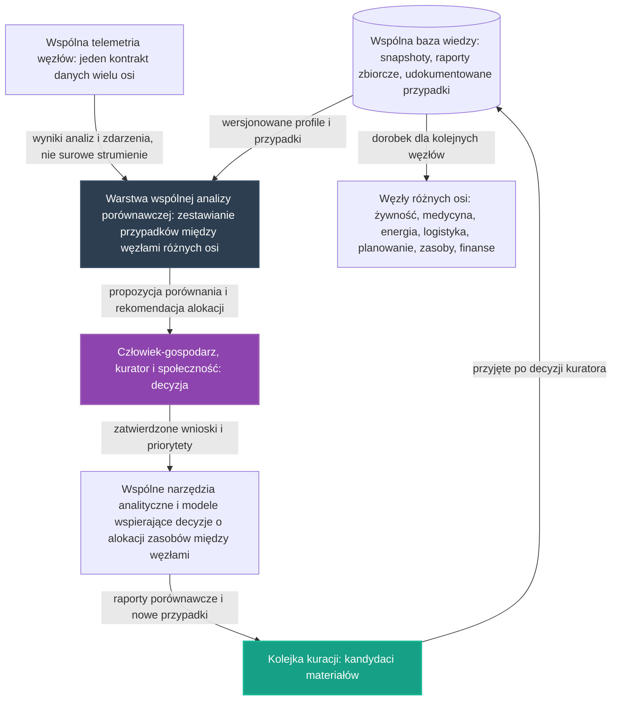

# 36. Koncepcyjny Pilotaż Wspólnej Analizy Porównawczej Węzłów

## **Intelekt wyprzedza Kapitał!**

Zanim sieć węzłów zacznie uczyć się od siebie nawzajem, projektujemy intelektem to, co najtrudniejsze: wspólną warstwę analizy porównawczej — pytania stawiane przypadkom z wielu węzłów naraz oraz rekomendacje, które z tych porównań wypływają. Wszystkie potrzebne konwencje już istnieją w repozytorium — zadaniem twórców jest ich twórcze spięcie, nie budowa kolejnej warstwy od zera.

## Opis Projektu

Ten dokument definiuje koncepcję piątego pilotażu poprzecznego [głównych osi rozwoju](../README.md) NARODOWYCH SIŁ INTELEKTUALNYCH POLSKI — spięcia projektów **01 + 30 + 34 + 35**, które nie buduje kolejnego węzła ani nie powiela już zaprojektowanych warstw wspólnych, lecz projektuje **warstwę wspólnej analizy porównawczej pracującą na tych warstwach**: korzysta ze [wspólnej bazy wiedzy i snapshotów](35_pilot_wspolnej_bazy_wiedzy.md) — snapshotów, raportów zbiorczych i udokumentowanych przypadków wielu węzłów — oraz ze [wspólnej telemetrii](34_pilot_lacznosci_wspolnej_telemetrii.md) z jednym kontraktem danych, żeby porównywać przypadki między węzłami różnych osi — tego, co według pilotażu 34 nie da osiągnąć żadna pojedyncza telemetria — i by zasilać **wspólne narzędzia analityczne oraz modele wspierające decyzje o alokacji zasobów między węzłami**, zapowiedziane w Fazie 1 [Mapy drogowej](../ROADMAPA.md) dla osi czwartej, według wzorca pętli **pomiar, rekomendacja, decyzja człowieka** wypracowanego w [Koncepcyjnym Pilotażu Gospodarki Zasobami Strategicznymi](30_pilot_gospodarki_zasobami.md).

> [!IMPORTANT]
> **Zakres dokumentu:** opisujemy wyłącznie koncepcję organizacji pracy i architekturę narzędzi — bez danych technicznych, parametrów i wyników liczbowych oraz bez wskazywania konkretnych lokalizacji. Zasadę pracy przejmujemy ze wzorca pilotaży, na których się opieramy: **rekomendacja jest zawsze wejściem do decyzji człowieka, nigdy jej zamiennikiem** — a warstwa analizy pracuje wyłącznie na wiedzy opracowanej, zgodnie z konwencją „edge-first" z [Inteligentnej Akwakultury](01_inteligentna_akwakultura.md).

Pilotaż nie zaczyna od zera. W repozytorium istnieją już zalążki tego kierunku:

* **[01. Inteligentna Akwakultura](01_inteligentna_akwakultura.md)** — wzorzec pracy „edge-first" oraz wspólny kontrakt danych z ujednoliconym kształtem wyniku analitycznego; w sekcji o wynikach analizy obrazu projekt zapisuje wprost, że takie wyniki są wystarczające, by zasilać wspólny model wiedzy i porównywać przypadki między stawami, a backlog Issues zawiera zadanie zdefiniowania, jak z obserwacji wielu providerów budować porównywalne przypadki,
* **[30. Koncepcyjny Pilotaż Gospodarki Zasobami Strategicznymi](30_pilot_gospodarki_zasobami.md)** — wzorzec pętli „pomiar, rekomendacja, decyzja człowieka, a wypracowany wniosek wraca do wspólnej bazy wiedzy" oraz kierunek wspólnej analizy zużycia zasobów dla tej osi,
* **[34. Koncepcyjny Pilotaż Łączności i Wspólnej Telemetrii Węzłów](34_pilot_lacznosci_wspolnej_telemetrii.md)** — wspólna warstwa telemetrii wielu węzłów z jednym kontraktem danych oraz diagnoza, że porównywanie przypadków między węzłami różnych osi wymaga więcej niż pojedynczej telemetrii,
* **[35. Koncepcyjny Pilotaż Wspólnej Bazy Wiedzy i Snapshotów](35_pilot_wspolnej_bazy_wiedzy.md)** — wspólny magazyn dorobku wielu węzłów: przechowywanie i kuracja snapshotów, raportów zbiorczych i udokumentowanych przypadków w wersjonowanych profilach, z zapisem, że oś czwarta jest jednym z klientów bazy,
* **[reports/README.md](../reports/README.md)** i **[`pipelines/export_knowledge_snapshot.py`](../pipelines/export_knowledge_snapshot.py)** — zalążki eksportu wiedzy z bazy operacyjnej, czyli materiał wejściowy, na którym warstwa analizy może pracować, oraz punkt startowy eksportu wyników z powrotem do repozytorium.

Motywacją tego dokumentu jest diagnoza postawiona wprost w [pilotażu łączności i wspólnej telemetrii](34_pilot_lacznosci_wspolnej_telemetrii.md): pilotaże 25–35 wielokrotnie przywołują porównywanie przypadków, wspólne narzędzia analityczne i modele wspierające decyzje o alokacji — tak zapisują to [pilotaż żywnościowy](25_pilot_automatyzacji_zywnosci.md) w [Mapie drogowej](../ROADMAPA.md), [pilotaż zasobowy](30_pilot_gospodarki_zasobami.md), [pilotaż energetyczny](27_pilot_sieci_energetycznej.md) oraz [wspólna baza wiedzy](35_pilot_wspolnej_bazy_wiedzy.md) — ale żadna koncepcja w repozytorium nie projektuje jeszcze samodzielnej warstwy, która przypadki między węzłami różnych osi zestawia, porównuje i zamienia w rekomendacje dla ludzi. [Pilotaż wspólnej bazy wiedzy](35_pilot_wspolnej_bazy_wiedzy.md) projektował magazyn dorobku i kurację; ten dokument stawia kolejną diagnozę po stronie analizy: sam magazyn wiedzy nie porównuje jeszcze przypadków za nas — potrzebna jest warstwa, która czyta dorobek wielu węzłów naraz i zadaje pytania między osiami. Kolejność powstawania koncepcji jest względna: najpierw zaproszenie z sekcji **„Synergie osi"** [Mapy drogowej](../ROADMAPA.md) przyjęło pilotaże gospodarki zasobami i finansowania, następnie powstały pilotaże poprzeczne — [węzła zintegrowanego](32_pilot_wezla_zintegrowanego.md), [warsztatu serwisowego](33_pilot_warsztat_serwisowy.md), [łączności i wspólnej telemetrii](34_pilot_lacznosci_wspolnej_telemetrii.md) i [wspólnej bazy wiedzy](35_pilot_wspolnej_bazy_wiedzy.md) — a ten dokument jest kolejną odpowiedzią na to samo zaproszenie, tym razem po stronie wspólnej analizy porównawczej. Zgodnie z [Mapą drogową](../ROADMAPA.md) jest to przykład projektu pilotażowego z Fazy 1: niewielka, weryfikowalna realizacja, która dowodzi słuszności koncepcji i staje się wzorcem do powielenia w fazie skalowania.

---

## Proponowane moduły koncepcyjne

Pilotaż projektujemy jako zespół współpracujących warstw. Warstwy te nie są nowe — to zasady, które wypracowały już [projekt 01](01_inteligentna_akwakultura.md) oraz pilotaże [30](30_pilot_gospodarki_zasobami.md), [34](34_pilot_lacznosci_wspolnej_telemetrii.md) i [35](35_pilot_wspolnej_bazy_wiedzy.md); nowością jest ich wspólne życie w warstwie, która porównuje przypadki wielu węzłów naraz. Każda warstwa powstaje w oparciu o gotowe, otwarte komponenty zebrane w repozytorium — zgodnie z Naszą zasadą, że kod już istnieje, a zadaniem twórców jest jego twórcza adaptacja.

### Moduł 1: Wspólny kontrakt danych i zasilanie wspólnego modelu wiedzy — konwencja [projektu 01](01_inteligentna_akwakultura.md)
* Ujednolicony kształt wyniku analitycznego, który definiuje kontrakt danych [projektu 01](01_inteligentna_akwakultura.md): **poziom ryzyka, rekomendacja, poziom pewności i kody przyczyn** — uzupełnione o identyfikację providera i wersję schematu. To właśnie ten kształt sprawia, że przypadki pochodzące z różnych węzłów i różnych osi dają się zestawiać obok siebie — warstwa analizy porównawczej czyta dorobek wielu węzłów bez tłumaczenia formatów między projektami.
* Zdanie z sekcji o wynikach analizy obrazu [projektu 01](01_inteligentna_akwakultura.md): **„Takie wyniki są wystarczające, by zasilać wspólny model wiedzy i porównywać przypadki między stawami."** — ten pilotaż rozciąga je ze stawów hodowlanych na węzły wszystkich osi: wspólny model wiedzy zasilany jest wynikami analiz z wielu węzłów naraz, a porównania prowadzone są w tym samym kontrakcie danych.
* Zasada brzegowa z [projektu 01](01_inteligentna_akwakultura.md): repozytorium nie jest miejscem składowania surowych, bieżących odczytów providerów — te trafiają do warstwy operacyjnej poza repozytorium, a z danych wyprowadzany jest snapshot wiedzy lub raport zbiorczy. Warstwa analizy porównawczej pracuje na tak przygotowanym materiale, nigdy na surowych strumieniach.
* Wspólna konwencja `provider_id` z [projektu 01](01_inteligentna_akwakultura.md), pozwalająca odróżnić środowiska `local`, `demo`, `preview`, `staging` i `prod`: w warstwie analizy polityka środowisk obowiązuje również przy zestawianiu przypadków — porównania respektują granice środowisk, tak jak robi to publiczne API projektu 01.
* Zadanie z backlogu Issues [projektu 01](01_inteligentna_akwakultura.md) — zdefiniować, jak z obserwacji wielu providerów budować porównywalne przypadki, oraz opracować proces kuracji przypadków do repozytorium — ten pilotaż przyjmuje jako punkt wyjścia i rozszerza je z pojedynczego stawu na całą sieć węzłów.

### Moduł 2: Pętla pomiar–rekomendacja–decyzja człowieka nad porównaniami — konwencja [pilotażu 30](30_pilot_gospodarki_zasobami.md)
* Wzorzec nadrzędny przejęty z [pilotażu gospodarki zasobami](30_pilot_gospodarki_zasobami.md) i przywołany w [Mapie drogowej](../ROADMAPA.md): **pomiar, rekomendacja, decyzja człowieka, a wypracowany wniosek wraca do wspólnej bazy wiedzy** — przy zasadzie pracy, że **AI rekomenduje, zamiast decydować za człowieka**.
* W wersji analizy porównawczej: pomiarem jest zestawienie przypadków z wielu węzłów różnych osi, rekomendacją jest propozycja przygotowana przez AI — na przykład priorytety pracy węzłów albo sugestia alokacji zasobów między węzłami — a decyzją jest rozstrzygnięcie człowieka-gospodarza węzła oraz społeczności. Rekomendacja jest zawsze wejściem do decyzji człowieka, nigdy jej zamiennikiem.
* Zasada „Rekomendacje, nie Nakazy" z [projektu 16](16_geoportal_potencjal_rozwoju.md): system generuje niezobowiązujące sugestie, które stanowią bazę do decyzji podejmowanych przez ludzi — obowiązuje przy każdym zestawieniu i każdej rekomendacji wypływającej z porównania.
* Pętla domyka się tak samo jak w pilotażach: decyzja człowieka i jej skutek tworzą kolejne udokumentowane przypadki, które po kuracji wracają do wspólnej bazy wiedzy i poprawiają jakość kolejnych porównań — dokładnie według opisu pętli nauki w [pilotażu 30](30_pilot_gospodarki_zasobami.md) i [wspólnej bazie wiedzy](35_pilot_wspolnej_bazy_wiedzy.md).

### Moduł 3: Wejście danych ze wspólnej telemetrii i snapshotów — konwencja [pilotażu 34](34_pilot_lacznosci_wspolnej_telemetrii.md)
* Warstwa analizy nie buduje własnego kanału danych: korzysta ze wspólnej telemetrii wielu węzłów zaprojektowanej w [pilotażu łączności i wspólnej telemetrii](34_pilot_lacznosci_wspolnej_telemetrii.md) — jednego kontraktu danych dla telemetrii żywności, energii i zasobów naraz — oraz ze snapshotów i raportów zbiorczych eksportowanych według ścieżki z [projektu 01](01_inteligentna_akwakultura.md).
* Wprost przywołana diagnoza z Modułu 5 [pilotażu 34](34_pilot_lacznosci_wspolnej_telemetrii.md): do repozytorium wraca wyłącznie wiedza opracowana — snapshoty, raporty zbiorcze i udokumentowane przypadki pracy wielu węzłów; **porównywanie przypadków między węzłami różnych osi jest tym, czego nie da osiągnąć żadna pojedyncza telemetria**. Ten pilotaż projektuje dokładnie tę brakującą warstwę, która z takiego porównania czyni narzędzie codziennej pracy.
* Rodzaje materiałów wejściowych są tymi, które [wspólna baza wiedzy](35_pilot_wspolnej_bazy_wiedzy.md) przyjmuje po kuracji: udokumentowane przypadki pracy węzłów żywnościowych [25](25_pilot_automatyzacji_zywnosci.md), organizacyjne przypadki pracy narzędzi medycznych [26](26_pilot_ai_w_medycynie.md), pracy węzłów energetycznych [27](27_pilot_sieci_energetycznej.md), przypadki przewozów [28](28_pilot_logistyki_sasiadzkiej.md), decyzji o lokowaniu [29](29_pilot_planowania_przestrzennego.md), gospodarki zasobami [30](30_pilot_gospodarki_zasobami.md), decyzji o wspieraniu projektów [31](31_pilot_finansowania_inicjatywy.md), pracy węzła zintegrowanego [32](32_pilot_wezla_zintegrowanego.md), napraw serwisowych [33](33_pilot_warsztat_serwisowy.md) oraz pracy wielu węzłów [34](34_pilot_lacznosci_wspolnej_telemetrii.md) — właśnie ta różnorodność osi jest źródłem wartości porównania.
* Zasada „edge-first" obowiązuje także po stronie analizy: porównania prowadzone są na wynikach analiz i wiedzy opracowanej, nie na surowych strumieniach — dokładnie tak, jak opisuje to konwencja wspólnego kształtu danych w [pilotażu 34](34_pilot_lacznosci_wspolnej_telemetrii.md), przy której przesyłanie surowych strumieni nie ma sensu, więc przesyła się wynik analizy.

### Moduł 4: Kolejka kuracji i wersjonowane profile wiedzy jako materiał i cel analizy — konwencja [pilotażu 35](35_pilot_wspolnej_bazy_wiedzy.md)
* Warstwa analizy jest klientem wspólnej bazy wiedzy: czyta wersjonowane, kuratorowane profile wiedzy w formatach JSON/YAML — na wzór otwartych receptur klimatycznych z [projektu 24](24_automatyzacja_hodowli_grzybow.md) — dzięki czemu porównuje tylko materiał, który przeszedł decyzję człowieka-kuratora, i nigdy nie opiera rekomendacji na nieprzeglądanych zapiskach.
* Wyniki porównań wracają tą samą drogą: raport porównawczy albo udokumentowane zestawienie przypadków to kolejny rodzaj wiedzy opracowanej, który najpierw trafia do kolejki kuracji — w duchu konwencji z [projektu 13](13_baza_czesci_recykling/README.md), przejętej przez [wspólną bazę wiedzy](35_pilot_wspolnej_bazy_wiedzy.md) — a dopiero decyzja człowieka-kuratora przyjmuje go do kanonicznego katalogu. Propozycja AI jest wejściem do tej decyzji, nigdy jej zamiennikiem.
* Wersjonowanie artefaktów: profil wiedzy i raport porównawczy są dokumentami podlegającymi przeglądowi, nie zapiskami — zmiany przechodzą tę samą drogę co zmiany kodu, czyli Pull Requesty według instrukcji z [CONTRIBUTING.md](../CONTRIBUTING.md).
* Zalążki ścieżki eksportu już istnieją: [reports/README.md](../reports/README.md) opisuje katalog raportów i snapshotów wiedzy wyprowadzonych z bazy operacyjnej, a generator [`pipelines/export_knowledge_snapshot.py`](../pipelines/export_knowledge_snapshot.py) stanowi punkt startowy eksportu — warstwa analizy czerpie z tej ścieżki i na tej samej ścieżce oddaje wyniki z powrotem do repozytorium, z anonimizacją wybranych pól przed publikacją w duchu [projektu 01](01_inteligentna_akwakultura.md), przyjętą przez [wspólną bazę wiedzy](35_pilot_wspolnej_bazy_wiedzy.md).

### Moduł 5: Suwerenność danych i wspólne dobro — wzorce z [pilotażu 30](30_pilot_gospodarki_zasobami.md) i [pilotażu 34](34_pilot_lacznosci_wspolnej_telemetrii.md)
* Suwerenność danych w duchu [projektu 19](19_spoleczna_baza_przedmiotow.md), tak jak opisuje go [pilotaż 30](30_pilot_gospodarki_zasobami.md) i przywołuje [pilotaż 34](34_pilot_lacznosci_wspolnej_telemetrii.md): dane o zasobach, potrzebach i zużyciu pozostają własnością społeczności i służą wyłącznie optymalizacji wspólnej gospodarki, a nie monetyzacji przez komercyjne korporacje.
* W warstwie analizy ta zasada oznacza, że porównania pracują na wiedzy opracowanej i zanonimizowanej, a ich wyniki służą wspólnym decyzjom społeczności o alokacji zasobów między węzłami — nie profilowaniu pojedynczych providerów.
* Warstwa analizy porównawczej jest materializacją hasła z [README](../README.md): **„Budujemy Polską Bazę Danych"** — suwerennego zasobu informacji o zasobach, potrzebach i logistyce, który ma służyć polskiemu społeczeństwu. Każde porównanie zasilające decyzję o wspólnym zasobie to krok, w którym *Intelekt wyprzedza Kapitał*: najpierw analiza i rekomendacja, decyzja ludzi, a dopiero potem wkład materialny.

---

## Zależności od pozostałych osi i pilotaży

Pilotaż nie jest wyspą — sam jest warstwą analizy, która wyrasta nad warstwami wspólnymi, więc jego zależności są podwójne: czerpie materiał i konwencje z dorobku, który już zaprojektowano, a zarazem oddaje wyniki porównań osiom oraz wspólnym narzędziom analitycznym, zgodnie z zasadą spójności opisaną w [Mapie drogowej](../ROADMAPA.md).

### Wzorzec „edge-first", wspólny kontrakt danych i wspólny model wiedzy (projekt 01)
[Inteligentna Akwakultura](01_inteligentna_akwakultura.md) definiuje obie połówki tej warstwy: kontrakt danych z ujednoliconym kształtem wyniku analitycznego oraz zasadę, że do wspólnej bazy wiedzy trafia wynik analizy, a nie surowy strumień danych. Projekt zapisuje tam wprost, że wynik ma służyć budowie bazy wiedzy i porównywaniu przypadków, a jego sekcja o analizie obrazu kończy się zdaniem o zasilaniu wspólnego modelu wiedzy i porównywaniu przypadków między stawami. [README](../README.md) dodaje wymiar organizacyjny: inicjatywa rozdziela onboarding Strażnika od onboardingu providera danych — technicznej ścieżki dla węzłów pomiarowych, smartfonów edge, gospodarstw i partnerów, którzy chcą zasilać API. Ten pilotaż czyni z porównywania przypadków, o którym pisze projekt 01, wspólne narzędzie całej sieci węzłów.

### Pętla pomiar–rekomendacja–decyzja człowieka (pilotaż 30)
[Koncepcyjny Pilotaż Gospodarki Zasobami Strategicznymi](30_pilot_gospodarki_zasobami.md) wypracował wzorzec, który ten pilotaż przyjmuje w całości: **pomiar, rekomendacja, decyzja człowieka, a wypracowany wniosek wraca do wspólnej bazy wiedzy**. Warstwa analizy porównawczej nie zmienia tej kolejności — jedynie poszerza zakres pomiaru z pojedynczego węzła na zestawienie wielu węzłów różnych osi — a każda rekomendacja alokacji zasobów jest wejściem do decyzji człowieka-gospodarza i społeczności, według zasady „Rekomendacje, nie Nakazy" z [projektu 16](16_geoportal_potencjal_rozwoju.md).

### Wspólna telemetria wielu węzłów (pilotaż 34)
[Pilotaż Łączności i Wspólnej Telemetrii Węzłów](34_pilot_lacznosci_wspolnej_telemetrii.md) jest bezpośrednim dostawcą materiału wejściowego: jeden kontrakt danych dla telemetrii żywności, energii i zasobów sprawia, że węzły różnych osi stają się porównywalne. Ten sam pilotaż stawia diagnozę, że porównywanie przypadków między węzłami różnych osi jest tym, czego nie da osiągnąć żadna pojedyncza telemetria — a ten dokument nadaje tej diagnozie formę samodzielnej koncepcji warstwy analizy.

### Wspólna baza wiedzy i snapshoty (pilotaż 35)
[Koncepcyjny Pilotaż Wspólnej Bazy Wiedzy i Snapshotów](35_pilot_wspolnej_bazy_wiedzy.md) projektuje magazyn dorobku wielu węzłów oraz kurację, która rozstrzyga, co do niego trafia. Jego zapis o kliencie bazy prowadzi wprost do tego dokumentu: wspólne narzędzia analityczne i modele wspierające decyzje o alokacji zasobów między węzłami — kierunki prac zapisane w Fazie 1 [Mapy drogowej](../ROADMAPA.md) — mają pracować na wiedzy zgromadzonej przez wiele węzłów naraz, a nie tylko na danych pojedynczego pilotażu. Warstwa analizy jest materializacją tego zdania: pierwszym zaprojektowanym klientem, który czyta bazę i oddaje jej wyniki swoich porównań.

### Optymalizacja zużycia zasobów strategicznych (oś czwarta)
Opis tej osi w Fazie 1 [Mapy drogowej](../ROADMAPA.md) wymienia wprost kierunki, którym ten pilotaż służy: systemy monitoringu i prognozowania zużycia zasobów, modele wspierające decyzje o ich alokacji oraz narzędzia analityczne pomagające eliminować gospodarkę rabunkową — a synergie osi w [Mapie drogowej](../ROADMAPA.md) doprecyzowują, że pilotaż żywnościowy korzystać będzie z narzędzi analitycznych i modeli wspierających decyzje o alokacji zasobów między węzłami. Warstwa analizy porównawczej zasila te kierunki dorobkiem wielu węzłów naraz, przy zachowaniu wzorca z [pilotażu 30](30_pilot_gospodarki_zasobami.md): **dorobek tej osi bezpośrednio wzmacnia produkcję żywności (woda, ziemia) oraz gospodarkę energetyczną (surowce)**.

### Przypadki do porównania (pilotaże osiowe 25–31)
Każdy z pilotaży osiowych opisuje pętlę nauki kończącą się tym samym: wniosek zapisywany jest do wspólnej bazy wiedzy — żywnościowy [25](25_pilot_automatyzacji_zywnosci.md), medyczny [26](26_pilot_ai_w_medycynie.md), energetyczny [27](27_pilot_sieci_energetycznej.md), logistyczny [28](28_pilot_logistyki_sasiadzkiej.md), planistyczny [29](29_pilot_planowania_przestrzennego.md), zasobowy [30](30_pilot_gospodarki_zasobami.md) i finansowy [31](31_pilot_finansowania_inicjatywy.md). Dla warstwy analizy te udokumentowane przypadki są surowcem pracy: to dzięki nim porównanie może stawiać pytania między osiami — na przykład o zużycie zasobów w węzłach różnych dziedzin — zamiast zamykać się w obrębie jednej.

### Powiązanie z pilotażami poprzecznymi (32 i 33)
[Węzeł zintegrowany](32_pilot_wezla_zintegrowanego.md) pokazuje, jak warstwy żywności, energii i zasobów pracują razem w jednej realizacji, a [warsztat serwisowy](33_pilot_warsztat_serwisowy.md) projektuje zaplecze utrzymaniowe, które domyka cykl życia węzłów po stronie utrzymania w ruchu — oba dokumentują swoją pracę w tym samym porządku: do repozytorium wraca wyłącznie wiedza opracowana. Warstwa analizy porównawczej może zestawiać przypadki węzła zintegrowanego z przypadkami węzłów pojedynczych oraz uwzględniać przypadki napraw serwisowych przy ocenie trwałości rozwiązań. Kolejność jest względna: najpierw pilotaże osiowe i poprzeczne budują telemetrię i zapisują wnioski o wspólną bazę wiedzy, w kolejnym etapie warstwa analizy porównuje dorobek wielu węzłów, a przed skalowaniem powstaje wzorzec wspólnych narzędzi analitycznych i modeli alokacji gotowy do powielenia.

### Suwerenność danych i wspólne dobro (projekty 16 i 19)
Wspólna analiza porównawcza jest materializacją hasła z [README](../README.md): **„Budujemy Polską Bazę Danych"** — suwerenny zasób informacji o zasobach, potrzebach i logistyce, który ma służyć polskiemu społeczeństwu, a nie zagranicznym interesom. W duchu [projektu 19](19_spoleczna_baza_przedmiotow.md), tak jak opisują go [pilotaż 30](30_pilot_gospodarki_zasobami.md) i [pilotaż 34](34_pilot_lacznosci_wspolnej_telemetrii.md), dane o zasobach i potrzebach pozostają własnością społeczności i służą wyłącznie optymalizacji wspólnej gospodarki, nie monetyzacji przez komercyjne korporacje. Zasada „Rekomendacje, nie Nakazy" z [projektu 16](16_geoportal_potencjal_rozwoju.md) obowiązuje przy każdym zestawieniu: propozycja AI jest zawsze wejściem do decyzji człowieka, nigdy jej zamiennikiem.

---

## Miejsce pilotażu na mapie drogowej

* **Faza 0 (Krystalizacja):** ten dokument jest produktem burzy mózgów, analizy i planowania — precyzyjną koncepcją, która powstaje intelektem, nie budżetem; jest też kolejną odpowiedzią na zaproszenie z sekcji **„Synergie osi"** [Mapy drogowej](../ROADMAPA.md), po pilotażach gospodarki zasobami i finansowania oraz po pilotażach poprzecznych — [węzła zintegrowanego](32_pilot_wezla_zintegrowanego.md), [warsztatu serwisowego](33_pilot_warsztat_serwisowy.md), [łączności i wspólnej telemetrii](34_pilot_lacznosci_wspolnej_telemetrii.md) i [wspólnej bazy wiedzy](35_pilot_wspolnej_bazy_wiedzy.md).
* **Faza 1 (Pierwsze projekty pilotażowe):** tu jest miejsce tego pilotażu. Kolejność jest względna: najpierw pilotaże osiowe — [25](25_pilot_automatyzacji_zywnosci.md), [26](26_pilot_ai_w_medycynie.md), [27](27_pilot_sieci_energetycznej.md), [28](28_pilot_logistyki_sasiadzkiej.md), [29](29_pilot_planowania_przestrzennego.md), [30](30_pilot_gospodarki_zasobami.md) i [31](31_pilot_finansowania_inicjatywy.md) — oraz poprzeczne — [32](32_pilot_wezla_zintegrowanego.md), [33](33_pilot_warsztat_serwisowy.md), [34](34_pilot_lacznosci_wspolnej_telemetrii.md) i [35](35_pilot_wspolnej_bazy_wiedzy.md) — budują telemetrię węzłów i zapisują pierwsze przypadki o wspólną bazę wiedzy, w kolejnym etapie warstwa analizy porównuje przypadki między węzłami różnych osi i zasila wspólne narzędzia analityczne, a przed skalowaniem powstaje wzorzec modeli wspierających decyzje o alokacji zasobów między węzłami, gotowy do powielenia.
* **Faza 2 (Skalowanie i samonapędzająca się gospodarka):** podrozdział **„Od projektów do systemu"** opisuje, że dane i doświadczenia z każdej realizacji poprawiają działanie pozostałych, a każdy zrealizowany projekt obniża koszt następnego, bo wiedza, narzędzia i doświadczenie pozostają wspólne. Wspólna analiza porównawcza realizuje to zdanie dosłownie: porównanie przypadków węzła żywnościowego, energetycznego i zasobowego w jednym zestawieniu sprawia, że doświadczenie każdej osi poprawia decyzje pozostałych — a kolejny węzeł dołącza do systemu z dorobkiem poprzedników, zamiast uczyć się od zera.
* **Faza 3 (Finansowanie Dochodu Gwarantowanego):** docelowy punkt. [Mapa drogowa](../ROADMAPA.md) stanowi: **„Do tej fazy nie przechodzimy obietnicami, lecz zasobami."** Wspólna analiza ćwiczy tę dyscyplinę na najtwardszym materiale: o jej wartości rozstrzygają realne, zweryfikowane porównania przypadków z pracy wielu węzłów, nie deklaracje — a nadwyżki wypracowane dzięki lepszym decyzjom o alokacji zasobów wracają do **WSPÓLNEGO DOBRA NARODOWEGO**, finansując **Dochód Gwarantowany (UBI)**.

Granice między fazami są jakościowe, a nie kalendarzowe: fazę zamyka realne osiągnięcie, a nie data. Kolejność prac wewnątrz Fazy 1 nie jest sztywna — osie wzajemnie się napędzają.

---

## Jak społeczność może rozwinąć ten projekt

Ten projekt jest własnością społeczności i tak ma być rozwijany — w otwartym modelu współtworzenia opisanym w **[CONTRIBUTING.md](../CONTRIBUTING.md)**.

* **Dyskusja i analiza:** pytania, pomysły i zastrzeżenia zgłaszaj w zakładce Issues repozytorium — to serce projektu, w którym ma się roić jak w ulu. Każdy komentarz merytoryczny to cenny wkład w **NARODOWY WYSIŁEK INTELEKTUALNY**.
* **Pull Requesty:** dojrzałe zmiany — rozszerzenia koncepcji, dokumentacja, schematy porównań, narzędzia analityczne — trafiają do plików poprzez Pull Requesty, dokładnie według instrukcji z [CONTRIBUTING.md](../CONTRIBUTING.md).
* **Ścieżki wkładu:**
  * analiza porównawcza — projektowanie zestawień przypadków między węzłami różnych osi, definiowanie pytań porównawczych i form raportów porównawczych w konwencji [pilotażu 35](35_pilot_wspolnej_bazy_wiedzy.md),
  * kontrakty danych i schematy — wspólny kształt wyniku porównania w konwencji [projektu 01](01_inteligentna_akwakultura.md), rozwój generatora eksportu wiedzy,
  * modele wspierające alokację — lekkie modele pracujące na wiedzy z wielu węzłów naraz, zgodnie z kierunkami osi czwartej zapisanymi w Fazie 1 [Mapy drogowej](../ROADMAPA.md),
  * kolejka kuracji materiałów porównawczych — narzędzia kuratora na wzór [projektu 13](13_baza_czesci_recykling/README.md): przegląd kandydatów, ślad audytu decyzji, statusy raportów oczekujących na rozstrzygnięcie,
  * jakość i ochrona danych — walidacja materiałów, anonimizacja wybranych pól przed publikacją, suwerenność danych społeczności,
  * eksperci dziedzinowi — [Mapa drogowa](../ROADMAPA.md) wymienia agronomię, energetykę, medycynę, logistykę i finanse wśród dziedzin, z których eksperci są potrzebni od samego początku: bez ich oceny porównanie przypadków między osiami nie stanie się rekomendacją godną decyzji człowieka,
  * dokumentacja i kuracja wiedzy — raporty porównawcze i udokumentowane zestawienia przypadków wracające do wspólnej bazy wiedzy.

Pełnoprawny wkład jest możliwy także bez własnego sprzętu: projektowanie schematów, walidacja danych, analiza przypadków i dokumentacja to praca intelektualna tej samej rangi. Oceniamy pomysły i kod, nie ludzi — a liczy się wyłącznie dokonanie.

---

## Zasoby wewnętrzne w repozytorium
* **[01. Inteligentna Akwakultura](01_inteligentna_akwakultura.md)** — wzorzec edge-first, kontrakt danych, ścieżka eksportu wiedzy oraz zdanie o zasilaniu wspólnego modelu wiedzy i porównywaniu przypadków między stawami.
* **[30. Koncepcyjny Pilotaż Gospodarki Zasobami Strategicznymi](30_pilot_gospodarki_zasobami.md)** — wzorzec „pomiar, rekomendacja, decyzja człowieka, wniosek wraca do bazy" oraz suwerenność danych.
* **[34. Koncepcyjny Pilotaż Łączności i Wspólnej Telemetrii Węzłów](34_pilot_lacznosci_wspolnej_telemetrii.md)** — wspólna telemetria wielu węzłów i diagnoza o porównywaniu przypadków między węzłami różnych osi.
* **[35. Koncepcyjny Pilotaż Wspólnej Bazy Wiedzy i Snapshotów](35_pilot_wspolnej_bazy_wiedzy.md)** — magazyn dorobku wielu węzłów, kolejka kuracji i wersjonowane profile wiedzy; oś czwarta wskazana jako klient bazy.
* **[25. Zintegrowany Pilotaż Automatyzacji Produkcji Żywności](25_pilot_automatyzacji_zywnosci.md)**, **[26. Koncepcyjny Pilotaż AI w Medycynie](26_pilot_ai_w_medycynie.md)**, **[27. Koncepcyjny Pilotaż Sieci Energetycznej](27_pilot_sieci_energetycznej.md)**, **[28. Koncepcyjny Pilotaż Logistyki Sąsiedzkiej](28_pilot_logistyki_sasiadzkiej.md)**, **[29. Koncepcyjny Pilotaż Planowania Przestrzennego](29_pilot_planowania_przestrzennego.md)** i **[31. Koncepcyjny Pilotaż Finansowania Inicjatywy](31_pilot_finansowania_inicjatywy.md)** — pilotaże osiowe, których udokumentowane przypadki są materiałem porównań.
* **[32. Koncepcyjny Pilotaż Węzła Zintegrowanego](32_pilot_wezla_zintegrowanego.md)** i **[33. Koncepcyjny Pilotaż Warsztatu Serwisowego Węzłów](33_pilot_warsztat_serwisowy.md)** — pilotaże poprzeczne, których przypadki pracy i napraw mogą wejść do zestawień między węzłami.
* **[24. Automatyzacja Hodowli Grzybów](24_automatyzacja_hodowli_grzybow.md)** — otwarte receptury klimatyczne w formatach JSON/YAML jako wzorzec wersjonowanych profili wiedzy.
* **[13. GitHub-first baza części z recyklingu](13_baza_czesci_recykling/README.md)** — kolejka kuracji i wersjonowanie GitHub-first jako wzorzec przeglądu materiałów.
* **[16. Geoportal i Potencjał Rozwoju](16_geoportal_potencjal_rozwoju.md)** — źródło zasady „Rekomendacje, nie Nakazy".
* **[19. Społeczna Baza Przedmiotów „Zero Waste"](19_spoleczna_baza_przedmiotow.md)** — suwerenna infrastruktura danych o zasobach społeczności.
* **[17. Autonomiczne Przetwarzanie Elektrośmieci na Hardware](17_autonomiczne_przetwarzanie_elektrosmieci_na_hardware.md)** — dyscyplina kwalifikacji: testowanie, statusy, katalog.
* **[00. Fundamenty Technologiczne NSIP](00_fundamenty_technologiczne.md)** — wspólne narzędzia węzłów, na których pracują pilotaże zasilające bazę wiedzy i warstwę analizy.
* **[reports/README.md](../reports/README.md)** — zasada katalogu raportów i snapshotów wiedzy wyprowadzonych z bazy operacyjnej.
* **[`pipelines/export_knowledge_snapshot.py`](../pipelines/export_knowledge_snapshot.py)** — generator minimalnego eksportu snapshotu wiedzy, punkt startowy ścieżki eksportu wyników porównań.
* **[`schemas/fish_pond_v1.yaml`](../schemas/fish_pond_v1.yaml)** i **[`openapi/fish_pond_api_v1.yaml`](../openapi/fish_pond_api_v1.yaml)** — zalążki wspólnego kontraktu danych przywoływane w pilotażu żywnościowym.
* **[Mapa drogowa (ROADMAPA.md)](../ROADMAPA.md)** — Faza 1 i kierunki osi czwartej, sekcja „Synergie osi" wraz z podsekcją „Kolejne spięcia osi", podrozdział „Od projektów do systemu" oraz zasada „Do tej fazy nie przechodzimy obietnicami, lecz zasobami".
* **[README](../README.md)** — hasło „Budujemy Polską Bazę Danych", główne osie rozwoju oraz rozdzielenie onboardingu Strażnika i providera danych.
* **[CONTRIBUTING.md](../CONTRIBUTING.md)** — jak zgłaszać pomysły i współtworzyć repozytorium.

---
*Intelekt wyprzedza Kapitał!*

**Nawet tu kod już jest — brakuje tylko Ciebie.**
