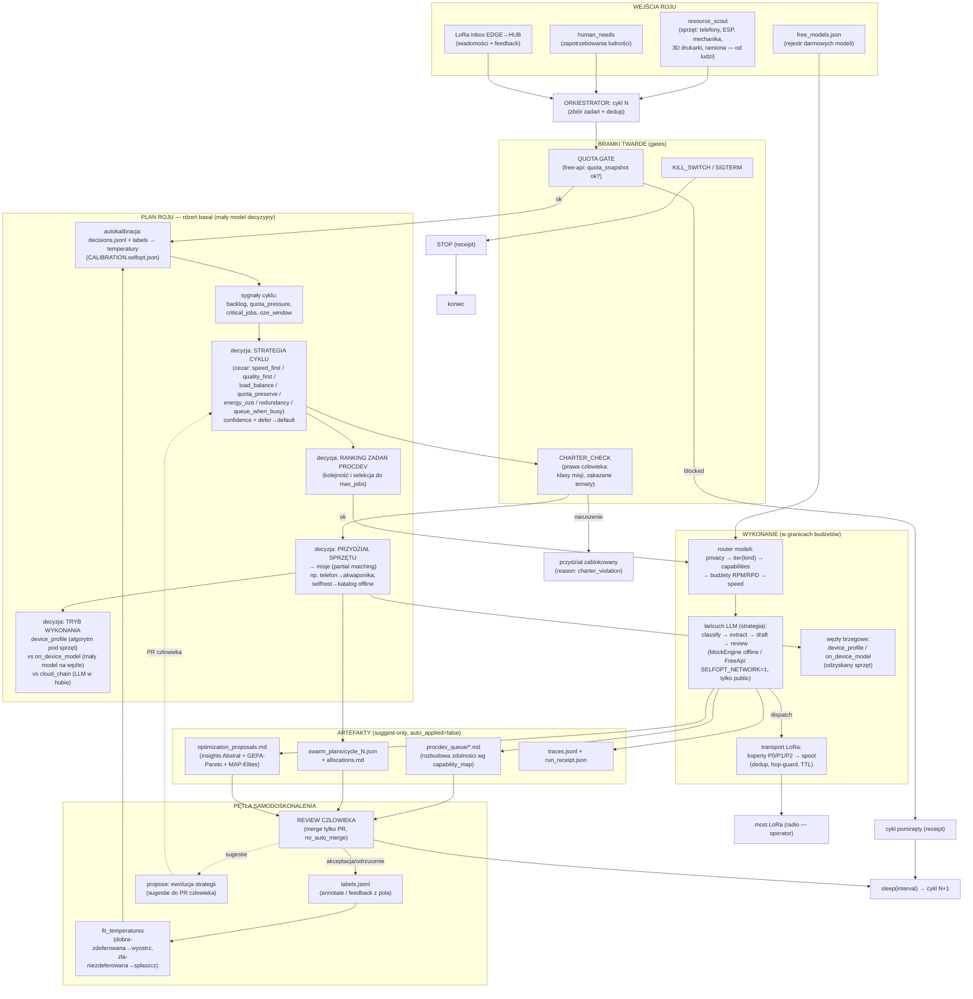

# Schemat algorytmu roju (selfopt_chain)

Aktualny stan implementacji: T48 (łańcuch + router darmowych modeli + transport
LoRa), T49 (rezydentny orkiestrator), T50 (rdzeń decyzyjny basal + strategie
cezar), T51 (samokalibracja + konstytucja + drabina produkcji).

## 1. Diagram przepływu cyklu roju



## 2. Pseudokod cyklu (autoritative: `orchestrator.run`/`run_cycle`)

```
loop:                                          # daemon, co interval sekund
    if KILL_SWITCH exists or SIGTERM:          # twardy stop operatora
        write stopped.json; exit 0

    # === 1. BRAMKI ===
    if engine == "free-api" and quota_snapshot not ok:
        receipt(skip: quota_gate); continue     # operator uzbraja system

    # === 2. ZBIÓR ===
    jobs      = resource_scout_records + lora_inbox_messages   # dedup fingerprint
    feedback  = lora_inbox[{feedback}] → labels.jsonl          # pole etykietuje decyzje
    missions  = human_needs → Demands (reguły capabilities)

    # === 3. SAMOKALIBRACJA (uczenie przed decyzją) ===
    calibration = fit_temperatures(decisions.jsonl, labels.jsonl)   # bounded [0.3, 3.0]
    core = BasalDecisionCore(temperatures=calibration)             # defer poniżej floor

    # === 4. PLAN ROJU (basal; wiele decyzji) ===
    signals = {backlog, mission_backlog, quota_pressure, critical_jobs, oze_window}
    strategy = core.decide(STRATEGIES, score(signals))             # cezar-style, defer→speed_first
    for misja in missions:
        if charter_check(misja) fails: block (charter_violation)    # prawa człowieka
        else:
            zasób   = core.decide(candidates, score(strategy, pokrycie))  # sprzęt/model → misja
            tryb    = core.decide(EXEC_MODES, exec_mode_scores)            # device_profile / on_device_model / cloud_chain
    execution_order = core.ranking(procdev_demands)[:max_jobs]

    # === 5. WYKONANIE (LLM = strategia; basal = decyzje) ===
    registry_view = registry − daily_used                       # wyczerpane modele wypadają
    for job in execution_order:                                 # kolejność wg basala
        chain = classify → extract → draft → review             # łańcuch na darmowych modelach
        model = router(job): privacy→tier→capabilities→quota→speed
        run(chain, engine, registry_view) → traces → insights → proposals
        draft = procdev(job, capability_map[zasób])              # suggest-only
        opcjonalnie: dispatch → koperta LoRa → spool (P0/P1/P2)

    # === 6. ARTEFAKTY I DOMKNIĘCIE PĘTLI ===
    receipt(swarm_plan, calibration, budgets, auto_applied=false)
    człowiek: review → PR (no_auto_merge) → akceptacja/odrzucenie → labels
    goto loop
```

## 3. Niezmienniki systemu (trzeba zachować przy każdej zmianie)

1. **Suggest-only**: rój planuje i proponuje; merge kodu/konstytucji wyłącznie
   człowiek przez PR (`no_auto_merge`); fizyczna aktuation = operator.
2. **Konstytucja przed planem**: `charter_check` jest bramką, nie podpowiedzią;
   naruszenie = brak przydziału (nawet gdy basal byłby confident).
3. **Budżety darmowych tierów**: RPM per cykl, RPD per doba per model;
   wyczerpany zasób znika z widoku rejestru (router wybiera zamiennik).
4. **Prywatność**: `privacy=private` → wyłącznie zasoby `local_private`;
   publiczne dane na darmowe API; sekrety tylko w env.
5. **Zero sieci domyślnie**: realne wywołania API tylko przy
   `SELFOPT_NETWORK=1` + sekrety + bramka quota.
6. **Audyt**: każda decyzja basala (options, scores, confidence, defer,
   ranking, kontekst) w `decisions.jsonl`; każdy run w `traces.jsonl`;
   każdy cykl ma receipt z `auto_applied=false`.
7. **Determinizm rdzenia**: builtin basal offline = brak RNG; tezy
   testowalne (447 testów Python); prawdziwy basal-serve opcjonalny
   (`SELFOPT_BASAL_URL`) — wybór silnika zapisany w logu decyzji.
8. **Uczenie zamiast eskalacji**: problemy jakości rozwiązywane
   kalibracją/etykietami/ewolucją strategii, nie dokupowaniem mocy
   (teza LiteWeed: adaptacja software'u > eskalacja sprzętu).
